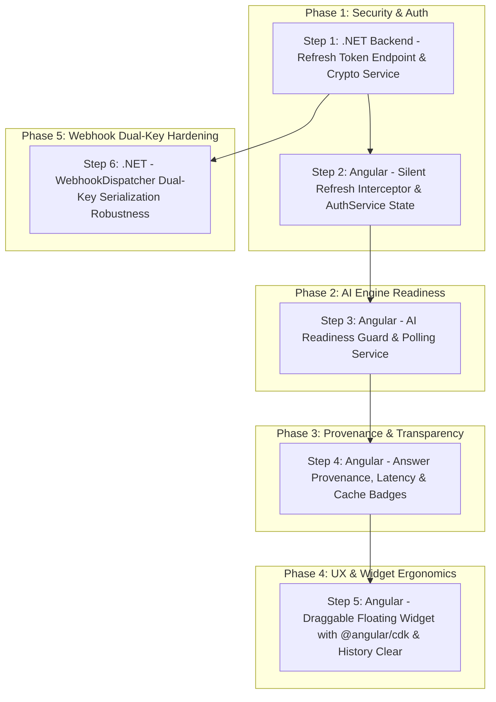

# 🏗️ Blueprint: LMS & AI Co-Pilot Full Integration Construction Plan

> **مشروع العمل:** `LearnDynamicPro` (.NET 10 Web API & Angular 19 UI)  
> **الهدف الفني:** إنجاز كافة المتطلبات المتبقية في [AI_INTEGRATION_TRACKER.md](file:///e:/Mazen/DynamicProLearn/AI_INTEGRATION_TRACKER.md) بدقة معيارية عالية وتأمين تجربة مستخدم سلسة بدون أي انقطاع للجلسات وبأعلى درجات الموثوقية.  
> **مبدأ Blueprint:** كل خطوة مصممة لتكون **مستقلة بذاتها (Cold-Start Executable)** وتحتوي على سياقها الكامل بحيث يمكن لأي مطور أو وكيل ذكاء اصطناعي البدء بها واختبارها فوراً.

---

## 🗺️ خريطة المراحل والاعتماديات (Phase & Dependency Graph)



---

## 📋 تفاصيل خطوات البناء (Step-by-Step Construction Briefs)

---

### 🔹 الخطوة 1: مسار تجديد التوكنات في الباك إند (.NET Silent Refresh Token) - [x] (تم الإنجاز بنجاح ✅)

#### 🎯 الهدف:
إنشاء نقطة نهاية عامة `POST /api/Auth/refresh-token` تصدر زوجاً جديداً من التوكنات (Access Token جديد + Refresh Token جديد) عند تقديم Refresh Token ساري المفعول، دون الحاجة لأي تعديل في جداول قاعدة البيانات (Stateless Cryptographic Token).

#### 📦 الملفات المعنية:
- **[NEW]** `src/LearnDynamicPro.Application/Dtos/Auth/RefreshTokenRequest.cs`
- **[MODIFY]** `src/LearnDynamicPro.Application/Dtos/Auth/LoginResponse.cs`
- **[MODIFY]** `src/LearnDynamicPro.Application/Interfaces/ITokenService.cs`
- **[MODIFY]** `src/LearnDynamicPro.Infrastructure/Identity/TokenService.cs`
- **[MODIFY]** `src/LearnDynamicPro.Application/Interfaces/IAuthService.cs`
- **[MODIFY]** `src/LearnDynamicPro.Application/Features/Auth/AuthService.cs`
- **[MODIFY]** `src/LearnDynamicPro.API/Controllers/AuthController.cs`

#### 📝 تفاصيل التنفيذ الهندسي:
1. **DTOs:**
   - إنشاء `RefreshTokenRequest` بحقلين: `Token` (الـ Access Token المنتهي) و `RefreshToken`.
   - إضافة خاصية `public string RefreshToken { get; set; } = string.Empty;` في `LoginResponse` (والتي يرث منها `ErpLoginResponse`).
2. **TokenService:**
   - إضافة دالة توليد Refresh Token مشفر وموقّع بنفس المفتاح السري وبمدة صلاحية 7 أيام مع إضافة Claim صريح: `Claim("token_type", "refresh")`.
   - إضافة دالة للتحقق من الـ Refresh Token واستخراج الـ `UserId` أو الـ Claims بأمان مع تجاوز التحقق من تاريخ انتهاء الـ Access Token القديم عبر `TokenValidationParameters { ValidateLifetime = false }`.
3. **AuthService:**
   - تحديث `LoginAsync` و `ErpLoginAsync` لتوليد وإرجاع الـ `RefreshToken` جنباً إلى جنب مع الـ Access Token.
   - تطبيق دالة `RefreshTokenAsync(RefreshTokenRequest request)`: التحقق من صحة الـ Refresh Token، التأكد من وجود المستخدم في قاعدة البيانات عبر `_unitOfWork.Repository<User>()`، إصدار Access Token جديد و Refresh Token جديد وإرجاعهما في `LoginResponse`.
4. **AuthController:**
   - إضافة مسار:
     ```csharp
     [HttpPost("refresh-token")]
     public async Task<IActionResult> RefreshToken([FromBody] RefreshTokenRequest request)
     ```
     يعيد `200 OK` مع التوكنات الجديدة، أو `401 Unauthorized` في حال بطلان أو انتهاء الـ Refresh Token.

#### 🧪 معايير القبول والتحقق (Verification):
```bash
dotnet build
```
- يجب أن ينتهي البناء بـ `0 Errors, 0 Warnings`.
- اختبار استدعاء `POST /api/Auth/login` والتأكد من وجود `token` و `refreshToken` في الاستجابة.
- اختبار استدعاء `POST /api/Auth/refresh-token` والتأكد من إرجاع توكنات جديدة بنجاح.

---

### 🔹 الخطوة 2: التجديد التلقائي الصامت في الفرونت إند (Angular Silent Refresh Interceptor) - [x] (تم الإنجاز بنجاح ✅)

#### 🎯 الهدف:
التقاط خطأ `401 Unauthorized` تلقائياً لأي طلب HTTP، وتجديد التوكن في الخلفية صامتاً عبر `POST /api/Auth/refresh-token`، ثم إعادة إرسال الطلب الأصلي بسلاسة دون تسجيل خروج المستخدم أو مقاطعة عمله.

#### 📦 الملفات المعنية:
- **[MODIFY]** `learn-dynamic-pro-ui/src/app/core/services/auth.service.ts`
- **[MODIFY]** `learn-dynamic-pro-ui/src/app/core/interceptors/jwt.interceptor.ts`
- **[MODIFY]** `learn-dynamic-pro-ui/src/app/core/services/copilot.service.ts`

#### 📝 تفاصيل التنفيذ الهندسي:
1. **AuthService:**
   - إضافة Signal لإدارة الـ Refresh Token: `readonly refreshTokenValue = signal<string | null>(localStorage.getItem('refresh_token'));`.
   - تعديل `login(token: string, refreshToken?: string)` لحفظ `refresh_token` في `localStorage` وتحديث الـ Signal.
   - تعديل `logout()` لمسح `jwt_token` و `refresh_token` وتصفير الـ Signals.
   - إضافة دالة `refreshToken(): Observable<any>` ترسل `POST /api/Auth/refresh-token` مع `{ token: this.token(), refreshToken: this.refreshTokenValue() }` وتحدث التوكنات فور نجاحها عبر `tap()`.
2. **jwt.interceptor.ts:**
   - تطبيق نمط إدارة طابور التجديد (Token Refresh Mutex / Queue) باستخدام `isRefreshing` و `BehaviorSubject<string | null>`:
     - إذا كان الطلب الفاشل هو طلب `refresh-token` نفسه: تنفيذ `authService.logout()` فوراً والتحويل لـ `/login`.
     - إذا لم يكن هناك تجديد قيد التنفيذ: بدء التجديد وتمرير التوكن الجديد للطلبات المعلقة.
     - إذا كان هناك تجديد قيد التنفيذ: تعليق الطلبات في الطابور عبر `filter(token => token !== null).pipe(take(1), switchMap(...))` حتى يصدر التوكن الجديد.
3. **copilot.service.ts (حماية البث المباشر SSE):**
   - داخل `streamSearch`: إذا استجاب الـ `fetch` بـ `response.status === 401`:
     - استدعاء `firstValueFrom(this.authService.refreshToken())`.
     - إعادة إرسال طلب الـ `fetch` للـ SSE بالتوكن الجديد فوراً لمرة واحدة دون إيقاف الشات.

#### 🧪 معايير القبول والتحقق (Verification):
```bash
npm run build
```
- اكتمال بناء تطبيق Angular بنجاح بدون أخطاء.
- فتح الصفحة والشات، والتأكد من تجديد التوكن تلقائياً في الخلفية عند انتهاء الـ Access Token دون انقطاع الاتصال.

---

### 🔹 الخطوة 3: حارس جاهزية الذكاء الاصطناعي (AI Readiness Guard) - [x] (تم الإنجاز بنجاح ✅)

#### 🎯 الهدف:
فحص مسار `GET /v1/ready` عند فتح ويدجت الشات، وتعطيل حقل الإدخال وزر الإرسال وإظهار مؤشر تهيئة ناعم ريثما تنتهي خوادم بايثون من تحميل الموديلات والاتصال بـ Qdrant.

#### 📦 الملفات المعنية:
- **[MODIFY]** `learn-dynamic-pro-ui/src/app/core/services/copilot.service.ts`
- **[MODIFY]** `learn-dynamic-pro-ui/src/app/shared/components/copilot-chat/copilot-chat.component.ts`
- **[MODIFY]** `learn-dynamic-pro-ui/src/app/shared/components/copilot-chat/copilot-chat.component.html`
- **[MODIFY]** `learn-dynamic-pro-ui/src/app/shared/components/copilot-chat/copilot-chat.component.css`

#### 📝 تفاصيل التنفيذ الهندسي:
1. **CopilotService:**
   - إضافة دالة `checkReadiness(): Observable<{ ready: boolean; status: string }>` تستدعي `GET ${this.aiBaseUrl}/v1/ready`.
2. **CopilotChatComponent:**
   - تعريف حالة `isAiReady = true;` (افتراضياً) و `isWarmingUp = false;`.
   - عند فتح الشات `toggleChat()`: استدعاء `checkReadiness()`. في حال كانت النتيجة `ready: false` أو رمز `503`:
     - ضبط `isAiReady = false;` و `isWarmingUp = true;`.
     - تشغيل Polling دوري كل ثانيتين عبر `timer(0, 2000)` يتوقف تلقائياً بمجرد استلام `ready: true`.
3. **HTML & CSS:**
   - تعطيل زر الإرسال وحقل الإدخال: `[disabled]="!isAiReady || isStreaming"`.
   - شريط تنبيه لطيف أسفل الهيدر أثناء التهيئة: *"جاري تهيئة محرك الذكاء الاصطناعي... ⏳"*.
   - تحديث مؤشر الاتصال (`.status-dot`) ليعكس اللون الأصفر أثناء التهيئة والأخضر عند الجاهزية.

#### 🧪 معايير القبول والتحقق:
- عند إيقاف أو إعادة إقلاع سيرفر بايثون، يظهر الشات مؤشر التهيئة ويمنع إرسال الرسائل قبل الجاهزية التامة.
- بمجرد اكتمال إقلاع بايثون (`ready: true`)، يتحول المؤشر للأخضر ويصبح الشات جاهزاً فوراً.

---

### 🔹 الخطوة 4: شارات مصدر الإجابة وزمن الاستجابة (Answer Provenance Badges) - [x] (تم الإنجاز بنجاح ✅)

#### 🎯 الهدف:
استخراج حقول `provenance`, `cache_hit`, و `metrics.total_latency_ms` من حدث `done` في البث المباشر، وعرض شارة بصرية واضحة ومميزة بجانب كل رد للمساعد توضح ما إذا كانت الإجابة فورية من الكاش أو تم توليدها حياً عبر Gemini مع توضيح زمن الاستجابة.

#### 📦 الملفات المعنية:
- **[MODIFY]** `learn-dynamic-pro-ui/src/app/shared/components/copilot-chat/copilot-chat.component.ts`
- **[MODIFY]** `learn-dynamic-pro-ui/src/app/shared/components/copilot-chat/copilot-chat.component.html`
- **[MODIFY]** `learn-dynamic-pro-ui/src/app/shared/components/copilot-chat/copilot-chat.component.css`

#### 📝 تفاصيل التنفيذ الهندسي:
1. **ChatMessage Interface:**
   - إضافة الخصائص:
     ```typescript
     cacheHit?: boolean;
     provenance?: string;
     latencyMs?: number;
     ```
2. **Component Logic:**
   - في معالج حدث `onDone: (meta?: any)`:
     ```typescript
     if (meta) {
       msg.cacheHit = meta.cache_hit ?? false;
       msg.provenance = meta.provenance;
       msg.latencyMs = meta.metrics?.total_latency_ms ?? meta.latency_ms;
     }
     ```
3. **HTML Template:**
   - داخل حاوية الرسالة:
     ```html
     <div *ngIf="msg.sender === 'assistant' && !msg.isStreaming && msg.provenance" class="provenance-badge-container">
       <span *ngIf="msg.cacheHit" class="badge badge-cache" [title]="'المصدر: ' + msg.provenance">
         ⚡ استجابة فورية ({{ msg.latencyMs }} ms)
       </span>
       <span *ngIf="!msg.cacheHit" class="badge badge-rag" [title]="'المصدر: ' + msg.provenance">
         🧠 توليد ذكي ({{ ((msg.latencyMs || 0) / 1000).toFixed(1) }} s)
       </span>
     </div>
     ```
4. **CSS Styling:**
   - بادجات بتصميم عصري (Glassmorphism خفيف، خط صغير وواضح، ألوان مميزة: أخضر/بنفسجي للكاش وأزرق هادئ للتوليد الحي).

#### 🧪 معايير القبول والتحقق:
- عند سؤال نفس السؤال للمرة الثانية: تظهر شارة ⚡ فورية مع زمن استجابة سريع جداً (< 50ms).
- عند الضغط على زر 🔄 Retry: تظهر شارة 🧠 توليد ذكي مع وقت التوليد الحي.

---

### 🔹 الخطوة 5: الشات العائم القابل للسحب الحر وزر مسح المحادثة (Draggable Widget & History Clear) - [x] (تم الإنجاز بنجاح ✅)

#### 🎯 الهدف:
تمكين المستخدم من سحب نافذة الشات لأي مكان على الشاشة بحرية تامة دون حجب محتوى الدروس أو الفيديو، مع رفع طبقة العرض (`z-index: 99999`) لضمان عدم اختفائها خلف أي نوافذ منبثقة، وإضافة زر مسح المحادثة 🗑️ في الهيدر.

#### 📦 الملفات المعنية:
- **[MODIFY]** `learn-dynamic-pro-ui/package.json` (إضافة `@angular/cdk`)
- **[MODIFY]** `learn-dynamic-pro-ui/src/app/shared/components/copilot-chat/copilot-chat.component.ts`
- **[MODIFY]** `learn-dynamic-pro-ui/src/app/shared/components/copilot-chat/copilot-chat.component.html`
- **[MODIFY]** `learn-dynamic-pro-ui/src/app/shared/components/copilot-chat/copilot-chat.component.css`

#### 📝 تفاصيل التنفيذ الهندسي:
1. **تثبيت الحزمة:**
   ```bash
   npm install @angular/cdk
   ```
2. **استيراد الـ Directives في الكومبوننت:**
   - إضافة `CdkDrag`, `CdkDragHandle` إلى مصفوفة `imports` في `@Component` (باعتباره Standalone).
3. **HTML Template:**
   - إضافة `cdkDrag` و `cdkDragBoundary="body"` إلى الحاوية الرئيسية `.copilot-window`.
   - إضافة `cdkDragHandle` إلى رأس النافذة `.copilot-header`.
   - إضافة زر تفريغ الشات في `header-controls`:
     ```html
     <button class="header-btn" (click)="clearHistory()" title="مسح المحادثة">🗑️</button>
     ```
4. **Component Logic:**
   - دالة `clearHistory()`: إعادة تعيين مصفوفة `messages` للرسالة الترحيبية الأولى فقط وإعادة تعيين الـ `threadId`.
5. **CSS Styling:**
   - `.copilot-header { cursor: grab; }` و `.copilot-header:active { cursor: grabbing; }`.
   - `.copilot-window { z-index: 99999 !important; }`.

#### 🧪 معايير القبول والتحقق:
- إمكانية سحب نافذة الشات بسلاسة من الهيدر ووضعها في أي مكان داخل حدود الشاشة.
- زر مسح المحادثة 🗑️ يقوم بتفريغ الشات وبدء جلسة جديدة بنجاح.

---

### 🔹 الخطوة 6: تأمين توافق مفاتيح الويب هوك (.NET Webhook Dual-Key Robustness) - [x] (تم الإنجاز بنجاح ✅)

#### 🎯 الهدف:
ضمان توافق بايلود إشعار تحديث وحذف الدروس مع محرك بايثون بنسبة 100% سواء كان السيرفر يتوقع المفتاح بصيغة CamelCase (`lessonId`) أو SnakeCase (`lesson_id`).

#### 📦 الملفات المعنية:
- **[MODIFY]** `src/LearnDynamicPro.Infrastructure/Services/WebhookDispatcher.cs`

#### 📝 تفاصيل التنفيذ الهندسي:
تحديث كائن الـ Payload في دالة `SendWebhookAsync` ليشمل كلا المفتاحين معاً:
```csharp
var payload = new
{
    lesson_id = lessonId.ToString(),
    lessonId  = lessonId.ToString(),
    action    = action
};
```

#### 🧪 معايير القبول والتحقق:
- تشغيل `dotnet build` والتأكد من نجاحه بـ 0 أخطاء.

---

## 🚀 خطة التحقق الشاملة للمنظومة (Full System Smoke Test)

1. **الباك إند (.NET):** `dotnet build`
2. **الفرونت إند (Angular):** `npm run build`
3. **سيناريو المستخدم المتكامل:**
   - تسجيل الدخول ➔ استلام الـ Refresh Token.
   - فتح شات المساعد الذكي ➔ فحص الجاهزية تلقائياً وعرض الشات الأخضر.
   - سحب نافذة الشات بالماوس بحرية على الشاشة.
   - طرح سؤال ➔ استلام المصادر أولاً ثم استلام النص بالدفق الحي.
   - عرض شارة الـ Provenance (كاش أو توليد حي مع المللي ثانية).
   - تجربة انتهاء التوكن (401) ➔ التجديد الصامت التلقائي واستمرار الشات دون أي رسالة خطأ للمستخدم.
