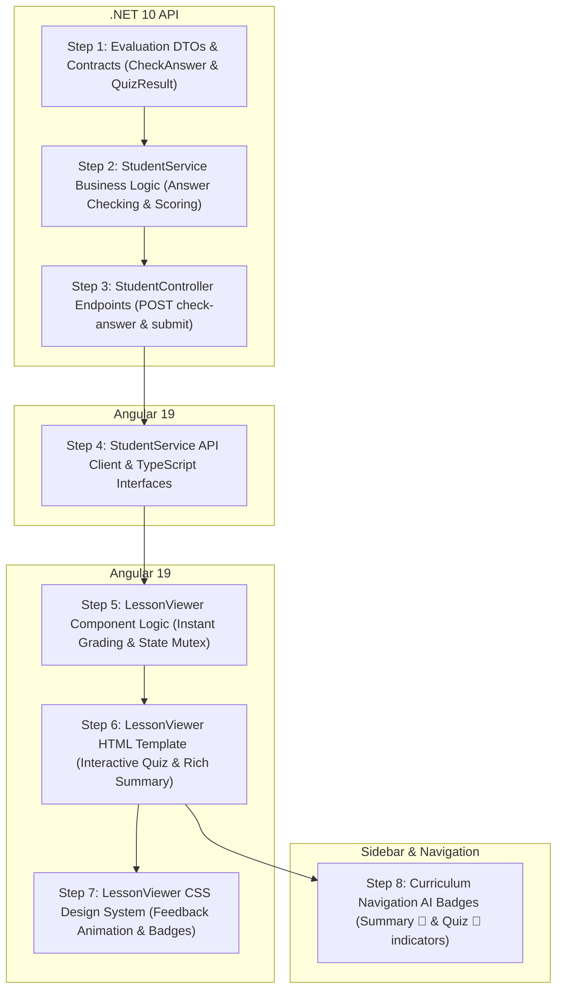

# 🏗️ Blueprint: Student AI Quiz & Summary Interactive Learning Experience

> **مشروع العمل:** `DynamicProLearn` (.NET 10 Web API & Angular 19 UI)  
> **الهدف الفني:** تفعيل وعرض ملخص واختبار الذكاء الاصطناعي في شاشة الطالب (`lesson-viewer`)، مع تطبيق مبدأ **(Zero-Cheat Initial State)** بحيث تظهر الأسئلة والخيارات فقط في البداية، وبمجرد اختيار الطالب للإجابة يتم **التصحيح اللحظي والتفاعلي (Instant Interactive Grading)** بكشف صحة الإجابة (أخضر/أحمر)، وإظهار الشرح والتوضيح (`Explanation`)، وحساب النتيجة الإجمالية وتثبيتها.  
> **مبدأ Blueprint:** كل خطوة مصممة لتكون **مستقلة بذاتها (Cold-Start Executable)** وتحتوي على سياقها الفني الكامل وعقود الـ DTOs وكافة مسارات الملفات بحيث يمكن لأي وكيل برمجي أو مطور البدء بها وتنفيذها واختبارها فوراً.

---

## 🗺️ خريطة المراحل والاعتماديات (Phase & Dependency Graph)



---

## 📋 تفاصيل خطوات البناء (Step-by-Step Construction Briefs)

---

### 🔹 الخطوة 1: عقود الـ DTOs للتقييم والتصحيح في الباك إند (.NET Evaluation DTOs)
- **الحالة:** `[x] مكتملة بنجاح`
- **الملفات المعنية:**
  - **[MODIFY]** `src/LearnDynamicPro.Application/Dtos/Student/StudentAiContentDtos.cs`

#### 🎯 الهدف الفني:
تعريف كائنات نقل البيانات (DTOs) اللازمة لفحص إجابة سؤال فردي لحظياً، ولتأكيد وإنهاء الاختبار بالكامل وحفظ النتيجة في قاعدة البيانات.

#### 📝 تفاصيل التنفيذ الهندسي:
إضافة الكائنات التالية في `StudentAiContentDtos.cs`:
1. `CheckQuizAnswerRequest`:
   - `int QuestionNumber { get; set; }`
   - `string SelectedOptionId { get; set; } = string.Empty;`
2. `QuestionEvaluationResultDto`:
   - `int QuestionNumber { get; set; }`
   - `bool IsCorrect { get; set; }`
   - `string CorrectAnswerId { get; set; } = string.Empty;`
   - `string Explanation { get; set; } = string.Empty;`
3. `SubmitQuizRequest`:
   - `List<CheckQuizAnswerRequest> Answers { get; set; } = new();`
4. `QuizSubmissionResultDto`:
   - `int TotalQuestions { get; set; }`
   - `int CorrectCount { get; set; }`
   - `double ScorePercentage { get; set; }`
   - `bool Passed { get; set; }`
   - `List<QuestionEvaluationResultDto> Results { get; set; } = new();`

#### 🧪 معايير القبول والتحقق:
```bash
dotnet build
```
- ينتهي البناء بـ `0 Errors, 0 Warnings`.

---

### 🔹 الخطوة 2: منطق التصحيح والتقييم في خدمة الطلاب (StudentService Logic)
- **الحالة:** `[x] مكتملة بنجاح`
- **الملفات المعنية:**
  - **[MODIFY]** `src/LearnDynamicPro.Application/Features/Student/IStudentService.cs`
  - **[MODIFY]** `src/LearnDynamicPro.Application/Features/Student/StudentService.cs`

#### 🎯 الهدف الفني:
إضافة دالتين في `StudentService`:
1. دالة لفحص إجابة سؤال محدد لحظياً بالرجوع لسجل `LessonQuiz` المخزن في SQL Server.
2. دالة لتقييم الاختبار كاملاً وتحديث نسبة نجاح الطالب في `LessonProgress`.

#### 📝 تفاصيل التنفيذ الهندسي:
1. في `IStudentService.cs`:
   ```csharp
   Task<Result<QuestionEvaluationResultDto>> CheckQuizAnswerAsync(Guid lessonId, CheckQuizAnswerRequest request, Guid userId);
   Task<Result<QuizSubmissionResultDto>> SubmitQuizAsync(Guid lessonId, SubmitQuizRequest request, Guid userId);
   ```
2. في `StudentService.cs`:
   - التحقق من صلاحية وصول الطالب للدرس عبر `GetLessonDetailAsync(lessonId, userId)`.
   - جلب `LessonQuiz` الخاص بالدرس من `_context.LessonQuizzes`.
   - في `CheckQuizAnswerAsync`:
     - مطابقة `QuestionNumber` والتحقق مما إذا كان `SelectedOptionId == question.CorrectAnswerId`.
     - إرجاع `QuestionEvaluationResultDto` متضمناً `IsCorrect` و `CorrectAnswerId` و `Explanation`.
   - في `SubmitQuizAsync`:
     - تصحيح كافة الأسئلة وحساب `ScorePercentage = (correctCount / total) * 100`.
     - جلب أو إنشاء سجل `LessonProgress` الخاص بالطالب وتحديث `QuizScore`.
     - إرجاع النتيجة الكاملة مع قائمة التصحيح التفصيلية.

#### 🧪 معايير القبول والتحقق:
```bash
dotnet build
```
- نجاح بناء المشروع وخلوه من أي أخطاء.

---

### 🔹 الخطوة 3: نقاط النهاية في StudentController (.NET Web API Endpoints)
- **الحالة:** `[x] مكتملة بنجاح`
- **الملفات المعنية:**
  - **[MODIFY]** `src/LearnDynamicPro.API/Controllers/StudentController.cs`

#### 🎯 الهدف الفني:
تعريض مسارين مؤمنين بصلاحية `StudentOrAbove`:
1. `POST /api/Student/lessons/{lessonId}/quiz/check-answer`
2. `POST /api/Student/lessons/{lessonId}/quiz/submit`

#### 📝 تفاصيل التنفيذ الهندسي:
```csharp
[HttpPost("lessons/{lessonId}/quiz/check-answer")]
public async Task<IActionResult> CheckQuizAnswer(Guid lessonId, [FromBody] CheckQuizAnswerRequest request)
{
    var result = await _studentService.CheckQuizAnswerAsync(lessonId, request, _currentUserService.UserId);
    if (!result.IsSuccess) return BadRequest(result.Error);
    return Ok(result.Value);
}

[HttpPost("lessons/{lessonId}/quiz/submit")]
public async Task<IActionResult> SubmitQuiz(Guid lessonId, [FromBody] SubmitQuizRequest request)
{
    var result = await _studentService.SubmitQuizAsync(lessonId, request, _currentUserService.UserId);
    if (!result.IsSuccess) return BadRequest(result.Error);
    return Ok(result.Value);
}
```

#### 🧪 معايير القبول والتحقق:
- تشغيل `dotnet build` والتأكد من `0 Errors`.
- اختبار المسار عبر Swagger أو Postman والتحقق من إرجاع النتيجة والشرح فور إرسال الإجابة.

---

### 🔹 الخطوة 4: تكامل عميل الواجهة الأمامية (Angular StudentService)
- **الحالة:** `[x] مكتملة بنجاح`
- **الملفات المعنية:**
  - **[MODIFY]** `learn-dynamic-pro-ui/src/app/core/services/student.service.ts`

#### 🎯 الهدف الفني:
توسيع `StudentService` في Angular بإضافة الدوال والـ Interfaces اللازمة لاستدعاء مسارات الفحص والتقييم.

#### 📝 تفاصيل التنفيذ الهندسي:
1. إضافة الواجهات:
   ```typescript
   export interface CheckAnswerRequest {
     questionNumber: number;
     selectedOptionId: string;
   }

   export interface QuestionEvaluationResult {
     questionNumber: number;
     isCorrect: boolean;
     correctAnswerId: string;
     explanation: string;
   }

   export interface QuizSubmissionResult {
     totalQuestions: number;
     correctCount: number;
     scorePercentage: number;
     passed: boolean;
     results: QuestionEvaluationResult[];
   }
   ```
2. إضافة الدوال:
   ```typescript
   checkQuizAnswer(lessonId: string, req: CheckAnswerRequest): Observable<QuestionEvaluationResult> {
     return this.http.post<QuestionEvaluationResult>(`/api/Student/lessons/${lessonId}/quiz/check-answer`, req);
   }

   submitQuiz(lessonId: string, answers: CheckAnswerRequest[]): Observable<QuizSubmissionResult> {
     return this.http.post<QuizSubmissionResult>(`/api/Student/lessons/${lessonId}/quiz/submit`, { answers });
   }
   ```

#### 🧪 معايير القبول والتحقق:
```bash
cd learn-dynamic-pro-ui
npm run build
```
- التأكد من خلو ملفات TypeScript من أي أخطاء بناء.

---

### 🔹 الخطوة 5: منطق التصحيح التفاعلي في مكون المشاهد (LessonViewer Component Logic)
- **الحالة:** `[x] مكتملة بنجاح`
- **الملفات المعنية:**
  - **[MODIFY]** `learn-dynamic-pro-ui/src/app/features/student/lesson-viewer/lesson-viewer.ts`

#### 🎯 الهدف الفني:
تحديث حالة الكويز في `LessonViewer` لتدعم:
1. تتبع فحص كل سؤال على حدة بمجرد اختيار الخيار (`selectOptionAndCheck`).
2. قفل خيارات السؤال المجاب عنه لمنع التلاعب بعد ظهور التصحيح.
3. حفظ وتخزين التقييم (`isCorrect`, `correctAnswerId`, `explanation`) لكل سؤال.
4. حساب الإحصائيات اللحظية (عدد الإجابات الصحيحة، النسبة المئوية).
5. زر إعادة المحاولة (`resetQuiz`) لتصفير الحالة وبدء الاختبار من جديد.

#### 📝 تفاصيل التنفيذ الهندسي:
- إضافة متغيرات الحالة:
  ```typescript
  evaluations: { [questionNumber: number]: QuestionEvaluationResult } = {};
  checkingQuestions: { [questionNumber: number]: boolean } = {};
  correctCount = 0;
  totalAnswered = 0;
  quizCompleted = false;
  ```
- تطبيق دالة `selectOptionAndCheck(qNumber: number, optionId: string)`:
  - إذا كان السؤال تم تقييمه مسبقاً، تجاهل الضغط (Locking).
  - تعيين حالة التحميل للسؤال `checkingQuestions[qNumber] = true`.
  - استدعاء `studentService.checkQuizAnswer(this.activeLesson.id, { questionNumber: qNumber, selectedOptionId: optionId })`.
  - عند النجاح: تخزين النتيجة في `evaluations[qNumber]`، وتحديث `correctCount` إذا كانت الإجابة صحيحة، وزيادة `totalAnswered`.
  - إذا اكتملت جميع الأسئلة: تعيين `quizCompleted = true` واستدعاء `submitQuiz` صامتاً لحفظ النتيجة في قاعدة البيانات.

#### 🧪 معايير القبول والتحقق:
- تجربة اختبار أسئلة الدرس في الواجهة والتأكد من عدم حدوث أخطاء runtime في الكونسول.

---

### 🔹 الخطوة 6: القالب التفاعلي للاختبار والملخص (LessonViewer HTML Overhaul)
- **الحالة:** `[x] مكتملة بنجاح`
- **الملفات المعنية:**
  - **[MODIFY]** `learn-dynamic-pro-ui/src/app/features/student/lesson-viewer/lesson-viewer.html`

#### 🎯 الهدف الفني:
إعادة هيكلة تبويبي ملخص واختبار الذكاء الاصطناعي:
1. **تبويب الكويز (Interactive Quiz):**
   - في البداية: عرض نص السؤال والخيارات فقط دون أي تلميحات أو حلول.
   - عند الاختيار:
     - الخيار الصحيح يضيء بالأخضر ✅.
     - الخيار الخاطئ (إذا اختاره الطالب) يضيء بالأحمر ❌ ويتم تظليل الخيار الصحيح تلقائياً بالأخضر.
     - ظهور كارت الشرح الأنيق أسفل السؤال:
       `💡 الشرح والتوضيح: [نص الشرح القادم من الذكاء الاصطناعي]`.
   - شريط النتيجة العلوي: يوضح نسبة الإنجاز والدرجة الحالية.
   - كارت التهنئة النهائي عند إنهاء جميع الأسئلة مع زر `إعادة الاختبار 🔄`.
2. **تبويب الملخص (AI Summary):**
   - كارت النظرة العامة (Overview).
   - كروت المحاور الأساسية (Topics) مع نقاط الاستيعاب وقائمة الـ Key Points مع زر نسخ الملخص.

#### 🧪 معايير القبول والتحقق:
- فتح صفحة الدرس والتأكد من أن الكويز لا يسرب أي إجابات أو شروحات قبل النقر.
- التأكد من تجربة التصحيح السلسة وظهور الشرح فور النقر.

---

### 🔹 الخطوة 7: التصميم والألوان الحركية التفاعلية (LessonViewer CSS Enhancement)
- **الحالة:** `[x] مكتملة بنجاح`
- **الملفات المعنية:**
  - **[MODIFY]** `learn-dynamic-pro-ui/src/app/features/student/lesson-viewer/lesson-viewer.css`

#### 🎯 الهدف الفني:
إضافة مؤثرات بصرية مريحة للعين وفخمة:
- `.student-opt-row.correct`: خلفية خضراء هادئة `#ecfdf5`، إطار زمردي `#10b981`، أيقونة صح خضراء.
- `.student-opt-row.incorrect`: خلفية حمراء هادئة `#fef2f2`، إطار أحمر `#ef4444`، أيقونة خطأ حمراء.
- `.explanation-box`: حركة انزلاق وانسياب ناعمة `slideDown` مع خلفية زرقاء فاتحة `#eff6ff` وإطار أزرق `#bfdbfe`.
- `.score-summary-bar`: شريط تقدم تفاعلي أنيق يوضح النتيجة الحالية بلون مميز.

#### 🧪 معايير القبول والتحقق:
- فحص التجاوبية (Responsive Design) والتأكد من عدم وجود أخطاء في الـ CSS Budgets.

---

### 🔹 الخطوة 8: إشارات الدروس الذكية في القائمة الجانبية (Sidebar Curriculum Badges)
- **الحالة:** `[x] مكتملة بنجاح`
- **الملفات المعنية:**
  - **[MODIFY]** `src/LearnDynamicPro.Application/Dtos/Modules/LessonDto.cs`
  - **[MODIFY]** `src/LearnDynamicPro.Application/Features/Student/StudentService.cs`
  - **[MODIFY]** `learn-dynamic-pro-ui/src/app/shared/components/lesson-sidebar/lesson-sidebar.component.html`
  - **[MODIFY]** `learn-dynamic-pro-ui/src/app/shared/components/lesson-sidebar/lesson-sidebar.component.css`

#### 🎯 الهدف الفني:
إظهار شارات صغيرة لطيفة بجانب عنوان الدرس في القائمة الجانبية:
- علامة 📝 إذا كان الدرس يملك ملخصاً ذكياً.
- علامة 🧠 إذا كان الدرس يملك اختباراً تفاعلياً.
ليعرف الطالب مسبقاً أي الدروس تحتوي على محتوى ذكي جاهز للاستفادة منه فوراً.

#### 🧪 معايير القبول والتحقق:
- مراجعة القائمة الجانبية والتأكد من ظهور الشارات للدروس المولدة فقط.

---

## 🛡️ استراتيجية التراجع والأمان (Rollback & Safety Guidelines)

1. **سلامة قاعدة البيانات:** التعديل لا يتطلب أي Migrations جديدة، فالبيانات مخزنة بالفعل في جدولي `LessonQuizzes` و `LessonSummaries`.
2. **منع الغش في الاختبار:** لن يتم إرسال `CorrectAnswerId` أو `Explanation` في طلب جلب الكويز الأولي `GET /quiz`؛ ويتم إرجاعها فقط للسؤال المحدد بعد إرسال الطالب لإجابته عبر `POST /check-answer`.
3. **التوافق التام:** الدروس التي لم يُولّد لها كويز أو ملخص ستستمر في عرض الصندوق التوضيحي الهادئ: *"لم يتم نشر ملخص/اختبار لهذا الدرس بعد"*.

---

## 🏁 أمر البدء بالتنفيذ (Execution Command)

بمجرد مراجعة واعتماد هذه الخطة من قِبل المستخدم، يمكن البدء في تنفيذ الخطوات فوراً عبر الأمر:
```bash
/executing-plans
```
