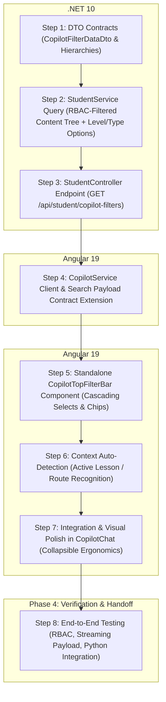

# 🏗️ Blueprint: LMS AI Co-Pilot Smart Top Filter Bar Integration

> **المشروع المستهدف:** `DynamicProLearn` (.NET 10 Web API & Angular 19 UI)  
> **المحرك المرتبط:** `LMS_CO_Pilot` (Python / FastAPI / Qdrant)  
> **الهدف:** تمكين الطالب من توجيه وتخصيص نطاق أسئلته في شاشة محادثة الذكاء الاصطناعي (LMS AI Co-Pilot) عبر شريط فلاتر علوي ذكي (Top Filter Bar) يدعم تحديد النطاق (الكل / موديول / وحدة / درس محدد) وفلاتر المستوى والنوع، مع الالتزام الصارم بصلاحيات الطالب (RBAC)، والالتقاط التلقائي لسياق الدرس الحالي، والتكامل المتناسق مع محرك البحث المباشر.

---

## 🗺️ خريطة المراحل والاعتماديات (Phase & Dependency Graph)



---

## 📋 تفاصيل خطوات التنفيذ (Step-by-Step Construction Briefs)

---

### 🔹 الخطوة 1: عقود الـ DTOs لشجرة فلاتر المحتوى (.NET Filter DTOs)
- **الحالة:** `[x] تم الإنجاز بنجاح`
- **الملفات المعنية:**
  - **[MODIFY]** `src/LearnDynamicPro.Application/Dtos/Student/StudentAiContentDtos.cs`

#### 🎯 الهدف الفني:
تعريف كائنات نقل البيانات (DTOs) اللازمة لتسليم شجرة المحتوى الكاملة المصرح بها فقط للطالب متضمنة الموديولات والوحدات والدروس والمستويات والأنواع في طلب واحد خفيف وسريع.

#### 📝 تفاصيل التنفيذ:
إضافة الكائنات التالية في `StudentAiContentDtos.cs`:
1. `CopilotFilterOptionDto`:
   - `Guid Id { get; set; }`
   - `string Name { get; set; } = string.Empty;`
   - `int SortOrder { get; set; }`
2. `CopilotFilterLessonDto`:
   - `Guid Id { get; set; }`
   - `string Title { get; set; } = string.Empty;`
   - `Guid LevelId { get; set; }`
   - `Guid TypeId { get; set; }`
3. `CopilotFilterUnitDto`:
   - `Guid Id { get; set; }`
   - `string Title { get; set; } = string.Empty;`
   - `List<CopilotFilterLessonDto> Lessons { get; set; } = new();`
4. `CopilotFilterModuleDto`:
   - `Guid Id { get; set; }`
   - `string Title { get; set; } = string.Empty;`
   - `string Code { get; set; } = string.Empty;`
   - `List<CopilotFilterUnitDto> Units { get; set; } = new();`
5. `StudentCopilotFilterDataDto`:
   - `List<CopilotFilterModuleDto> Modules { get; set; } = new();`
   - `List<CopilotFilterOptionDto> Levels { get; set; } = new();`
   - `List<CopilotFilterOptionDto> Types { get; set; } = new();`

#### 🧪 معايير القبول والتحقق:
```bash
dotnet build src/LearnDynamicPro.Application
```
- نجاح البناء بـ 0 أخطاء و 0 تحذيرات.

---

### 🔹 الخطوة 2: استعلام شجرة المحتوى المقيدة بالصلاحيات (StudentService Logic)
- **الحالة:** `[x] تم الإنجاز بنجاح`
- **الملفات المعنية:**
  - **[MODIFY]** `src/LearnDynamicPro.Application/Features/Student/IStudentService.cs`
  - **[MODIFY]** `src/LearnDynamicPro.Application/Features/Student/StudentService.cs`

#### 🎯 الهدف الفني:
إضافة دالة `GetCopilotFiltersAsync(Guid userId)` في `StudentService` لتوليد الشجرة بدقة وكفاءة:
1. التحقق من قسم ودور الطالب (`userInfo.DepartmentId`, `userInfo.Role`).
2. إسقاط الدروس المصرح بها فقط عبر استعلام `accessibleLessonsQuery` المعتمد في المنصة مع الالتزام بقيود `AssignmentLevelFilters` و `AssignmentTypeFilters`.
3. تجميع الدروس في الذاكرة تحت وحداتها وموديولاتها بدون أي استعلامات متكررة (Zero N+1 Queries).
4. جلب خيارات `LevelOptions` مرتبة بـ `SortOrder` وخيارات `TypeOptions`.

#### 🧪 معايير القبول والتحقق:
- التأكد من أن الطالب لا يستلم في القائمة أي درس أو موديول غير مسجل في قسمه.

---

### 🔹 الخطوة 3: نقطة النهاية في الباك إند (StudentController Endpoint)
- **الحالة:** `[x] تم الإنجاز بنجاح`
- **الملفات المعنية:**
  - **[MODIFY]** `src/LearnDynamicPro.API/Controllers/StudentController.cs`

#### 🎯 الهدف الفني:
توفير نقطة النهاية:
`GET /api/student/copilot-filters`
- محمية بـ `[Authorize(Policy = "StudentOrAbove")]`.
- تسجل لوج خفيف وتستدعي `_studentService.GetCopilotFiltersAsync(_currentUserService.UserId)`.

#### 🧪 معايير القبول والتحقق:
```bash
dotnet build src/LearnDynamicPro.API
```
- طلب `GET http://localhost:5115/api/student/copilot-filters` بـ Bearer Token يرجع كود `200 OK` مع بنية JSON مطابقة للعقد.

---

### 🔹 الخطوة 4: تحديث عميل الـ API وعقد محرك البحث في الفرونت إند (CopilotService Extension)
- **الحالة:** `[x] تم الإنجاز بنجاح`
- **الملفات المعنية:**
  - **[MODIFY]** `learn-dynamic-pro-ui/src/app/core/services/copilot.service.ts`

#### 🎯 الهدف الفني:
1. إضافة استدعاء `getCopilotFilters()` مع تخزين مؤقت `shareReplay(1)` لمنع تكرار جلب الفلاتر مع كل فتح وإغلاق للشات.
2. تعريف واجهة `CopilotFilterState`:
   ```typescript
   export interface CopilotFilterState {
     scope: 'all' | 'module' | 'unit' | 'lesson';
     moduleId?: string;
     unitId?: string;
     lessonId?: string;
     levelId?: string;
     typeId?: string;
   }
   ```
3. تحديث دالة `streamSearch` لتستقبل كائن `filters?: CopilotFilterState` وتضمينه في جسم طلب الـ JSON لـ `POST /v1/search/stream`:
   ```json
   {
     "query": "...",
     "scope": "lesson",
     "moduleId": "...",
     "unitId": "...",
     "lessonId": "...",
     "levelId": "...",
     "typeId": "...",
     "threadId": "...",
     "skipCache": false
   }
   ```

#### 🧪 معايير القبول والتحقق:
- مطابقة حمولة الطلب المرسلة مع مواصفات وثيقة `LMS_CO_Pilot`.

---

### 🔹 الخطوة 5: بناء مكوّن شريط الفلاتر المستقل (Standalone CopilotTopFilterBar Component)
- **الحالة:** `[x] تم الإنجاز بنجاح`
- **الملفات المعنية:**
  - **[NEW]** `learn-dynamic-pro-ui/src/app/shared/components/copilot-top-filter-bar/copilot-top-filter-bar.component.ts`
  - **[NEW]** `learn-dynamic-pro-ui/src/app/shared/components/copilot-top-filter-bar/copilot-top-filter-bar.component.html`
  - **[NEW]** `learn-dynamic-pro-ui/src/app/shared/components/copilot-top-filter-bar/copilot-top-filter-bar.component.css`

#### 🎯 الهدف الفني:
1. **محدد النطاق الرئيسي (Segmented Scope Tabs):**
   `[ 🌐 الكل | 📚 موديول | 📑 وحدة | 🎯 درس محدد ]`
2. **القوائم المتتالية المعتمدة على النطاق (Cascading Selects):**
   - اختيار موديول يقوم بتصفية قائمة الوحدات.
   - اختيار وحدة يقوم بتصفية قائمة الدروس.
3. **فلاتر الشرائح السريعة (Chips):**
   - أزرار شرائح سريعة للمستوى (`الكل`, `مبتدئ`, `متوسط`, `متقدم`).
   - أزرار شرائح للنوع (`الكل`, `فيديو 🎬`, `مستند PDF 📄`, `عملي ⚙️`).
4. **زر تصفير الفلاتر (Reset All):**
   - زر سريع يعيد النطاق فوراً إلى `الكل (all)` ويمسح التحديدات الفرعية.
5. **شارة النطاق النشط (Active Scope Badge):**
   - شريط ملخص سياقي مدمج ومريح للعين يوضح المسار المختار (مثال: `🔍 موديول التصنيع > دورة الإنتاج [مبتدئ]`).

---

### 🔹 الخطوة 6: الالتقاط السياقي التلقائي للدرس الحالي (Context Auto-Detection)
- **الحالة:** `[x] تم الإنجاز بنجاح`
- **الملفات المعنية:**
  - **[MODIFY]** `learn-dynamic-pro-ui/src/app/shared/components/copilot-chat/copilot-chat.component.ts`

#### 🎯 الهدف الفني:
عند فتح الطالب للمساعد الذكي أثناء تصفحه لدرس معين (سواء في شاشة `continue-learning` أو `lesson-viewer` عبر الـ URL Query Params أو مسار الصفحة):
1. التقاط معرّف الدرس النشط تلقائياً (`lessonId`).
2. البحث عنه في شجرة الفلاتر لتحديد الموديول والوحدة التابع لهما.
3. ضبط النطاق تلقائياً على `🎯 درس محدد` واختيار الدرس تلقائياً مع إظهار شارة: `🎯 تم تحديد نطاق الدرس الحالي تلقائياً [توسيع للكل]`.

---

### 🔹 الخطوة 7: دمج شريط الفلاتر وضبط الأبعاد وقابلية الطي (Ergonomics & Polish)
- **الحالة:** `[x] تم الإنجاز بنجاح`
- **الملفات المعنية:**
  - **[MODIFY]** `learn-dynamic-pro-ui/src/app/shared/components/copilot-chat/copilot-chat.component.html`
  - **[MODIFY]** `learn-dynamic-pro-ui/src/app/shared/components/copilot-chat/copilot-chat.component.css`

#### 🎯 الهدف الفني:
1. وضع شريط الفلاتر أعلى منطقة الرسائل مباشرة.
2. إضافة زر طي/توسيع (`Toggle Collapse`) بحيث يستطيع الطالب إخفاء خيارات الفلاتر مع بقاء شريط الملخص الصغير، للحفاظ على أقصى مساحة ممكنة لمشاهدة رسائل المحادثة.
3. تجاوب كامل مع وضع التكبير والتصغير وتصميم الزجاج المصنفر (Glassmorphic Dark/Navy Design).

---

### 🔹 الخطوة 8: التحقق المتكامل وتجهيز التسليم للمشروع الثاني
- **الحالة:** `[x] تم الإنجاز بنجاح`
- **الملفات المعنية:** كافة الملفات المعدلة + [COPILOT_FILTER_HANDOFF_DOC.md](file:///e:/Mazen/DynamicProLearn/COPILOT_FILTER_HANDOFF_DOC.md).

#### 🎯 الهدف الفني:
1. التأكد من نجاح بناء كل من `dotnet build` و `ng build`.
2. اختبار إرسال أسئلة بنطاقات مختلفة (الكل / موديول / وحدة / درس) والتحقق من استقبال محرك الذكاء الاصطناعي (`LMS_CO_Pilot`) للحقول واستجابته المباشرة.
3. إعداد وثيقة التسليم والمزامنة الجاهزة للاستخدام في مشروع `LMS_CO_Pilot`.

