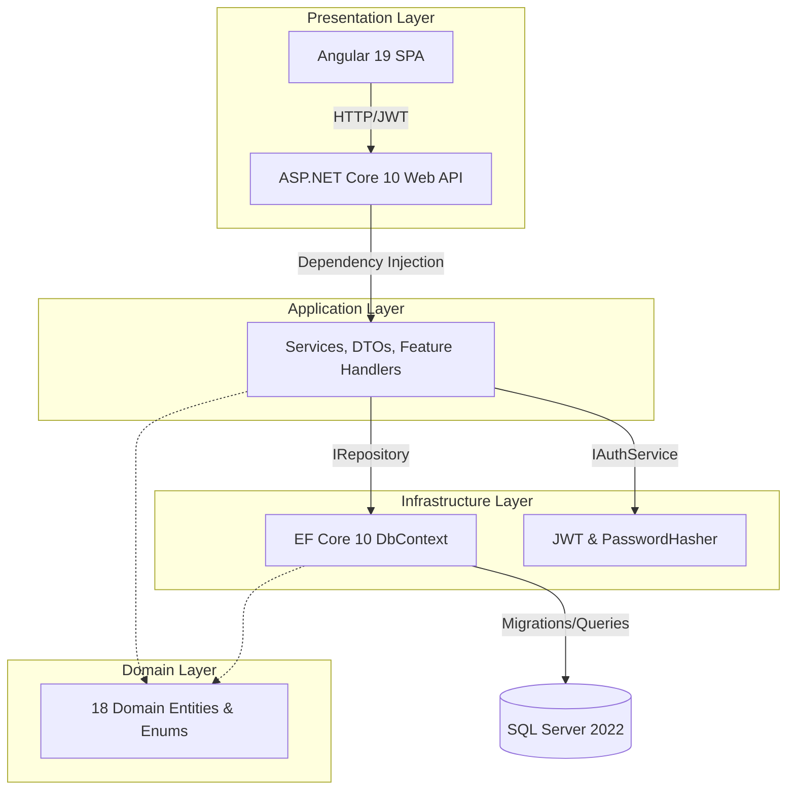

# 🚀 DynamicProLearn

<div align="center">


</div>

> A full-stack, production-ready Enterprise LMS platform purpose-built for ERP software onboarding, tester evaluation, and employee training workflows.

## ✨ Key Features
- **Role-Based Portals**: Distinct dashboards and capabilities for Admins, Students (Employees), and Testers.
- **Visual Content Builder**: Intuitive management of ERP training content mapped into Modules → Units → Lessons.
- **Deep-Link ERP SSO**: Seamless cross-platform authentication allowing users to launch the learning portal directly from inside the ERP using a secure `erpKey`.
- **Structured Tester Evaluation**: Dedicated version-assignment workflow where testers submit highly structured feedback with configurable condition/level/type filters.
- **Zero-Config Deployment**: The entire application (Angular SPA + .NET API) is packaged as a single, lightweight multi-stage Docker container.

## 🏗️ Architecture


## 🚀 API Endpoints

| Method | Endpoint | Auth Level | Description |
|:-------|:---------|:-----------|:------------|
| `POST` | `/api/Auth/login` | Public | Standard JWT authentication |
| `POST` | `/api/Auth/erp-login` | Public | Deep-link SSO from external ERP |
| `GET` | `/api/Admin/analytics` | Admin | Real-time lesson engagement metrics |
| `POST` | `/api/Admin/modules/assign` | Admin | Assign ERP modules to departments |
| `GET` | `/api/Student/dashboard` | Student+ | View assigned learning tracks |
| `POST` | `/api/Student/lesson/{id}/complete` | Student+ | Log lesson completion status |
| `POST` | `/api/Tester/versions/select` | Tester | Set active ERP version for evaluation |
| `POST` | `/api/Tester/feedback` | Tester | Submit structured lesson evaluation |

## 📊 Performance

| Metric | Value | Description |
|:-------|:------|:------------|
| **Container Size** | `< 200MB` | Multi-stage build strips SDKs, leaving only the minimal .NET runtime and compiled static Angular files. |
| **Auth Latency** | `< 25ms` | Stateless JWT validation prevents database round-trips on every protected route. |
| **Cold Start** | `< 2s` | .NET 10 optimized startup time, including EF Core auto-migration and database seeding. |

## 🛠️ Tech Stack

| Category | Technologies |
|:---------|:-------------|
| **Backend** | .NET 10, ASP.NET Core, C# 12 |
| **Database** | SQL Server 2022, Entity Framework Core 10 |
| **Frontend** | Angular 19, Vanilla CSS, Signals |
| **Security** | JWT Bearer Authentication, BCrypt Password Hashing, RBAC Policies |
| **DevOps** | Docker, Docker Compose, GitHub Actions |

## ⚡ Quick Start

```bash
# 1. Clone the repository
git clone https://github.com/MazenDarweesh/DynamicProLearn.git

# 2. Navigate to the deployment directory
cd DynamicProLearn/deployment

# 3. Start the full stack (App + DB)
docker-compose up -d
```
*Access the application at `http://localhost:8080`. Default Admin credentials are `admin` / `Admin@123`.*

## 🗺️ Roadmap
- [x] Migrate to Clean Architecture
- [x] Implement Multi-stage Dockerization
- [x] Build ERP SSO Deep-linking
- [x] Resolve EF Core migration FK constraints (Error 5074)
- [ ] Implement Multi-tenant database isolation
- [ ] Integrate Python RAG AI Co-Pilot for contextual Q&A

## 👨‍💻 Author
**Mazen Darweesh**
[LinkedIn](https://linkedin.com/in/mazen-darweesh) | [Docker Hub](https://hub.docker.com/r/mazendarweesh/dynamicprolearn)
