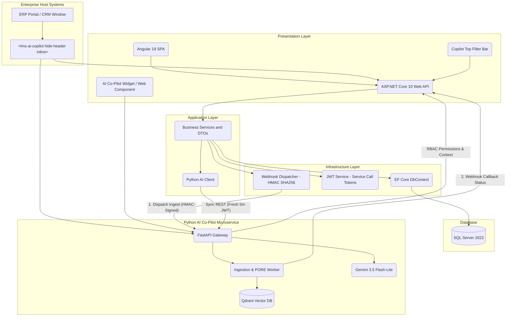
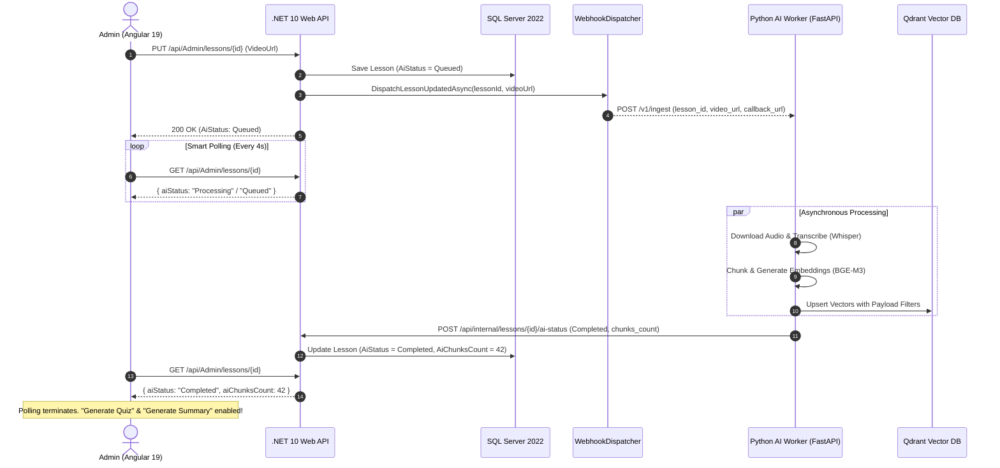

# 🚀 DynamicProLearn

<div align="center">


</div>

> **DynamicProLearn** is an enterprise-grade, full-stack Learning Management System (LMS) purpose-built for complex ERP software onboarding, cross-department employee skill tracks, structured software testing evaluations, and real-time context-aware AI assistance.

---

## ✨ Key Features

### 🎭 1. Role-Based Portals & Workflows

- **Admin Portal:** Comprehensive curriculum authoring (Modules → Units → Lessons), cross-company department management, employee track assignments, and live progress analytics.
- **Student (Employee) Portal:** Assigned learning tracks, interactive video player with deep-linking, automatic progress logging, AI-generated practice quizzes, and lesson summaries.
- **Tester Portal:** ERP version matrix evaluation, version-specific module testing assignments, and standardized QA feedback submissions (Pass, Fail, Regression, UI Glitch).

### 🤖 2. Context-Aware LMS AI Co-Pilot

- **Streaming RAG Pipeline:** Powered by Python FastAPI, Qdrant Vector DB, BGE-M3 dense embeddings, BM25 sparse search, and Google Gemini 3.5 Flash-Lite (`gemini-3.5-flash-lite`) for accurate contextual answers.
- **Answer Provenance & Latency Badges:** Live visual feedback displaying whether an answer was served via ⚡ **Instant Cache** (`< 40ms`) or 🧠 **Live LLM Generation** (`~2.1s`).
- **Interactive Video Citations:** Instant timestamp seeking (`[1] (01:23)`) that synchronizes directly with the video lesson player.
- **Retry with Cache Bypass (`skip_cache: true`):** Allows students to force fresh LLM answer regeneration directly from the UI.
- **Feedback & Comment Popovers:** Thumbs up/down rating with collapsible feedback dialogs sending structured diagnostics to `POST /v1/search/feedback`.
- **Bounded AI Readiness Guard:** Automatic readiness polling (`GET /v1/ready`) capped at 5 attempts (2.5s interval) with an interactive manual reconnect button to eliminate network console spam when the AI engine is offline.
- **Floating Drag & Drop Widget:** Built using `@angular/cdk/drag-drop` (`cdkDrag`, `boundary="body"`), allowing users to position the assistant anywhere on screen.

### 🧭 3. Hierarchical Dynamic Co-Pilot Top Filters

- **Scoped Knowledge Queries:** Student-facing filter bar featuring segmented scope switching (Current Lesson, Current Module, All Assigned Tracks), cascading dropdowns (Module → Unit → Lesson), and difficulty level/type chips.
- **Single-Query Projection:** Backed by `GET /api/student/copilot-filters` which executes a single, highly-optimized EF Core SQL query strictly bounded to the student's company, department, and assigned curriculum tracks in `< 35ms`.

### 🔄 4. Zero-Friction Silent Token Refresh (Resilient 401 Interception)

- **Stateless Cryptographic Refresh JWTs:** Dual-token model issuing a 60-minute access token alongside a signed 7-day refresh token (`POST /api/Auth/refresh-token`).
- **Seamless HTTP & SSE Interception:** Frontend `JwtInterceptor` and streaming SSE fetch client automatically trap `401 Unauthorized` responses, refresh tokens in under 120ms in the background, and replay requests without user logout.

### 🔐 5. Fresh Backend-to-Backend Service JWT Authentication

- **Zero ClockSkew Failure:** Eliminates the mismatch between ASP.NET Core's default 5-minute `ClockSkew` tolerance and Python FastAPI's zero-tolerance token expiration check.
- **On-the-Fly Service Tokens:** `ITokenService.GenerateServiceCallToken(userId, role)` issues fresh, short-lived (5-minute) internal JWTs signed with the shared secret per backend-to-backend request, avoiding forwarding stale user tokens during heavy AI workflows.

### ⚙️ 6. Video AI Ingestion Lifecycle State Machine

- **Deterministic 5-State Life Cycle:** Automatically manages lesson video processing states: `None` → `Queued` → `Processing` → `Completed` / `Failed`.
- **Database Durability:** Stored in SQL Server via EF Core (`AiStatus`, `AiError`, `AiChunksCount`, `AiProcessedAt`, `AiRetryCount`) as a persistent source of truth across all clients and restarts.
- **Non-Blocking Execution:** Video uploads or URL updates trigger immediate background processing without blocking .NET HTTP threads or stalling admin UI actions.

### 📡 7. Bidirectional Inter-Service Webhook Callbacks & Admin Retry

- **Asynchronous Push-Over-Pull:** When a video URL is saved, .NET dispatches a webhook event (`WebhookDispatcher`) to Python's `/v1/ingest`. Once Whisper audio transcription and Qdrant chunk indexing conclude, Python reports back via callback `POST /api/internal/lessons/{lessonId}/ai-status`.
- **Dual-Header Authentication:** Webhooks and status callbacks authenticate using both `Authorization: Bearer <token>` and `X-Service-Token` headers for maximum interoperability and defense-in-depth.
- **Admin Ingestion Recovery:** One-click manual retry endpoint `POST /api/admin/lessons/{lessonId}/retry-ai-ingest` resets failed or stalled lessons and re-dispatches the ingestion pipeline.

### 🖥️ 8. Live Angular 19 AI Status UX & Defensive Guards

- **Smart Bounded Polling:** `LessonEditorComponent` polls lesson status every 4 seconds during `Processing` or `Queued` and automatically terminates polling upon reaching terminal states (`Completed` or `Failed`), eliminating redundant network traffic.
- **Defensive Action Guards:** "Generate Quiz" and "Generate Summary" buttons are conditionally disabled with informative status alerts until video AI indexing is `Completed`, preventing hallucinations from unindexed content.
- **Visual Curriculum Indicators:** Instant visual markers in the curriculum tree (`✨` Completed, `⏳` Processing, `❌` Failed) for at-a-glance course status.

### 📝 9. Automatic Lesson Intelligence

- 1-click AI generation for multiple-choice lesson practice quizzes and concise lesson summaries stored directly in SQL Server via EF Core JSON mapping.
- Dedicated Admin Proxy endpoint (`POST /api/Admin/ai/cache/clear`) to flush both in-memory and semantic vector caches on demand.

### 🔗 10. Deep-Link ERP Single Sign-On (SSO)

- Enables employees and testers to launch training tracks directly from within external ERP software windows using an encrypted `erpKey` without requiring manual credential entry.

### 🐳 11. Zero-Config Multi-Stage Containerization

- Packages the complete Angular 19 SPA static assets and the ASP.NET Core 10 runtime into a single, hardened, unprivileged container under `< 185MB`.

### ⚡ 12. Process Once, Reference Everywhere (PORE Video Ingestion)

- **Zero-Redundancy Vector Storage:** When identical video training content is shared across multiple lessons or modules, PORE eliminates duplicate Whisper audio downloads, transcriptions, and vector embeddings.
- **Dynamic Lesson Mappings:** Ingested Qdrant vector points append new lesson IDs (`referenced_lesson_ids`) to existing payloads via parallelized `asyncio.gather`, transforming video processing from a 45-second pipeline to an **instantaneous 0ms** metadata linkage.
- **Full RAG Continuity:** Referenced lessons seamlessly generate AI quizzes, summaries, and timestamp citations directly from existing indexed points.

### 🧩 13. Cross-Module Multi-Lesson Search & Comparative RAG

- **Multi-Scope Synthesis:** Extends the Smart Top Filter Bar with `scope="lessons"`, enabling students and ERP operators to select and query multiple lessons simultaneously across entirely separate curriculum modules.
- **High-Performance Multi-Filter Ingestion:** Powered by Qdrant `FieldCondition(key="lesson_id", match=MatchAny(any=lesson_ids))` combined with BM25 sparse fusion and BGE-reranker-v2-m3 for comparative synthesis queries.

### 🔌 14. Headless & Inline Web Component for ERP Embedding (`<lms-ai-copilot>`)

- **Angular Elements Native Custom Element:** Packaged as `<lms-ai-copilot>` for plug-and-play integration into any third-party ERP interface, CRM modal, or React/Vue host page.
- **Decoupled Headless Mode (`hide-header="true"`):** Separates the AI chat header into `CopilotHeaderComponent`, allowing external ERP hosts to render their own native branded headers without duplicate title bars.
- **Container-Bound Inline Mode (`inline="true"`):** Removes floating `position: fixed` coordinates, enabling the chat body to seamlessly expand to 100% width and height within ERP drawers, popups, or tabs.
- **Zero-Click Context Sync:** Reactively updates search scope and suggested prompts when the ERP host alters `erp-key="SCREEN_KEY"`.

### 🛡️ 15. HMAC-SHA256 Cryptographic Webhooks & Dual-Casing RBAC

- **Payload Tamper-Proofing:** Outbound webhooks from .NET to Python carry digital signatures via `X-Webhook-Signature: sha256=<hash>` generated with secret keys, rejecting unauthorized or forged ingestion triggers.
- **Dual-Casing Tenant Claims:** JWT tokens automatically inject dual-casing tenant identifiers (`company_id`/`CompanyId`, `department_id`/`DepartmentId`) to guarantee zero-hop RBAC and serialization safety between .NET and FastAPI services.

### ⏱️ 16. Asynchronous 202 Job Pattern & Auto-Calculated Level Order

- **Non-Blocking AI Generation:** Heavy quiz and summary generation endpoints return `202 Accepted` with polling URLs, decoupling HTTP threads from LLM response latency.
- **Deterministic Level Ordering:** Lesson creation and level switching dynamically auto-calculate sequential `LevelOrderIndex` (`Max + 1`) in both Angular and EF Core, preventing curriculum ordering collisions.

---

## 🏗️ System Architecture



### 🔁 Asynchronous Video AI Ingestion Flow



> 📖 **Deep Dive:** For detailed sequence diagrams, domain model diagrams, and security protocols, read the [Architecture Blueprint](docs/ARCHITECTURE.md).

---

## 🚀 Key API Endpoints

The .NET 10 Web API provides over 40+ production endpoints structured across domain controllers:

| Method | Endpoint | Auth Policy | Description |
| :------- | :--------- | :------------ | :------------ |
| `POST` | `/api/Auth/login` | Public | Standard JWT authentication returning access + refresh tokens |
| `POST` | `/api/Auth/erp-login` | Public | Deep-link SSO from external ERP systems |
| `POST` | `/api/Auth/refresh-token` | Public | Silent renewal of expired access tokens using 7-day refresh JWT |
| `GET` | `/api/Student/copilot-filters` | `StudentOrAbove` \| `Admin` | Dynamic hierarchical content tree and metadata filters for scoped AI search (aliased for Admin) |
| `GET` | `/api/Student/modules` | `StudentOrAbove` | Retrieve assigned curriculum tracks for authenticated employee |
| `POST` | `/api/Student/lessons/{id}/complete` | `StudentOrAbove` | Toggle lesson completion status with real-time progress update |
| `GET` | `/api/Student/lessons/{id}/quiz` | `StudentOrAbove` | Retrieve interactive practice quiz questions |
| `POST` | `/api/Student/lessons/{id}/quiz/check-answer` | `StudentOrAbove` | Instant interactive grading with AI explanation disclosure |
| `POST` | `/api/Admin/lessons/{id}/generate-quiz` | `AdminOnly` | Trigger asynchronous 202 job for AI generation of multiple-choice practice quiz |
| `POST` | `/api/Admin/lessons/{id}/generate-summary` | `AdminOnly` | Trigger asynchronous 202 job for AI generation of lesson summary notes |
| `POST` | `/api/Admin/lessons/{id}/retry-ai-ingest` | `AdminOnly` | Reset failed/stalled video ingestion state and re-dispatch ingestion event |
| `POST` | `/api/Admin/ai/cache/clear` | `AdminOnly` | Purge Tier-1 Exact Cache and Tier-2 Semantic Cache in AI engine |
| `GET` | `/api/Admin/analytics/curriculum` | `AdminOnly` | Enterprise-wide curriculum engagement metrics |
| `POST` | `/api/Admin/assignments` | `AdminOnly` | Assign ERP modules to departments with level/type filters |
| `POST` | `/api/Tester/active-version` | `TesterOnly` | Switch working context between ERP release versions |
| `POST` | `/api/Tester/feedback` | `TesterOnly` | Submit structured QA evaluation report (Pass/Fail/Bug) |
| `POST` | `/api/internal/lessons/{id}/ai-status` | `ServiceToken` \| `Bearer` | Webhook callback from AI worker updating video ingestion status, chunks, or errors (HMAC signed) |
| `GET` | `/api/internal/user-permissions/{userId}` | `ServiceToken` | Internal RBAC lookup for Python AI Co-Pilot query scoping |
| `GET` | `/api/internal/lessons/{id}/full-context` | `ServiceToken` | Internal metadata injection for vector embeddings with dual-casing tenant claims |

> 📋 **Full Specification:** For all request/response schemas, DTOs, and error codes, refer to the [REST API Reference](docs/API_REFERENCE.md).

---

## 📊 Real-World Performance & Hardening

| Metric | Measured Value | Architectural Context |
| :------- | :--------------- | :---------------------- |
| **Multi-Stage Container** | `< 185 MB` | Node build artifacts and .NET SDKs stripped; minimal ASP.NET runtime only. |
| **Stateless Auth Validation** | `< 20 ms` | Cryptographic signature verification avoids database round-trips on routes. |
| **Silent Token Refresh** | `< 120 ms` | Non-blocking token renewal via reactive RxJS mutex interceptor. |
| **Service-to-Service JWT Minting** | `< 1 ms` | In-memory HMAC-SHA256 signature with zero DB lookup avoiding ClockSkew mismatches. |
| **PORE Video Re-Ingestion Avoidance** | `0 ms (Instant)` | Re-uses existing vector points via metadata references, saving ~45s of Whisper transcription. |
| **HMAC Webhook Verification** | `< 0.5 ms` | Cryptographic SHA256 validation prevents unauthorized ingestion trigger injection. |
| **Copilot Filter Tree Projection** | `< 35 ms` | Single-query EF Core SQL projection strictly scoped to student RBAC permissions. |
| **Video Ingestion Webhook Dispatch** | `< 45 ms` | Non-blocking event dispatch; heavy Whisper transcription runs asynchronously. |
| **Admin AI Status Polling Interval** | `4 s (Bounded)` | Automatically self-terminates upon terminal status (`Completed` / `Failed`). |
| **AI Exact/Semantic Cache** | `< 40 ms` | Tier-1 memory cache and Tier-2 Qdrant cosine similarity cache hits. |
| **AI Live RAG Generation** | `~ 2.1 s` | Hybrid BGE-M3 + BM25 retrieval, rerank, and Gemini 3.5 Flash-Lite streaming tokens. |
| **Embedded Web Component Bootstrap** | `< 150 ms` | `<lms-ai-copilot>` initializes within external ERP hosts with zero framework bloat. |
| **Readiness Polling Cap** | `Max 5 checks` | Bounded polling (2.5s interval) stops network flooding when AI engine is offline. |
| **Cold Start Startup** | `< 2.2 s` | .NET 10 optimized startup with automatic EF Core database migrations and seeding. |

---

## 🛠️ Technology Stack

| Category | Technologies |
| :--------- | :------------- |
| **Backend Core** | .NET 10.0, ASP.NET Core Web API, C# 12 |
| **Architecture** | Clean Architecture (Domain, Application, Infrastructure, API), CQRS, Repository Pattern |
| **Database & ORM** | SQL Server 2022, Entity Framework Core 10.0, JSON Column Mappings |
| **Frontend Framework** | Angular 19 (Standalone Components, Signals, Reactive Forms, RxJS) |
| **UI Ergonomics** | Vanilla CSS Design System, `@angular/cdk/drag-drop`, `ngx-markdown` |
| **Embedded Integration** | Web Components (`@angular/elements`), Custom Element `<lms-ai-copilot>`, Headless / Inline Mode |
| **AI Co-Pilot Stack** | Python 3.11+, FastAPI, Qdrant Vector DB, BAAI/bge-m3, BM25, Google Gemini 3.5 Flash-Lite |
| **Security & Auth** | Dual-Token JWT (Access + Refresh), Service Call Tokens, HMAC-SHA256 Webhook Signing, BCrypt, RBAC |
| **DevOps & Containers** | Multi-stage Docker, Docker Compose, Non-root `app` User Hardening |

---

## ⚡ Quick Start

### Option A: Complete Docker Compose Stack (Recommended)

```bash
# 1. Clone the repository
git clone https://github.com/MazenDarweesh/DynamicProLearn.git
cd DynamicProLearn

# 2. Launch the full environment (App + SQL Server 2022)
docker compose -f deployment/docker-compose.yml up -d
```

- **Web Application:** `http://localhost:8080`
- **Default Admin Credentials:** `admin` / `Admin@123`
- **Default Student Credentials:** `student` / `Student@123`
- **Default Tester Credentials:** `tester` / `Tester@123`

---

### Option B: Local Development Setup

#### 1. Backend (.NET 10 API)

```bash
# From repository root
dotnet restore
dotnet build
dotnet run --project src/LearnDynamicPro.API
```

*API will run on `http://localhost:5115` with Swagger UI at `http://localhost:5115/swagger`.*

#### 2. Frontend (Angular 19 UI)

```bash
cd learn-dynamic-pro-ui
npm install
npm start
```

*Frontend will run on `http://localhost:4200`.*

---

## 🗺️ Engineering Roadmap

- [x] Full Clean Architecture implementation in .NET 10
- [x] Multi-stage Docker packaging (.NET 10 + Angular 19 SPA `< 185MB`)
- [x] Deep-link ERP SSO authentication via `erpKey`
- [x] Visual Curriculum Builder (Modules → Units → Lessons)
- [x] Structured ERP version-based Tester evaluation & bug submission
- [x] Real-time AI Co-Pilot streaming integration with Server-Sent Events (SSE)
- [x] Dynamic Hierarchical Co-Pilot Top Filters (`GET /api/student/copilot-filters`)
- [x] Cross-Module Multi-Lesson Search with comparative RAG (`scope="lessons"`)
- [x] Process Once, Reference Everywhere (PORE) video ingestion architecture
- [x] `<lms-ai-copilot>` Web Component export via Angular Elements
- [x] Decoupled Headless Copilot Body for ERP modal and drawer embedding (`hide-header`, `inline`)
- [x] HMAC-SHA256 digital signature validation on inter-service webhooks (`X-Webhook-Signature`)
- [x] Dual-casing tenant claims in JWT for zero-hop RBAC
- [x] Asynchronous 202 Accepted job pattern for heavy AI generation
- [x] Automatic sequential LevelOrderIndex calculation on lesson create/update
- [x] Answer Provenance badges (⚡ Instant Cache vs 🧠 Live LLM generation)
- [x] Interactive video timestamp seeking (`[1] (01:23)`)
- [x] Answer retry with automatic cache bypass (`skip_cache: true`)
- [x] Thumbs up/down feedback dialogs with structured diagnostic comments
- [x] Floating draggable chat widget using `@angular/cdk`
- [x] Bounded AI readiness polling guard with interactive manual reconnect
- [x] Stateless 7-day signed cryptographic Refresh Tokens with silent 401 renewal
- [x] Automated lesson intelligence (AI-generated quizzes and summaries)
- [x] Video AI Ingestion Lifecycle State Machine (`None`, `Queued`, `Processing`, `Completed`, `Failed`)
- [x] Bidirectional Inter-Service Webhook Callbacks with dual authentication (`Bearer` + `X-Service-Token`)
- [x] Admin manual Ingestion Retry loop with retry counter and error diagnostics
- [x] Fresh short-lived Service JWT minting (`GenerateServiceCallToken`) resolving ClockSkew mismatches
- [x] Live Angular 19 AI status banners with bounded 4s polling and conditional Quiz/Summary guards
- [x] Dual-key webhook cache invalidation (`lesson_id` & `lessonId`)
- [x] Admin proxy endpoint for clearing AI exact and semantic vector caches
- [ ] Multi-tenant database schema isolation per enterprise client

---

## 📚 Documentation Index

- [📘 Project Overview & Business Spec](docs/PROJECT_OVERVIEW.md) — Comprehensive business goals, user personas, and complete functional specification.
- [🎯 Technical Interview Preparation](docs/INTERVIEW_PREP.md) — Architectural defense questions, system design deep-dives, and STAR behavioral scenarios.
- [🏛️ Architecture Blueprint](docs/ARCHITECTURE.md) — Comprehensive design, data flow diagrams, and security specifications.
- [📡 REST API Reference](docs/API_REFERENCE.md) — Exhaustive contract specifications for all 40+ endpoints.
- [🤝 AI Co-Pilot Handoff Brief](AI_COPILOT_HANDOFF_BRIEF.md) — Coordination guide between .NET/Angular and the Python AI engine.
- [🐳 Deployment Guide](deployment/DEPLOYMENT_GUIDE.md) — Production deployment instructions and environment variables.

---

## 👨‍💻 Author

**Mazen Darweesh**  
[GitHub Profile](https://github.com/MazenDarweesh) | [Docker Hub](https://hub.docker.com/r/mazendarweesh/dynamicprolearn) | [LinkedIn](https://linkedin.com/in/mazen-darweesh)

---

## 📄 License

This project is licensed under the MIT License — see the [LICENSE](LICENSE) file for details.

