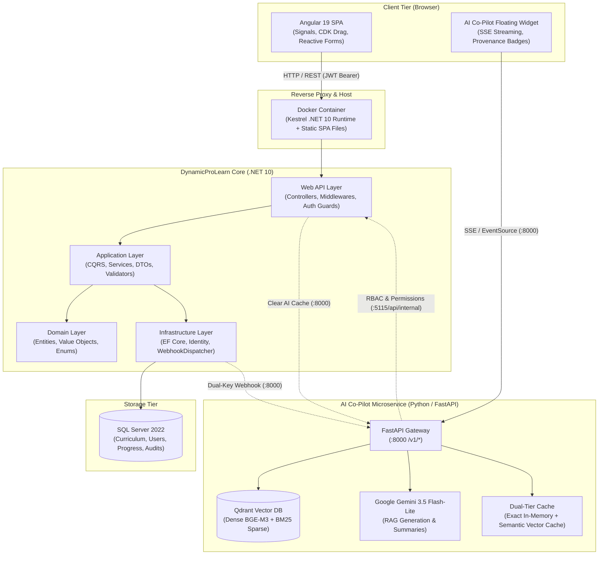
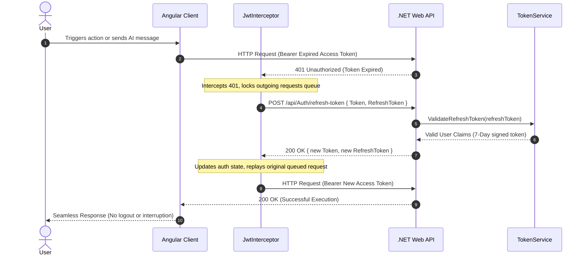
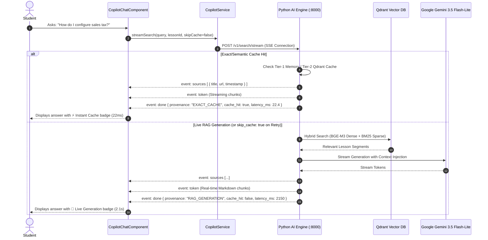
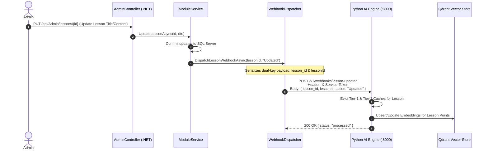
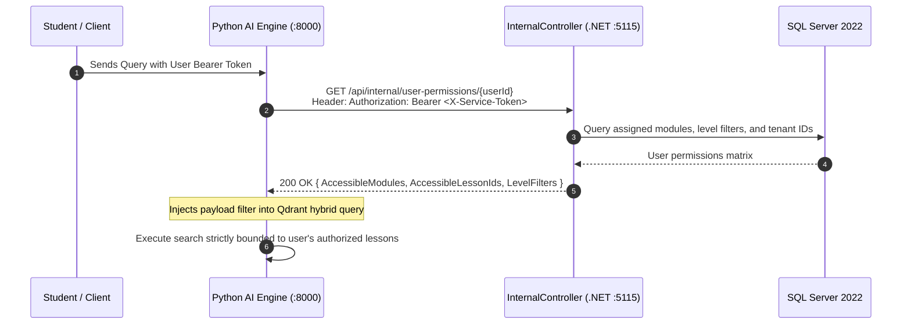
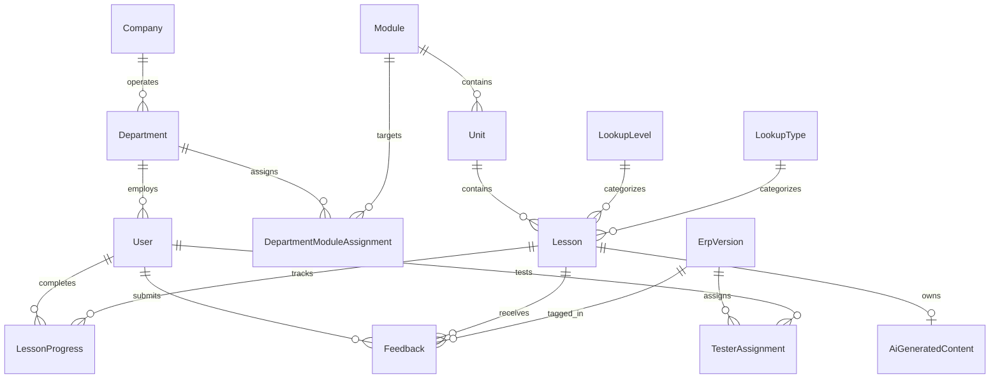

# 🏛️ DynamicProLearn Architecture Blueprint

DynamicProLearn is an enterprise-grade Learning Management System (LMS) engineered for ERP software onboarding, multi-department corporate training, tester quality evaluation, and context-aware artificial intelligence.

This document provides a deep architectural breakdown of the platform, including its Clean Architecture layers, reactive frontend design, data flow sequences, and microservice integration with the AI Co-Pilot engine.

---

## 🗺️ High-Level System Architecture



---

## 🧱 Backend Architecture (.NET 10 Clean Architecture)

The backend is built following strict **Clean Architecture (Onion Architecture)** principles, ensuring high testability, loose coupling, and domain independence.

```
src/
├── LearnDynamicPro.Domain/           # Enterprise Business Rules
│   ├── Common/                       # BaseEntity, AuditableEntity
│   ├── Entities/                     # User, Company, Department, Module, Unit, Lesson, Feedback, etc.
│   └── Enums/                        # UserRole, ContentType, DifficultyLevel
│
├── LearnDynamicPro.Application/      # Application Business Rules
│   ├── Common/                       # Result<T>, Error types, Service Lifespans
│   ├── DTOs/                         # Request/Response contracts per feature
│   ├── Interfaces/                   # IApplicationDbContext, ITokenService, IUnitOfWork
│   └── Features/                     # AuthService, AdminService, StudentService, TesterService
│
├── LearnDynamicPro.Infrastructure/   # External Interfaces & Data Access
│   ├── Data/                         # ApplicationDbContext, Model Configurations, Seeding
│   ├── Identity/                     # TokenService (Stateless JWT + 7-day Refresh Tokens)
│   ├── Repositories/                 # Generic Repository & Unit of Work implementation
│   └── Services/                     # WebhookDispatcher (Dual-key payload serialization)
│
└── LearnDynamicPro.API/              # Interface Adapters & Delivery Layer
    ├── Controllers/                  # Auth, Admin, Student, Tester, Internal
    ├── Middlewares/                  # ExceptionMiddleware, RequestLoggingMiddleware
    └── Program.cs                    # Dependency Injection, DB Retry Policy, Host Configuration
```

### Layer Dependency Rules:
1. **Domain** depends on nothing.
2. **Application** depends only on Domain.
3. **Infrastructure** depends on Application and Domain.
4. **API** acts as the entry point, resolving dependencies at startup.

---

## 🎨 Frontend Architecture (Angular 19 SPA)

The frontend is built using **Angular 19 Standalone Components**, eliminating traditional `NgModule` boilerplate and providing fine-grained reactivity through **Signals**.

```
learn-dynamic-pro-ui/src/app/
├── core/
│   ├── guards/                       # AuthGuard, RoleGuard (Admin, Student, Tester)
│   ├── interceptors/                 # JwtInterceptor (401 catch, Silent Token Refresh Mutex)
│   ├── models/                       # TypeScript interfaces mirroring backend DTOs
│   └── services/                     # AuthService, CopilotService, AdminService, StudentService
│
├── shared/
│   ├── components/                   # Navbar, Sidebar, CopilotChatComponent
│   └── pipes/                        # SafeUrlPipe, TimeAgoPipe, ArabicDatePipe
│
└── features/
    ├── auth/                         # Login, Register, ErpRedirect (SSO)
    ├── admin/                        # Dashboard, CurriculumBuilder, UsersManager, Analytics
    ├── student/                      # TracksViewer, LessonPlayer, QuizRunner, ProgressSummary
    └── tester/                       # VersionSelector, FeedbackForm, EvaluationMatrix
```

### Key Frontend Capabilities:
- **Signals-Driven Reactivity:** Instant state synchronization between session, roles, and UI components without unnecessary change-detection cycles.
- **Floating Ergonomics:** Chat widget is powered by `@angular/cdk/drag-drop` (`cdkDrag`, `cdkDragBoundary="body"`), ensuring users can drag the assistant window anywhere across complex ERP learning materials.
- **Zero-Flicker Markdown:** Responses from the AI are rendered in real-time markdown (`ngx-markdown`) supporting code syntax highlighting, tables, callouts, and interactive video timestamps.

---

## 🔄 Core Architectural Workflows & Sequence Diagrams

### 1. Zero-Friction Silent Token Refresh (Resilient 401 Interception)



---

### 2. AI Co-Pilot Streaming & Provenance Badging (SSE Flow)



---

### 3. Dual-Key Webhook Cache Invalidation

When an Administrator updates or removes curriculum content in .NET, the changes must instantly reflect in the AI engine's vector store and semantic cache.



---

### 4. RBAC Permission Filtering via Internal Service Token



---

## 🛡️ Enterprise Security Architecture

| Security Domain | Implementation Standard |
|:----------------|:------------------------|
| **Authentication** | Dual-token model: 60-min stateless access JWT + 7-day signed cryptographic refresh JWT. |
| **Password Security** | BCrypt Work Factor 12 with cryptographically random salt. |
| **Authorization** | Strict ASP.NET Core Policies (`AdminOnly`, `StudentOrAbove`, `TesterOnly`). |
| **Cross-Service Comms** | Static high-entropy `X-Service-Token` headers for internal endpoints (`/api/internal/*`). |
| **Multi-Tenancy** | Department-level and Company-level data isolation enforced via EF Core query filters. |
| **Container Hardening** | Production runtime executes under unprivileged built-in `app` user (non-root UID). |

---

## 📈 Database Schema & Relationships (EF Core 10)



- **AiGeneratedContent:** JSON-mapped EF Core entity storing AI-generated comprehensive summaries, multiple-choice quizzes, and explanation metadata directly associated with each lesson.
- **LessonProgress:** Captures completion timestamp, active watch time, quiz score, and last accessed date for curriculum analytics.
