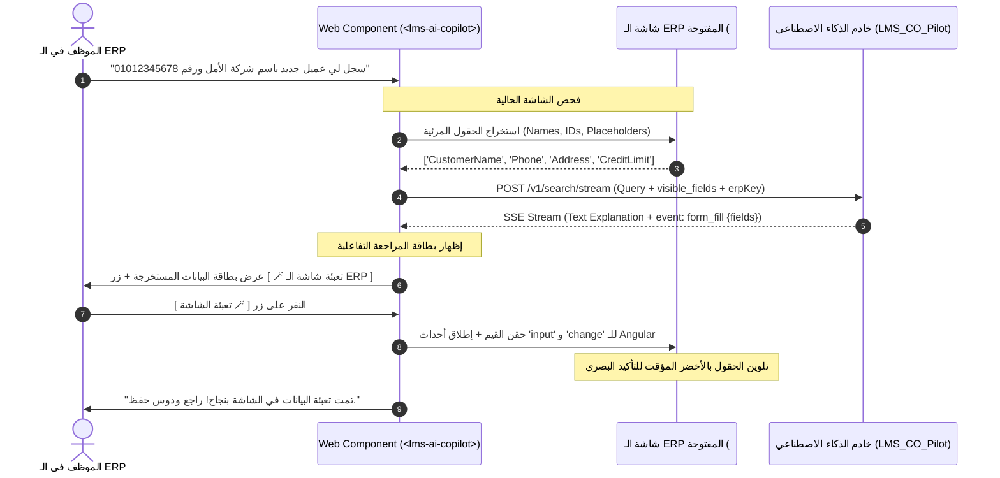

# 📐 Blueprint: نظام التعبئة التفاعلية المباشرة في شاشات الـ ERP عبر Web Component الشات الحالي
# DynamicPro ERP AI Form-Fill & Context-Aware Execution Plan

> **الإصدار:** 1.0.0 | **التاريخ:** 2026-10-06  
> **الهدف:** تمكين مكون الشات الحالي (`<lms-ai-copilot>`) من فحص شاشة الـ ERP التي يعمل بداخلها، واستخراج بيانات النماذج من طلبات المستخدم، وتعبئة الحقول مباشرة في الـ DOM بموافقة المستخدم ودون أي تعديل على كود الـ ERP الأصلي.  
> **المبدأ الهندسي الصارم:** **DRY** (إعادة استخدام نفس المكون، نفس الـ SSE Stream، ونفس الـ Web Component) و **YAGNI** (بدون أدوات خارجية، بدون Chrome Extension منفصلة، وبدون سيرفرات أتمتة إضافية).

---

## 1. ملخص المعمارية والتنفيذ (Architectural Overview)

يعمل مكون الشات حالياً كـ Web Component مسجل باسم `<lms-ai-copilot>` ومزروع داخل صفحة الـ ERP. وبما أنه يعيش في نفس الـ DOM ونفس سياق المتصفح، فإنه يستطيع الوصول مباشرة إلى عناصر الصفحة المجاورة له عبر جافاسكريبت القياسي.



---

## 2. جدول الخطوات التنفيذية (Execution Steps Breakdown)

كل خطوة مصممة لتكون قابلة للتنفيذ والاسترجاع والفحص المستقل (Self-Contained).

| الخطوة | الملفات المتأثرة | المسؤولية | الجهد التقديري |
|:---|:---|:---|:---:|
| **Step 1** | `LMS_CO_Pilot/src/api/routes/search.py`<br>`LMS_CO_Pilot/src/services/gemini_service.py` | دعم باراميتر `visible_fields` في البايثون وتوليد حدث `event: form_fill` في الـ SSE | 0.5 يوم |
| **Step 2** | `learn-dynamic-pro-ui/src/app/core/services/copilot.service.ts` | استقبال حدث `form_fill` في الـ SSE وتمرير حقول الـ DOM في الـ Payload | 0.5 يوم |
| **Step 3** | `learn-dynamic-pro-ui/src/app/shared/components/copilot-chat/copilot-chat.component.ts`<br>`copilot-chat.component.html`<br>`copilot-chat.component.css` | بناء منطق فحص الـ DOM (`DomInspector`)، وبطاقة التعبئة التفاعلية، وتعبئة الحقول (`fillFields`) | 1 يوم |
| **Step 4** | `learn-dynamic-pro-ui/src/app/features/erp-mock/erp-mock.component.ts`<br>`erp-mock.component.html` | تحديث شاشة المحاكي التجريبية `erp-mock` لاختبار التعبئة الفورية على فورم حقيقي | 0.5 يوم |
| **Step 5** | بناء واختبار الـ Web Component المحدث والتأكد من عدم كسر وظائف الـ LMS العادية | تشغيل اختبارات التجميع والتحقق من التوافقية الشاملة | 0.5 يوم |

---

## 3. المواصفات التفصيلية للخطوات (Detailed Implementation Specifications)

### 🧩 الخطوة 1: تحديث خادم الـ AI لدعم حدث `form_fill` (Python Backend)
* **المسار:** `LMS_CO_Pilot/src/`
* **المتطلبات:**
  1. تحديث نموذج الطلب `SearchRequest` في `src/models/search.py` لإضافة:
     ```python
     visible_fields: Optional[List[str]] = None
     erp_key: Optional[str] = None
     ```
  2. في الـ Prompt الموجه لـ Gemini:
     - إذا كانت `visible_fields` ممررة والطلب يحتوي على صيغة أمر إدخال أو تعبئة (مثل: *"سجل، ضيف، اكتب، عبي، اعمل فاتورة"*):
     - يُطلب من النموذج استخراج مصفوفة مفاتيح وقيم متطابقة مع `visible_fields`.
  3. في مولد الـ SSE Stream (`search.py`):
     - إذا تم استخراج بيانات تعبئة، يُرسل حدث SSE مخصص:
       ```
       event: form_fill
       data: {"fields": {"CustomerName": "شركة الأمل للتجارة", "Phone": "01012345678"}, "intent": "create_customer"}
       ```
* **معيار النجاح (Verification):**
  - استدعاء الـ endpoint عبر `curl` أو Postman يرجع نصوص الشرح العادية + حدث `event: form_fill`.

---

### 🧩 الخطوة 2: تحديث `copilot.service.ts` في Angular لدعم التعبئة
* **المسار:** [`learn-dynamic-pro-ui/src/app/core/services/copilot.service.ts`](file:///e:/Mazen/DynamicProLearn/learn-dynamic-pro-ui/src/app/core/services/copilot.service.ts)
* **المتطلبات:**
  1. تعريف واجهة بيانات التعبئة:
     ```typescript
     export interface CopilotFormFillData {
       intent?: string;
       fields: Record<string, any>;
       screenKey?: string;
     }
     ```
  2. تحديث واجهة الرسائل `ChatMessage` لتشمل:
     ```typescript
     formFillData?: CopilotFormFillData;
     formFillApplied?: boolean;
     ```
  3. تحديث دالة `streamSearch`:
     - إضافة معامل اختياري `visibleFields?: string[]`.
     - تمريره في الـ Request body: `payload['visible_fields'] = visibleFields`.
     - في حلقة قراءة الـ SSE، إضافة معالجة الحدث الجديد:
       ```typescript
       } else if (currentEvent === 'form_fill' && onFormFill) {
         onFormFill(data);
       }
       ```
* **معيار النجاح:**
  - الـ Service يلتقط الحدث بدون أي أخطاء في الـ Console، ويمرره للـ Callback المخصص.

---

### 🧩 الخطوة 3: تحديث مكون الشات `copilot-chat.component` (القلب النابض)
* **المسار:** 
  - [`copilot-chat.component.ts`](file:///e:/Mazen/DynamicProLearn/learn-dynamic-pro-ui/src/app/shared/components/copilot-chat/copilot-chat.component.ts)
  - [`copilot-chat.component.html`](file:///e:/Mazen/DynamicProLearn/learn-dynamic-pro-ui/src/app/shared/components/copilot-chat/copilot-chat.component.html)
  - [`copilot-chat.component.css`](file:///e:/Mazen/DynamicProLearn/learn-dynamic-pro-ui/src/app/shared/components/copilot-chat/copilot-chat.component.css)
* **المتطلبات الهندسية:**
  1. **خدمة فحص الـ DOM (`collectVisibleFormFields`):**
     - دالة تفحص المستند المحيط:
       ```typescript
       private collectVisibleFormFields(): string[] {
         if (typeof document === 'undefined') return [];
         // ابحث عن الحقول في الصفحة خارج مكون الشات نفسه
         const inputs = Array.from(document.querySelectorAll('input, select, textarea')) as (HTMLInputElement | HTMLSelectElement | HTMLTextAreaElement)[];
         const fields: string[] = [];
         
         for (const el of inputs) {
           // تجاهل حقول الإدخال الخاصة بالشات نفسه!
           if (this.elRef.nativeElement.contains(el)) continue;
           if (el.type === 'hidden' || el.style.display === 'none' || el.disabled) continue;
           
           const name = el.getAttribute('name') || el.id || el.getAttribute('placeholder') || el.getAttribute('data-testid');
           if (name && !fields.includes(name)) {
             fields.push(name.trim());
           }
         }
         return fields;
       }
       ```
  2. **تمرير الحقول أثناء إرسال الرسالة:**
     - داخل دالة `streamQuery`، إذا كان الشات يعمل داخل سياق ERP (أي `this.erpKey` موجود أو `this.isEmbedded === true`):
     - يتم استدعاء `this.collectVisibleFormFields()` وإرسالها مع الطلب.
  3. **دالة تنفيذ التعبئة (`applyFormFill`):**
     - عندما ينقر المستخدم على زر `[ 🪄 تعبئة شاشة الـ ERP ]`:
       ```typescript
       applyFormFill(msg: ChatMessage): void {
         if (!msg.formFillData?.fields) return;
         let filledCount = 0;
         
         for (const [key, val] of Object.entries(msg.formFillData.fields)) {
           // مطابقة مرنة مع name أو id أو data-testid
           const selector = `input[name="${key}"], select[name="${key}"], textarea[name="${key}"], #${key}, [data-testid="input-${key}"]`;
           const target = document.querySelector(selector) as HTMLInputElement | null;
           
           if (target && !this.elRef.nativeElement.contains(target)) {
             target.value = String(val);
             // إطلاق الأحداث إجبارياً ليعلم إطار Angular في الـ ERP بوجود قيمة جديدة
             target.dispatchEvent(new Event('input', { bubbles: true }));
             target.dispatchEvent(new Event('change', { bubbles: true }));
             target.dispatchEvent(new Event('blur', { bubbles: true }));
             
             // تأثير وميض أخضر شيك (Visual Highlight)
             target.classList.add('ai-autofill-highlight');
             setTimeout(() => target.classList.remove('ai-autofill-highlight'), 3000);
             filledCount++;
           }
         }
         msg.formFillApplied = true;
         this.cdr.markForCheck();
       }
       ```
  4. **واجهة العرض في HTML (`copilot-chat.component.html`):**
     - إضافة بطاقة تعبئة أنيقة أسفل فقاعة الرد:
       ```html
       <!-- Action Card: Auto-Fill Suggestion -->
       <div *ngIf="msg.formFillData && !msg.isStreaming" class="form-fill-card">
         <div class="form-fill-header">
           <span class="form-fill-icon">🪄</span>
           <span class="form-fill-title">اقتراح تعبئة الشاشة تلقائياً</span>
         </div>
         <div class="form-fill-details">
           <div *ngFor="let item of (msg.formFillData.fields | keyvalue)" class="form-fill-row">
             <span class="field-key">{{ item.key }}:</span>
             <span class="field-val">{{ item.value }}</span>
           </div>
         </div>
         <div class="form-fill-actions">
           <button *ngIf="!msg.formFillApplied" type="button" class="btn-apply-fill" (click)="applyFormFill(msg)">
             🪄 تعبئة البيانات في الشاشة الآن
           </button>
           <div *ngIf="msg.formFillApplied" class="fill-success-badge">
             ✅ تم ملء الحقول بنجاح في الصفحة! راجع واضغط حفظ.
           </div>
         </div>
       </div>
       ```

---

### 🧩 الخطوة 4: التحديث والاختبار على `erp-mock.component.ts`
* **المسار:** [`learn-dynamic-pro-ui/src/app/features/erp-mock/erp-mock.component.ts`](file:///e:/Mazen/DynamicProLearn/learn-dynamic-pro-ui/src/app/features/erp-mock/erp-mock.component.ts)
* **المتطلبات:**
  - شاشة `erp-mock` تحتوي بالفعل على نماذج حقيقية للعملاء والفواتير.
  - نجرب كتابة: *"سجل عميل اسمه شركة الفيروز ورقم 01123456789"*.
  - التحقق من أن الحقول في جانب شاشة الـ Mock تم تعبئتها فورياً بدون الحاجة إلى لمس الكيبورد.

---

## 4. خطة التراجع والأمان (Rollback & Safety Plan)

1. **العزل التام (Strict Containment):**
   - كود البحث عن الحقول يستثني دائماً: `this.elRef.nativeElement.contains(el)` لضمان عدم الكتابة داخل مدخلات الشات نفسه أو العبث به.
2. **منع الترحيل التلقائي (No Auto-Submit):**
   - الكود يقتصر على تعبئة الحقول فقط `target.value = val`. **ممنوع قطعياً** إطلاق حدث `submit()` على الفورم تلقائياً؛ المستخدم هو صاحب القرار النهائي في الضغط على زر الحفظ أو الإلغاء.
3. **تأثير بصري مؤقت:**
   - كلاس CSS باسم `ai-autofill-highlight` يضيف إطاراً أخضر متوهجاً يختفي بعد 3 ثوانٍ ليلاحظ الموظف الحقول التي تم تعديلها بدقة.

---

## 5. بروتوكول الإغلاق وموافقة البدء (Execution Gate)

بمجرد اعتماد هذه الخطة (Blueprint)، سنبدأ بتنفيذ الخطوات بالتتابع:
1. نجهز كود الـ Angular للـ Service والمكون أولاً ونختبره على `erp-mock`.
2. نضبط سيرفر البايثون لدعم الحدث.
3. نعمل Build وتجربة حية مشتركة.

هل تعتمد هذه الخطة للبدء الفوري في التنفيذ خطوة بخطوة؟
