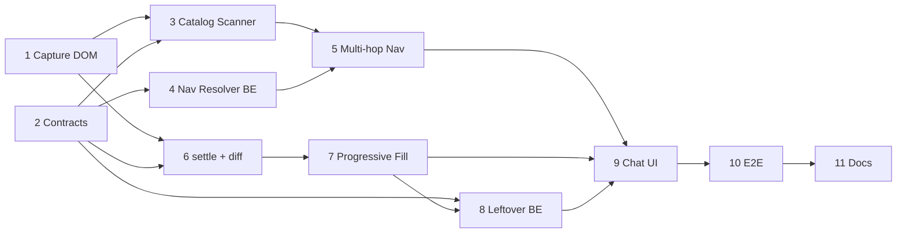

# BLUEPRINT — Autonomous Navigation + Progressive Form Fill (DynamicPro ERP)

**Objective:** من الشاشة الرئيسية للـ ERP، يفهم المساعد طلب المستخدم (حتى لو غامض)، يوصل لشاشة الإدخال الصحيحة بخطوات متعددة، ثم يملأ الحقول **على مراحل** — مع **مراقبة الـ DOM بعد كل اختيار** لأن حقولاً تظهر/تُفعَّل فقط بعد إدخال معيّن.

**Date:** 2026-10-11 · **Owner:** Mazen · **Status:** Draft (awaiting approval)

---

## 0. Recon — الموجود فعلاً (DRY: نبني فوقه ولا نكرره)

| Asset | Path | الحالة |
|---|---|---|
| Navigator | `learn-dynamic-pro-ui/src/app/core/services/erp-navigator.service.ts` | يضغط على `.dp-mods__card / .dp-hdr__tab / .dp-cats__chip` بناءً على **registry ثابت** (5 شاشات)، خطوة واحدة فقط، ثم يطلق `lms:navigate` |
| Form driver | `.../erp-form-driver.service.ts` | `collectFormSchema`, `applyFormFill` (**تمرير واحد**), `setNgSelect`, `fillGridRows`, `waitFor` (MutationObserver) |
| Batch stepper | `.../erp-batch-stepper.service.ts` | `startBatch/pause/resume/confirmAndNext` |
| Models | `.../core/models/erp-form.models.ts` | `FormFieldSchema`, `FormFillResult`, `FormFillExecutionReport` |
| DOM facts | `docs/erp-dom-samples.md` | عينة المورد + الحقول التابعة (disabled → تُملأ تلقائياً) |
| Prior blueprints | `docs/BLUEPRINT_ERP_AI_FORM_FILL.md`, `..._SMART_ACTIONS.md`, `..._UI_STEPPER_LOOP.md` | سياق سابق |

### فجوات حالية (ما سنحلّه)
1. **Navigation:** registry ثابت، لا اكتشاف حي للشاشات، لا drill-down متعدد المستويات، لا التعامل مع الغموض.
2. **Fill:** `applyFormFill` يمرّ مرة واحدة على `fields` الموجودة وقت الاستدعاء؛ أي حقل يظهر بعد اختيار آخر يُسجَّل `not_found`.
3. **لا يوجد** وصول لشاشة "إضافة جديد" الحقيقية بعد (الـ DOM الأخير الملتقط كان نافذة الإعدادات `#dpSettingsLabel / .dp-set` وليس الفورم).

### حقائق DOM مؤكدة (Angular 20.3)
- المكونات: `eg-select`(→`ng-select`, `appendto="body"`), `eg-text`, `eg-number`, `eg-date`(bsdatepicker), `eg-check`, `eg-file`, `eg-input` (wrapper يختار النوع).
- أزرار: `.dp-btn--primary` (حفظ)، `.dp-btn--ghost` (عودة).
- النوافذ: `.modal-dialog.dp-modal-dialog`; نافذة الإعدادات `.dp-set` **يجب استبعادها** من أي التقاط.

---

## 1. Design Decisions (قرارات المعمارية)

### 1.1 استراتيجية الغموض (حسمناها)
**Hybrid Confidence Gate:**
```
scan screens → rank (LLM + lexical) → top-K
 ├─ top1 ≥ 0.80 AND gap(top1-top2) ≥ 0.25 → اذهب مباشرة، ثم "هل هذه الشاشة المطلوبة؟" (chip تأكيد)
 ├─ غير ذلك → اعرض أعلى 3 كأزرار (quick-replies) → المستخدم يختار → اذهب
 └─ top1 < 0.30 → اسأل سؤال توضيحي نصي
```
- لا نُلزم المستخدم بالوصول للشاشة يدوياً؛ نذهب بالنيابة عنه، **لكن لا ندخل بيانات قبل تأكيد الوصول لآخر مرحلة** (الفورم).

### 1.2 Progressive Fill Loop (طلب المستخدم الأساسي)
```
plan = { fields{}, rows[] }          # القيم المستخرجة من AI (مرة واحدة)
pending = keys(plan.fields)
loop (max 8 passes):
   snap = collectFormSchema()                      # البصمة الحالية
   ready = pending ∩ visible/enabled in snap
   if ready empty: break
   for field in ready (header → grid → footer, بالترتيب):
       fill(field)
       await settle()                              # ← مراقبة بعد كل حقل
       snap2 = collectFormSchema()
       delta = diff(snap, snap2)                   # appeared / enabled / options-changed
       if delta.appeared|enabled: re-evaluate pending immediately (restart pass)
   pending -= filled
if pending still not empty after quiescence:
   → ask Backend/AI to map leftover extracted data to NEW fields (/form-fill/resolve-leftover)
   → else report as unresolved to user (never silent)
```

**`settle()`** = أول ما يتحقق من:
1. MutationObserver على حاوية الفورم: لا تغييرات لمدة **250ms** (quiescence).
2. ng-select: `ng-dropdown-panel` اختفى + `.ng-select-opened` زال.
3. سقف أقصى **3000ms** (لا انتظار لانهائي).
4. (اختياري داخل نفس الخدمة) تتبّع طلبات XHR/fetch الجارية عبر عداد خفيف → idle قبل الاستمرار.

**بصمة الحقل (signature)** = `key | kind | visible | disabled | optionsCount`. الـ diff يقارن بصمتين.

### 1.3 Safety Rails
- لا نضغط **حفظ** أبداً تلقائياً (المستخدم يؤكد).
- استبعاد: `lms-ai-copilot, app-copilot-chat, .dp-set, .dp-hdr, nav, aside`.
- إيقاف فوري لو المستخدم كتب/ضغط يدوياً أثناء التنفيذ (user-interrupt guard).
- Logging منظم (`debug` flag)، لا `console.log` خام، ولا بيانات حساسة.

---

## 2. Step Plan (كل خطوة = PR واحد، قابلة للتنفيذ من agent جديد)

> Branch convention: `feat/erp-nav-progressive-<step>` · لا commit/push تلقائي — تُقترح رسائل commit فقط.

### Step 1 — Capture Real Form DOM (Recon blocker)
**Context brief:** لا نعرف بعد DOM شاشة "إضافة جديد" الحقيقية. آخر لقطة كانت نافذة الإعدادات.
**Do:**
1. المستخدم يفتح فاتورة مشتريات → زر إضافة جديد، ثم في Console:
```js
(function(){
  const bad='.dp-set,#dpSettingsLabel';
  const root=[...document.querySelectorAll('app-base form, app-base .dp-form, main, router-outlet ~ *')]
    .find(e=>!e.closest(bad)&&e.querySelector('eg-select,eg-input,input'))
    || document.querySelector('app-base');
  copy(root.outerHTML); console.log('copied', root.outerHTML.length);
})();
```
2. التقط **3 حالات**: (أ) فورم فارغ (ب) بعد اختيار المورد (ج) بعد اختيار صنف/صف.
3. احفظ كـ fixtures في `learn-dynamic-pro-ui/src/testing/fixtures/erp/` وأضف ملخصاً في `docs/erp-dom-samples.md`.
**Done when:** 3 fixtures + ملخص الحقول الشرطية (أيها يظهر بعد أيها).
**Rollback:** حذف الملفات فقط.

### Step 2 — Contracts (Models first)
**Context:** وفّق النماذج قبل الكود.
**Do:** في `core/models/erp-form.models.ts` (وملف جديد `erp-nav.models.ts` للملاحة فقط):
```ts
export interface NavCandidate { id: string; label: string; path: string[]; el?: never; kind: 'module'|'tab'|'chip'|'menu'|'list-action'; }
export interface NavResolution { candidates: {id:string; confidence:number; reason:string}[]; decision:'go'|'ask'|'clarify'; }
export interface FieldSignature { key:string; kind:FieldKind; visible:boolean; disabled:boolean; optionsCount?:number; }
export interface SchemaDelta { appeared:FieldSignature[]; enabled:FieldSignature[]; changed:FieldSignature[]; }
export interface ProgressiveFillReport extends FormFillExecutionReport { passes:number; unresolved:string[]; deltas:SchemaDelta[]; }
```
وطابقها بـ Pydantic في الـ backend (Step 5) — **مصدر حقيقة واحد** (انسخ الحقول بنفس الأسماء).
**Done when:** `tsc --noEmit` نظيف.

### Step 3 — Live Screen Catalog Scanner
**Context:** استبدال الاعتماد الكلي على `screenRegistry`.
**Do:** `ErpNavigatorService.scanCatalog(): NavCandidate[]` يقرأ `.dp-mods__card, .dp-hdr__tab, .dp-cats__chip, .dp-fast__*` (أكواد الكلاسات من `erp-dom-samples`/DOM الرئيسي)، ويُرجع label نظيف (`normalizeArabicText`) + path. يُبقى `screenRegistry` فقط كـ **aliases** لرفع الدقة (لا يُحذف).
**Reuse:** `normalizeArabicText` من form-driver (صدّره لـ util مشترك بدل التكرار).
**Tests:** على fixture الشاشة الرئيسية → يرجع ≥ N مرشح، لا يضم عناصر الـ copilot.

### Step 4 — Backend: Navigation Resolver
**Context:** الـ LMS Co-Pilot (FastAPI، `e:\Mazen\EgyDynamic\LMS_CO_Pilot`). *(لم أستطع قراءة هذا المسار من بيئتي — الـ agent المنفّذ يتأكد من بنية `src/services` ويتبع نمط الـ singleton + structlog في skill `service-bootstrapper`.)*
**Do:** endpoint `POST /v1/erp/navigation/resolve`:
- Input: `{ user_message, candidates:[{id,label,path}], current_path:[] }`
- Output: `NavResolution` (Step 2).
- منطق: lexical prefilter (Arabic-normalized) → LLM rerank → تطبيق عتبات §1.1 **على السيرفر** (مكان واحد للقرار).
- Validation صارمة: `id` المُرجَع ∈ المدخلات (منع الهلوسة).
**Done when:** unit tests: طلب واضح → `go`; طلب غامض → `ask` مع 3؛ هراء → `clarify`.

### Step 5 — Multi-hop Navigator
**Context:** الشاشة الرئيسية → موديول → قائمة → "إضافة جديد" → فورم.
**Do:** `navigateToGoal(userMessage)`:
```
repeat (max 5 hops):
   cands = scanCatalog()  → resolve (Step 4)
   decision==ask/clarify → emit to chat UI, await choice
   click(candidate); await settleNav()          # نفس settle() المشتركة
   if looksLikeList(): clickAddNew()            # '.dp-btn' بنص/أيقونة إضافة (مع استبعاد header/nav)
   if looksLikeForm(): break
confirm chip: "هل هذه هي الشاشة المطلوبة؟ [نعم/لا]"   # لا إدخال قبل "نعم"
```
- `looksLikeForm()` = وجود ≥ 3 حقول إدخال خارج `.dp-set/.dp-hdr` + زر `.dp-btn--primary` حفظ.
- `lms:navigate` يبقى كـ fallback للمضيف الحقيقي (موجود بالفعل).
**Rollback:** الاحتفاظ بـ `navigateToScreen` القديم، والجديد بجانبه خلف flag.

### Step 6 — `settle()` + Schema Diff (قلب الطلب)
**Context:** لازم قبل الـ Progressive Fill.
**Do في `erp-form-driver.service.ts`:**
- `settle(container, {quietMs=250, maxMs=3000})` مبنية فوق `waitFor` الموجودة (لا نسخ جديد).
- `signatures(schemas): Map<key,FieldSignature>` + `diffSchemas(a,b): SchemaDelta`.
- توسيع `collectFormSchema` لتعبّئ `visible/optionsCount` (إن لم تكن).
**Tests (fixtures Step 1):** فورم فارغ→بعد المورد: `delta.enabled` يحوي الحقول التابعة؛ حقل شرطي يظهر → `delta.appeared`.

### Step 7 — Progressive Fill Loop
**Context:** استبدال التمرير الواحد.
**Do:** `applyProgressiveFill(plan, opts): Promise<ProgressiveFillReport>` يطبّق pseudo-code §1.2 ويستدعي `setNgSelect/setTextOrDate/fillGridRows` الموجودة. `applyFormFill` القديم يصبح wrapper لتمريرة واحدة (توافق رجعي).
قواعد:
- ترتيب: Header → Grid → Footer ($TOTAL آخراً كما هو الآن).
- حقل `disabled` بعد settle ولا زال disabled → `skipped_disabled` (يملؤه Angular)؛ إن تفعّل لاحقاً يدخل `pending` من جديد.
- سقف 8 passes و 40 field-actions لمنع الحلقات.
- `ambiguous` في ng-select → توقف مؤقت واسأل المستخدم (يتكامل مع `batch-stepper.confirmAndNext`).
**Done when:** اختبار: المورد → تظهر حقول تابعة → تُملأ في نفس الجلسة دون استدعاء ثانٍ.

### Step 8 — Leftover Resolver (AI يملأ الحقول الجديدة)
**Context:** حقول ظهرت لم يكن في plan قيمة لها.
**Do:** `POST /v1/erp/form-fill/resolve-leftover`: Input `{ user_message, extracted_data, filled:{}, new_fields:[FieldSignature+label+options?] }` → Output `{ fields:{key:value}, ask_user:[key] }`. العميل يدمجها في `pending` ويكمل الـ loop (يُستدعى **فقط** عند وجود `new_fields` بلا قيم — YAGNI).
**Validation:** المفاتيح المُرجعة ⊆ `new_fields`.

### Step 9 — Chat UI Integration
**Do:** في `copilot-chat`: عرض quick-reply chips للـ top-3، شريط تقدّم ("المورد ✓ → المخزن … → 3 حقول جديدة ظهرت")، زر إيقاف، تقرير نهائي بالـ `unresolved`.
**Reuse:** مكونات الـ stepper الحالية.

### Step 10 — E2E Hardening
- Mock ERP (الموجود `.screen-btn`) + سيناريو: home → ambiguity (ask) → اختيار → form → progressive fill مع حقل شرطي.
- حالات حافة: dropdown بطيء، لا نتائج، المستخدم يكتب أثناء التنفيذ، نافذة إعدادات مفتوحة، إعادة ظهور الحقل.
- Playwright أو skill `search-pipeline-linter` للـ backend. 

### Step 11 — Docs & Handoff
تحديث `docs/AI_INTEGRATION_TRACKER.md` + `LMS_INTEGRATION_CONTRACT.md` (الـ endpoints الجديدة + contracts) + مقترح commit messages (لا تنفيذ).

---

## 3. Dependency Graph


**Parallel:** (3 ∥ 4 ∥ 6) بعد Step 1+2. أسرع مسار للقيمة: 1→2→6→7 (يحل طلب الحقول الشرطية فوراً بدون backend جديد).

## 4. Risks

| Risk | Mitigation |
|---|---|
| حقل يظهر بعد XHR بطيء | settle + سقف زمني + إعادة تقييم في آخر الـ loop |
| Navigator يضغط عنصر خاطئ | قائمة مرشحين حية + تحقق id من السيرفر + chip تأكيد |
| حلقة لا نهائية | max passes/actions |
| Angular لا يلتقط القيمة | استخدم أحداث `input/change/blur` كما في `setTextOrDate` الحالي |
| اختلاف DOM بين العملاء | fixtures + محددات مبنية على class/tag الثابتة لا `_ngcontent` |

## 5. Verification per step
`npx tsc --noEmit` + `ng test --include=<modified spec>` للـ frontend؛ `pytest` للـ endpoints؛ لا full E2E قبل Step 10.

## 6. Decisions (محسومة 2026-10-11)
1. ✅ الـ resolve يتم في **FastAPI backend** (Steps 4 و 8). Handoff prompt: `docs/PROMPT_BACKEND_ERP_NAV_RESOLVER.md`.
2. ✅ عتبة 0.80 / gap 0.25 معتمدة (ثابتة كـ settings في الـ backend).
3. ⏳ Open: هل ننفّذ Step 1 أولاً (التقاط DOM الفورم الحقيقي) قبل أي كود؟ (موصى به)
