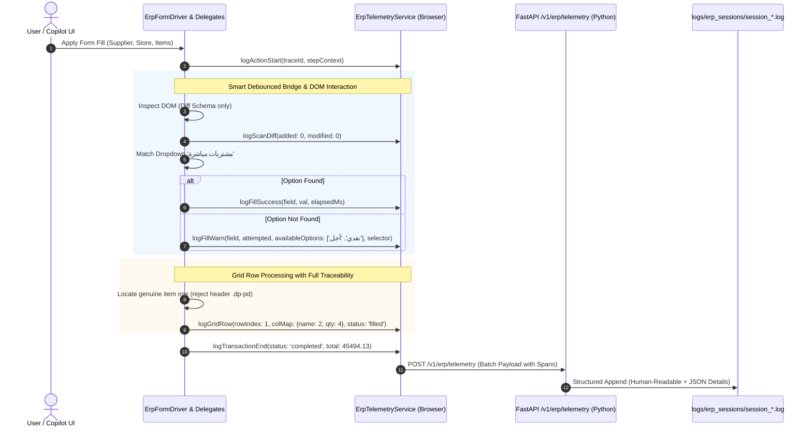

# BLUEPRINT: ERP BLACKBOX OBSERVABILITY & DIAGNOSTIC LOGGING ENGINE

**Status:** Proposed Architecture & Construction Plan  
**Target Projects:** `DynamicProLearn/learn-dynamic-pro-ui` & `EgyDynamic/LMS_CO_Pilot`  
**Anchor Case Study:** Forensic Audit of [session_session_20261105_133930_76ge.log](file:///e:/Mazen/EgyDynamic/LMS_CO_Pilot/logs/erp_sessions/session_session_20261105_133930_76ge.log)  
**Execution Standard:** Cold-Start Independent Execution (Strict DRY & YAGNI)

---

## 1. Executive Summary & Objective

In production ERP autonomous driving, session logs are our **flight data recorder (Blackbox)**. When an action succeeds or fails inside the browser DOM, the log must provide immediate, unequivocal forensic proof of:
1. Exactly what the user commanded.
2. What the AI extracted and proposed.
3. What elements and dropdown options the DOM presented at that exact millisecond.
4. Why an element was selected or rejected (matching score, column index, disabled state).
5. The full lifecycle conclusion (save/submit outcome, total balance, fallback paths).

This Blueprint establishes an end-to-end, structured observability pipeline between the Angular frontend RPA engine and the FastAPI backend session sink, completely eliminating log bloat, duplicate queries, and silent failures.

---

## 2. Forensic Audit of Target Session: `session_session_20261105_133930_76ge.log`

A deep inspection of the user's referenced session log reveals six critical deficiencies:

| Line Range | What Was Logged | Forensic Finding / Flaw | Engineering Solution |
| :--- | :--- | :--- | :--- |
| **Lines 3–5, 11–14** | `DynamicERP.getActiveScreen()` 4x and `getActiveFormContext()` 2x within 1ms | **Redundant Bridge Polling:** Repeated synchronous calls create noise and IPC overhead without state changes. | Implement micro-memoization (100ms TTL) in [erp-bridge.service.ts](file:///e:/Mazen/DynamicProLearn/learn-dynamic-pro-ui/src/app/core/services/erp-automation/erp-bridge.service.ts). |
| **Lines 7, 15, 18, 27, 28, 31, 32, 35, 36, 39** | `Collected form schema (32 fields)` dumped 10 times in full JSON (~3.5 KB each) | **Schema Scan Bloat:** ~35 KB of the 40 KB file (85%) was pure duplicate schema dumps, obscuring real actions. | Incremental Diff Scanning in [form-inspector.ts](file:///e:/Mazen/DynamicProLearn/learn-dynamic-pro-ui/src/app/core/services/erp-automation/form-driver/form-inspector.ts): log full schema on first scan, then log `+N new / -M removed` diffs only. |
| **Lines 7, 15 (Schema)** | `{"key": "undefined", "label": "اسم المنتج", ...}` | **Inspector Identifier Bug:** Attribute extraction produced string `"undefined"` when element lacked `name`/`id`. | Deterministic fallback key generator (e.g. `col_اسم_المنتج` or normalized label slug). |
| **Lines 19, 29, 33, 37** | `ng-select failed for 'مشتريات مباشرة' (not_found)` repeated 4 times (total wait ~11s) | **Blind Retry & Missing Dropdown Context:** Failed 4 times without logging which options *did* exist in the dropdown (`POSetting` vs `custom_select`). | Log available options (`foundOptions: [...]`), selector used, and enforce single-pass retry guard. |
| **Lines 40–44** | `Calculated total after filling row 1 -> 35494.13` | **Opaque Grid Actions:** Successfully filled, but did not log matched table selector, column index mapping, or add-row trigger. | Log grid topology: table selector, column mapping (`Col 2 -> اسم المنتج`, `Col 4 -> الكمية`), and row DOM state. |
| **Line 47** | `submitActiveForm() | {"result": false, "error": "submitActiveForm not supported"}` | **Abrupt Silent Halting:** Log abruptly ends on bridge unsupported error; no log of DOM Save Button fallback. | Lifecycle Guard: Log fallback attempt (`Clicking DOM [title*="حفظ"]`), verification of toast/alert, and final transaction status. |

---

## 3. Target End-to-End Architecture



---

## 4. Construction Plan — 6 Cold-Start Executable Steps

### Step 1: Telemetry Data Contract & Spans Definition
- **Files Modified:**
  - `learn-dynamic-pro-ui/src/app/core/models/erp-telemetry.models.ts`
  - `LMS_CO_Pilot/src/models/erp_models.py`
- **Objective:** Upgrade `TelemetryEventPayload` to include `traceId`, `spanId`, `durationMs`, and rich diagnostic detail objects.
- **Contract Schema:**
  ```typescript
  export interface TelemetryEventDetails {
    // Inspection & Scans
    fieldsCount?: number;
    schemaDiff?: { added: string[]; removed: string[]; count: number };
    // Field Interactions
    targetSelector?: string;
    attemptedValue?: any;
    availableOptions?: string[];
    fieldKey?: string;
    status?: 'filled' | 'not_found' | 'ambiguous' | 'skipped_disabled';
    // Grid Details
    rowIndex?: number;
    colMapping?: Record<string, number>;
    calculatedTotal?: string;
    // Bridge & Fallback
    args?: any;
    result?: any;
    error?: string;
    fallbackAttempted?: string;
  }
  ```
- **Verification:** Unit test models serializing and deserializing in both TypeScript and Python Pydantic.

---

### Step 2: Bridge Polling Debounce & Micro-Memoization
- **Files Modified:**
  - `learn-dynamic-pro-ui/src/app/core/services/erp-automation/erp-bridge.service.ts`
- **Objective:** Prevent redundant bridge calls within 100ms. If `getActiveScreen()` or `getActiveFormContext()` was called < 100ms ago, return the cached snapshot and do not emit a duplicate telemetry bridge log.
- **Implementation Rules:**
  - Fast TTL cache (100ms) for read-only queries (`getActiveScreen`, `getActiveFormContext`, `isPageBusy`).
  - Mutations (`executeAction`, `submitActiveForm`, `fillFormData`) bypass cache unconditionally.
- **Verification:** Run consecutive calls in browser console; observe exactly 1 bridge log entry instead of 4.

---

### Step 3: Schema Diff Engine & `"undefined"` Key Elimination
- **Files Modified:**
  - `learn-dynamic-pro-ui/src/app/core/services/erp-automation/form-driver/form-inspector.ts`
  - `learn-dynamic-pro-ui/src/app/core/services/erp-automation/erp-telemetry.service.ts`
- **Objective:**
  1. Fix the bug causing `"key": "undefined"` by falling back to stable deterministic keys:
     ```typescript
     const rawKey = el.getAttribute('name') || el.getAttribute('id') || el.getAttribute('formcontrolname');
     const cleanKey = (rawKey && rawKey !== 'undefined') ? rawKey : `auto_${normalizeArabicText(label || 'field')}_${index}`;
     ```
  2. Implement `logScanDiff`:
     - Compare current schema with `lastLoggedSchema`.
     - First scan: Log summary schema.
     - Subsequent scans: If unchanged, log `[SCAN] Schema stable (32 fields)` (1 line instead of 3.5 KB).
     - If changed: Log only added/removed fields.
- **Verification:** Compare session log output before and after; verify schema log payload drops by >80%.

---

### Step 4: Dropdown Forensic Diagnostic & Blind Retry Prevention
- **Files Modified:**
  - `learn-dynamic-pro-ui/src/app/core/services/erp-automation/form-driver/control-interactor.ts`
  - `learn-dynamic-pro-ui/src/app/core/services/erp-automation/erp-form-driver.service.ts`
- **Objective:** When `setNgSelect` or `setNativeSelect` fails to find an option:
  1. Read all currently rendered option labels in `.ng-dropdown-panel .ng-option` and log them in `details.availableOptions`.
  2. Log the exact selector attempted.
  3. Mark the field as `failed_unresolved` in the current pass so the driver does not repeat the same search 4 times in a loop.
- **Verification:** Intentionally trigger an invalid dropdown value (e.g. `مشتريات مباشرة` on `custom_select`); inspect log file to confirm `availableOptions: ['...', '...']` is recorded cleanly.

---

### Step 5: Grid Topology & Header Rejection Telemetry
- **Files Modified:**
  - `learn-dynamic-pro-ui/src/app/core/services/erp-automation/form-driver/grid-driver.ts`
- **Objective:**
  1. Log the grid discovery summary: table selector, identified genuine item rows count, and excluded header/filter rows count.
  2. Log column header associations: e.g. `colMap: {"اسم المنتج": 2, "الكمية": 4}`.
  3. Log each row addition event and the calculated running total.
- **Verification:** Run a 2-item purchase invoice fill; confirm grid log reflects row 1 and row 2 values with column positions.

---

### Step 6: Form Submission Fallback & Complete Lifecycle Closure
- **Files Modified:**
  - `learn-dynamic-pro-ui/src/app/core/services/erp-automation/erp-form-driver.service.ts`
  - `LMS_CO_Pilot/src/api/v1/erp.py`
- **Objective:**
  1. When `bridge.submitActiveForm()` returns `false` (unsupported), log:
     `[WARN] [BRIDGE] submitActiveForm unsupported -> Initiating DOM fallback...`
  2. Query DOM for save buttons (`button.dp-btn--save, [title*="حفظ"], [data-action="save"]`), click and log:
     `[INFO] [FILL] Triggered DOM save button click | {"selector": "button.dp-btn--save"}`
  3. Emit final session completion event:
     `[INFO] [SESSION_END] Transaction finished | {"success": true, "totalFields": 6, "gridRows": 2, "cashPaid": 45494.13}`
- **Verification:** Verify log file terminates with an explicit, structured `[SESSION_END]` summary.

---

## 5. Visual Proof: Expected Log Format After Blueprint Execution

```text
[2026-11-05T11:39:36.223Z] [INFO] [BRIDGE] [ Purchases ] DynamicERP.getActiveScreen() | {"pageId": 289, "pageName": " Purchases "}
[2026-11-05T11:39:36.224Z] [INFO] [USER_QUERY] [ Purchases ] User: "سجل فاتورة مشتريات جديدة..." | {"screenKey": "Purchases", "mode": "action"}
[2026-11-05T11:39:36.225Z] [INFO] [SCAN] [ Purchases ] Initial form schema (32 fields) [active_form] | {"fieldsCount": 32, "sample": ["SupplierID", "POSetting", "StoreID", "ProjectID"]}
[2026-11-05T11:39:39.069Z] [INFO] [AI_EXTRACT] [ Purchases ] AI extracted form proposal | {"fields": {"SupplierID": "حسين", "StoreID": "خامات تام", "ProjectID": "السحاب"}, "rows": [{"اسم المنتج": "سن", "الكمية": 10}, {"اسم المنتج": "رمل", "الكمية": 20}]}
[2026-11-05T11:39:47.616Z] [INFO] [FILL_START] [ Purchases ] Applying Form Fill (trace_id: trc_88f1)
[2026-11-05T11:39:47.672Z] [DEBUG] [SCAN] [ Purchases ] Schema verified: Unchanged (32 fields, 0 diff)
[2026-11-05T11:39:47.801Z] [WARN] [FILL] [ Purchases ] Option 'مشتريات مباشرة' not matched on 'custom_select' | {"attempted": "مشتريات مباشرة", "availableOptions": ["نقدية", "آجل"], "elapsedMs": 120}
[2026-11-05T11:39:48.104Z] [INFO] [FILL] [ Purchases ] Matched 'SupplierID' -> 'حسين' | {"optionsCount": 2, "elapsedMs": 96}
[2026-11-05T11:39:48.312Z] [INFO] [FILL] [ Purchases ] Matched 'StoreID' -> 'خامات تام' | {"optionsCount": 1, "elapsedMs": 85}
[2026-11-05T11:39:48.516Z] [INFO] [FILL] [ Purchases ] Matched 'ProjectID' -> 'السحاب' | {"optionsCount": 11, "elapsedMs": 118}
[2026-11-05T11:39:48.700Z] [INFO] [GRID] [ Purchases ] Grid Discovered | {"tableSelector": "table.dp-grid", "genuineRows": 2, "excludedHeaders": 1, "colMap": {"اسم المنتج": 2, "الكمية": 4}}
[2026-11-05T11:39:49.120Z] [INFO] [GRID] [ Purchases ] Row 1 Filled ('سن', qty: 10) | {"calculatedTotal": "35494.13"}
[2026-11-05T11:39:49.640Z] [INFO] [GRID] [ Purchases ] Row 2 Filled ('رمل', qty: 20) | {"calculatedTotal": "45494.13"}
[2026-11-05T11:39:49.700Z] [INFO] [FILL] [ Purchases ] Total (45494.13) populated to cash paid field 'POPaidCurrancy'
[2026-11-05T11:39:49.850Z] [WARN] [BRIDGE] DynamicERP.submitActiveForm() unsupported -> Trying DOM Fallback...
[2026-11-05T11:39:49.910Z] [INFO] [FILL] Clicked DOM Save Button | {"selector": "button.dp-btn--save"}
[2026-11-05T11:39:50.100Z] [INFO] [SESSION_END] [ Purchases ] Transaction completed successfully | {"success": true, "fieldsFilled": 5, "rowsFilled": 2, "total": "45494.13", "durationMs": 2484}
```

---

## 6. Implementation Checklist & Acceptance Criteria

- [ ] **Zero Duplicate Bridge Logs:** `DynamicERP.getActiveScreen()` debounced with 100ms window.
- [ ] **Log Bloat Reduced by >75%:** Full schema printed once; all subsequent scans emit lightweight diffs.
- [ ] **Zero `"key": "undefined"`:** Deterministic fallback key generator in `form-inspector.ts`.
- [ ] **Forensic Dropdown Telemetry:** All failed dropdown searches record `availableOptions` in `details`.
- [ ] **Grid Transparency:** Grid table selector, genuine row count, and column index mappings logged.
- [ ] **Complete Lifecycle:** Logs always terminate with explicit `SESSION_END` summary including total duration and success flag.
- [ ] **Cross-Stack Verification:** Angular `npm run build` and `npm run build:element` exit code 0; Python `pytest` exit code 0.
