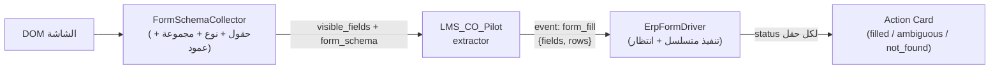

# 📐 Blueprint: Smart Actions — التعبئة المتسلسلة داخل المتصفح (المسار 2)
# Handles: Autocomplete / mat-select / Dependent fields / Grid rows

> **التاريخ:** 2026-10-07 | **الفرع:** `AI_Form_FIll`
> **الهدف:** توسيع `applyFormFill` الحالي (حقن قيم بسيط) ليتعامل مع شاشات معقدة مثل فاتورة المشتريات
> (مورد + طريقة شراء + مخزن + أصناف + كمية/تكلفة + مدفوع نقداً) **بدون** ماوس سحابي.
> **المبدأ:** DRY (نفس الشات ونفس SSE ونفس `form_fill`) + YAGNI (لا مكتبات جديدة، لا سيرفر أتمتة).

---

## 0. الوضع الحالي (مُتحقَّق منه من الكود)

| البند | الواقع في [copilot-chat.component.ts](file:///e:/Mazen/DynamicProLearn/learn-dynamic-pro-ui/src/app/shared/components/copilot-chat/copilot-chat.component.ts#L610-L707) |
|---|---|
| قراءة الحقول | `collectVisibleFormFields()` → `string[]` بأسماء فقط، يتخطى المقفول (`disabled`) |
| التعبئة | `target.value = ...` + أحداث `input/change/blur` |
| select | native `<select>` فقط |
| autocomplete / `mat-select` | **غير مدعوم** |
| جداول الأصناف | **غير مدعوم** (لا يقرأ `<th>`، لا يضيف صفوف) |
| الانتظار (async) | **لا يوجد** — كل شيء متزامن |
| ملاحظة | المحدد `#${key}` ينكسر مع معرفات تحتوي علامات اقتباس مثل `'SupplierName'` (ظهرت في JSON الشاشة الحقيقية) |

**الحكم الصريح:** النسخة الحالية تنجح في حقول نصية بسيطة (عميل جديد). **لن تنجح** في المورد/المخزن/الأصناف.

---

## 1. القرار المعماري

- ملف جديد واحد: `shared/services/erp-form-driver.ts` (يُستخرج من المكوّن المتضخم 952 سطر — Single Responsibility).
- العقد الخلفي **متوافق للخلف**: `visible_fields: string[]` يبقى كما هو، ونضيف `form_schema` و`rows` **اختياريين**.
- لا إرسال ولا حفظ تلقائي أبداً (`submit` ممنوع، وقائمة حظر لنصوص الأزرار: حفظ، ترحيل، اعتماد، حذف، Save, Post, Delete).

---

## 2. الخطوات (كل خطوة PR مستقلة)

### الخطوة 0 — استكشاف الشاشة الحقيقية (Spike — منجز جزئياً لحقل المورد)
**الوضع:** تم استخراج الـ DOM الحقيقي لحقل المورد والحقول التابعة وتوثيقه في [erp-dom-samples.md](file:///e:/Mazen/DynamicProLearn/docs/erp-dom-samples.md).
**النتائج المؤكدة بالدليل القاطع من الـ DOM:**
1. **طبيعة حقل المورد:** لا توجد نافذة منبثقة (Dialog)؛ الحقل هو مكوّن مخصص `<eg-select>` يغلّف `<ng-select appendto="body">` من مكتبة `@ng-select/ng-select` وهو Dropdown searchable typeahead في نفس الصفحة.
2. **الحقول التابعة:** الحقول الأربعة (`'SupplierName'`, `'address'`, `phone`, `TaxFile`) جميعها معطلة (`disabled=""`)، وتُملأ **تلقائياً بواسطة Angular** بمجرد اختيار المورد من الـ Dropdown. لا يحتاج الـ AI لتعبئتها إطلاقاً!
3. **الزر الجانبي:** زر "جديد" (`btn-outline-primary`) اختياري لفتح نافذة مورد جديد إن لم يكن مسجلاً.
**المتبقي من الخطوة 0:** فحص جدول الأصناف (طريقة إضافة الصف والحقول داخل الجدول).

### الخطوة 1 — Schema الحقول (v2)
- `collectFormSchema()` يرجع لكل حقل:
  `{ key, label, kind, group, rowIndex?, colHeader?, required, readonly, options? }`
  - `kind`: `text | number | date | checkbox | select | mat-select | ng-select | autocomplete | grid-cell`
  - **اكتشاف مؤكد (من DOM حقل المورد الحقيقي):** الحقل `<eg-select name="c.ColumnName">` يغلّف `<ng-select appendTo="body" typeahead>` من مكتبة `@ng-select/ng-select`. الـ `name` على العنصر الأب (وليس على `<input>` الداخلي) وقد لا يكون فريداً، والـ `<input role="combobox">` بلا `name/id` فيتخطاه `collectVisibleFormFields()` الحالي. لذلك يُجمَع الحقل من المضيف `eg-select`/`ng-select` ويُستخرج اسمه من الـ label المجاور.
  - `group`: `header | grid | footer` (حسب الـ `table` / `mat-table` / موقع الحقل).
  - للخلايا داخل جدول: اسم العمود من `<th>` أو `mat-header-cell` بالفهرس.
  - تجاهل `mat-input-N` غير المسمّاة من رأس الشاشة، واستخدام `colHeader` بدلاً منها.
  - تنظيف المحدد: استخدام `[id="..."]` + `CSS.escape` بدل `#id`.
- `collectVisibleFormFields()` الحالي يُبنى فوقه (يبقى للتوافق، لا نسخ منطق).

### الخطوة 2 — أدوات التنفيذ الأساسية (Driver Primitives)
في `erp-form-driver.ts`:
| الدالة | الآلية |
|---|---|
| `waitFor(predicate, timeoutMs)` | `MutationObserver` + مهلة (افتراضي 2000ms)، بلا `setTimeout` عشوائي |
| `setText/Number/Date` | استخدام **native value setter** للـ prototype ثم `input` + `change` (أوثق مع Angular) |
| `setCheckbox` | `click()` فقط إذا اختلفت الحالة |
| `setNativeSelect` | الموجود حالياً (مطابقة مرنة) |
| `setMatSelect` | click على `mat-select` ← `waitFor(.mat-option / .mat-mdc-option)` ← مطابقة بالنص ← click |
| `setNgSelect` | focus على `input[role=combobox]` الداخلي ← native setter + حدث `input` (يطلق typeahead) ← `waitFor(ng-dropdown-panel .ng-option)` في `body` (لأن `appendTo="body"`) ← اختيار أفضل تطابق بنص `.ng-option-label` ← click؛ والتحقق بقراءة `.ng-value-label` بعد الاختيار |
| `setAutocomplete` | focus ← كتابة النص ← `input` ← `waitFor(الخيارات)` ← اختيار أفضل تطابق ← click |
- **قاعدة الغموض:** إن وُجد أكثر من تطابق قوي أو لا يوجد → **لا نختار**؛ نرجع `ambiguous` مع أول 5 اقتراحات ليختار المستخدم (لا نخمّن مورداً مالياً).

### الخطوة 3 — الحقول المترتبة (Dependent Fields)
- تنفيذ **متسلسل بالترتيب**: `header` ثم `grid` ثم `footer`، وبداخل المجموعة حسب ترتيب DOM.
- بعد كل حقل select/autocomplete: انتظار استقرار التبعيات (`waitFor` أن تتغير قيم الحقول المقفولة التابعة أو تهدأ الـ mutations 150ms).
- **حقول ممنوعة التعبئة:** المقفولة/readonly (`disabled=""`)، والمحسوبة (إجمالي، قيمة ضريبة...) — يتركها الـ ERP يحسبها.
- **تأكيد عملي (حالة المورد):** ثبت من فحص DOM الشاشة الحقيقية أن حقول المورد الأربعة (`'SupplierName'`, `'address'`, `phone`, `TaxFile`) هي حقول `disabled=""`، وتُملأ بالكامل وفورياً عبر Angular Data Binding بمجرد اختيار المورد من `eg-select`. هذه الحقول تُستثنى تماماً من قائمة الحقول المطلوب تعبئتها بواسطة الـ AI، مما يضمن عدم تضارب البيانات.

### الخطوة 4 — صفوف الجدول (Grid Rows)
- عقد جديد: `form_fill.rows: [{ "الصنف": "...", "الكمية": 100, "التكلفة": 50 }]`
- المنفّذ: لكل صف → إيجاد أول صف فارغ أو الضغط على زر الإضافة (مطابقة نص `إضافة|Add|+` ضمن الجدول **فقط**، وبعد فحص قائمة الحظر) → `waitFor` ظهور الصف → تعبئة الخلايا بالمطابقة على `colHeader`.
- حقل الصنف غالباً autocomplete ← نفس قاعدة الغموض.

### الخطوة 5 — الباك إند (LMS_CO_Pilot)
- [search_models.py](file:///e:/Mazen/EgyDynamic/LMS_CO_Pilot/src/models/search_models.py): حقل اختياري `form_schema: list[dict] | None` (غير كاسر).
- `_extract_form_fields_if_needed` في [search_service.py](file:///e:/Mazen/EgyDynamic/LMS_CO_Pilot/src/services/search_service.py): يستقبل schema، ويرجع `{fields:{}, rows:[]}`؛ `temperature=0`، **قيم حرفية من كلام المستخدم** (اسم مورد/صنف كما كُتب، لا اختراع أكواد).
- تحديث الـ system prompt: الرد ينص على أن المورد/الصنف سيُطابَق من داخل الشاشة.
- ⚠️ نسخة Docker: بعد التعديل يلزم `docker cp` + restart (أو rebuild للصورة) — تعلمناه سابقاً.

### الخطوة 6 — (مشروطة) Adapter لشاشة بنافذة اختيار (Dialog Adapter)
- **ملاحظة سارة:** حقل المورد تبين أنه `ng-select` داخلي وليس Dialog، لذا **تم توفير جهد بناء Adapter للموردين**.
- تبقى هذه الخطوة مشروطة فقط إذا أثبت فحص جدول الأصناف لاحقاً أن اختيار الصنف يفتح Dialog خارجي بجدول. إن كان الصنف أيضاً `ng-select` فسيتم إسقاط هذه الخطوة نهائياً (YAGNI).

### الخطوة 7 — تقرير النتيجة في الـ UI
- Action Card تعرض لكل حقل: ✅ تمت / ⚠️ غامض (اختر من الاقتراحات) / ❌ لم يُعثر عليه.
- زر "إعادة المحاولة للحقول الفاشلة" فقط.

### الخطوة 8 — الاختبار والتسليم
- اختبارات وحدة بـ DOM وهمي (fixtures مأخوذة من الخطوة 0): autocomplete، mat-select، صف جدول، غموض.
- سيناريو قبول يدوي على شاشة الفاتورة:
  > «فاتورة مشتريات من شركة الأمل، مخزن القاهرة، شراء آجل/نقدي، صنف كابلات كمية 100 تكلفة 50، مدفوع نقداً 2000»
  النتيجة المتوقعة: كل الحقول معبأة أو موسومة غامضة بوضوح، والإجماليات يحسبها الـ ERP، ولا حفظ تلقائي.
- إعادة بناء `lms-copilot.bundle.js` (`npm run build:element`) وفحص `ng build`.

---

## 3. الجدول الزمني والاعتماديات

| # | الخطوة | يعتمد على | تقدير |
|---|---|---|---|
| 0 | Spike DOM | — | 0.5 يوم (منك + مني) |
| 1 | Schema v2 | 0 | 1 يوم |
| 2 | Primitives | 0 | 1.5 يوم |
| 3 | Dependent | 2 | 0.5 يوم |
| 4 | Grid rows | 1, 2 | 1.5 يوم |
| 5 | Backend | 1 | 1 يوم (يتوازى مع 2) |
| 6 | Adapter (مشروط) | 0 | 1 يوم |
| 7 | UI تقرير | 3, 4 | 0.5 يوم |
| 8 | اختبار وتسليم | الكل | 1 يوم |

التقديرات تقريبية؛ تُراجع بعد الخطوة 0.

---

## 4. المخاطر الصريحة (Adversarial Review)

| الخطر | الأثر | التخفيف |
|---|---|---|
| Autocomplete يعتمد على استدعاء API بتأخير | قد يفشل الانتظار | `waitFor` بمهلة + حالة `not_found` بدل خطأ صامت |
| جدول افتراضي (virtual scroll / ag-grid) لا يعرض كل الصفوف في DOM | صفوف لا تُرى | الاكتفاء بالصفوف المرئية + إضافة صف جديد؛ تقييم حالة ag-grid في الخطوة 0 |
| تغيّر إصدار Angular Material (أسماء الكلاسات `mat-option` vs `mat-mdc-option`) | كسر المحددات | دعم الاثنين + اختبار على الشاشة الحقيقية |
| تضارب مع حسابات الـ ERP | أرقام خاطئة | ممنوع تعبئة المحسوب/المقفول |
| اختيار مورد/صنف خاطئ | خطأ مالي | قاعدة الغموض: لا اختيار عند الشك، والمستخدم هو من يحفظ |
| ERP داخل `iframe` أو Shadow DOM | الشات لا يصل للحقول | يُكتشف في الخطوة 0 |

**حد صريح للمسار 2:** إن كانت شاشات كثيرة بلا DOM قياسي (Canvas، Desktop، iframe مختلف الأصل) فالمسار 2 لن يكفيها، وهنا فقط يُبرَّر مسار الماوس/الكيبورد.

---

## 5. التراجع (Rollback)
كل خطوة PR مستقلة خلف نفس الواجهة؛ التراجع = إلغاء الـ PR. الحقول الجديدة بالباك إند اختيارية فلا يتأثر العملاء القدامى.
