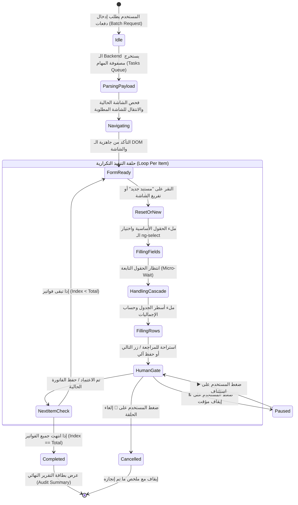

# 🏗️ BLUEPRINT: Autonomous ERP UI Stepper Loop (حلقة الإدخال والتنقل التكراري الآمن)

> **Document Version:** 1.0.0  
> **Target Branch:** `feature/erp-ui-stepper-loop`  
> **Status:** APPROVED FOR EXECUTION  
> **Methodology:** Strict DRY + Strict YAGNI + Cold-Start Execution  

---

## 1. Objective & Business Value (الهدف والقيمة التشغيلية)

تمكين مساعد الذكاء الاصطناعي (`LMS Co-Pilot`) من التحرك ذاتياً من أي مكان في النظام (مثل الصفحة الرئيسية أو أي شاشة أخرى)، والانتقال إلى الشاشة المطلوبة، ثم تنفيذ **عمليات متتابعة تكرارية (Batch UI Stepper)** مثل إدخال 5 أو 10 فواتير مشتريات/مبيعات متتالية خطوة بخطوة، مع مراقبة المستخدم وتوفير تحكم كامل (إيقاف مؤقت / استئناف / إلغاء / تخطي) لضمان السلامة المالية والمحاسبية.

---

## 2. Architectural Blueprint & State Machine (المعمارية ودورة الحياة)

---

## 3. Core Principles & Guardrails (المبادئ الحاكمة وضوابط الأمان)

1. **Strict DRY (لا تكرار للكود):**
   - إعادة استخدام `ErpFormDriverService` بالكامل لكل فاتورة منفردة. لا يتم كتابة أي كود جديد للتعامل مع الـ DOM أو الـ `ng-select` أو الـ `grid rows`؛ بل يتم استدعاء الدوال القائمة (`setNgSelect`, `fillGridRows`, `readCalculatedTotal`).
2. **Strict YAGNI (البساطة والواقعية):**
   - لا حاجة لـ Headless Puppeteer أو خوادم سيرفرات ثقيلة تحاكي المتصفح. كل شيء ينفذ في المتصفح الفعلي للعميل عبر `CustomEvent` و DOM native dispatchers.
3. **Safety & Human Oversight (الرقابة البشرية):**
   - منع الحفظ النهائي العشوائي الصامت: يتم توفير نمطين:
     - **Guided Mode (موصى به):** يملأ الفاتورة 1 وينتظر نقرة سريعة على زر `حفظ والتالي` من المستخدم.
     - **Turbo Autonomous Mode:** يملأ ويحفظ تلقائياً مع إتاحة زر ⏸️ للإيقاف اللحظي في أي أجزاء من الثانية.

---

## 4. Cold-Start Execution Phases (مراحل التنفيذ المستقلة)

---

### 🔹 الخطوة 1: تحديث عقد الـ Backend لدعم الدفعات (`LMS_CO_Pilot`)
**Context Brief (سياق مستقل لأي Agent):**
- **الملفات المعنية:**
  - `src/models/search_models.py`
  - `src/services/search_service.py`
  - `src/core/prompts.py`
- **المطلوب:**
  1. دعم حقل `batch_items: list[dict] | None` في الـ `form_fill` SSE event.
  2. عندما يطلب المستخدم: *"سجل 3 فواتير..."*، يستخرج الموديل مصفوفة `batch_items` تحتوي كل منها على `{ "fields": {...}, "rows": [...] }` مع كود الشاشة المستهدفة `target_screen: "PURCHASE_INVOICE"`.
  3. الحفاظ على التوافق الرجعي 100% مع الفاتورة الفردية (`fields`, `rows`).
- **معيار القبول (Verification):**
  - تشغيل اختبار عبر curl / python للتأكد من إرجاع SSE بحدث `form_fill` يحتوي على `batch_items` بطول 3 عند إرسال طلب متعدد.

---

### 🔹 الخطوة 2: بناء محرك التنقل الآلي (`ErpNavigatorService`)
**Context Brief (سياق مستقل لأي Agent):**
- **الملفات المعنية:**
  - `learn-dynamic-pro-ui/src/app/core/services/erp-navigator.service.ts` (جديد)
  - `learn-dynamic-pro-ui/src/app/core/models/erp-form.models.ts`
- **المطلوب:**
  1. خدمة خفيفة ومحددة المسؤولية مسؤولة عن التنقل بين شاشات الـ ERP:
     - فحص ما إذا كان المستخدم حالياً داخل الشاشة المستهدفة عبر فحص الـ DOM الحالي (وجود الكومبوننت أو التاج الخاص بها مثل `app-extraction-supplier` أو عنوان الشاشة).
     - إذا لم يكن في الشاشة: البحث عن كارت الوحدة المناسبة والنقر عليها (`dp-mods__card` أو روابط التبويب `dp-hdr__tabs` أو التوجيه بـ Angular Router إن وُجد).
     - دالة `waitForScreenReady(screenKey: string, timeoutMs: number): Promise<boolean>`.
- **معيار القبول (Verification):**
  - استدعاء `navigator.navigateToScreen('PURCHASE_INVOICE')` من الشاشة الرئيسية ينقل المتصفح تلقائياً ويؤكد جاهزية الشاشة بنجاح.

---

### 🔹 الخطوة 3: محرك الـ Stepper التكراري في الواجهة (`ErpBatchStepperService`)
**Context Brief (سياق مستقل لأي Agent):**
- **الملفات المعنية:**
  - `learn-dynamic-pro-ui/src/app/core/services/erp-batch-stepper.service.ts` (جديد)
  - `learn-dynamic-pro-ui/src/app/core/services/erp-form-driver.service.ts`
- **المطلوب:**
  1. إدارة حالة الـ Loop عبر Signals أو RxJS:
     - `currentStep`: رقم الفاتورة الحالية (مثلاً: 2).
     - `totalSteps`: إجمالي الفواتير (مثلاً: 10).
     - `status`: `idle` | `running` | `paused` | `completed` | `cancelled`.
     - `itemsSummary`: مصفوفة تقرير بكل فاتورة وحالتها (نجاح / استثناء).
  2. دوال التحكم: `startBatch()`, `pauseBatch()`, `resumeBatch()`, `cancelBatch()`, `skipCurrent()`.
  3. تنفيذ حلقة `for (const item of items)` مع النقر على زر "إضافة جديد" بين كل فاتورة والأخرى.
- **معيار القبول (Verification):**
  - تمرير مصفوفة من 3 فواتير تجريبية يملأها المحرك بالتتابع 1 تلو الأخرى مع تحديث العداد.

---

### 🔹 الخطوة 4: واجهة شريط التقدم والتحكم في الشات (`CopilotChatComponent`)
**Context Brief (سياق مستقل لأي Agent):**
- **الملفات المعنية:**
  - `learn-dynamic-pro-ui/src/app/shared/components/copilot-chat/copilot-chat.component.html`
  - `learn-dynamic-pro-ui/src/app/shared/components/copilot-chat/copilot-chat.component.css`
  - `learn-dynamic-pro-ui/src/app/shared/components/copilot-chat/copilot-chat.component.ts`
- **المطلوب:**
  1. تصميم كارت تفاعلي لحلقة العمليات (`Batch Stepper Card`):
     - شريط تقدم مرئي: `[██████░░░░] 6 / 10`.
     - أزرار التحكم اللحظية:
       - زر **⏸️ إيقاف مؤقت** / **▶️ متابعة**.
       - زر **⏭️ تخطي الفاتورة الحالية**.
       - زر **🛑 إلغاء الحلقة بالكامل**.
     - خيار تبديل: `☑️ التبديل الآلي الفوري` أو `الانتقال بعد التأكيد اليدوي`.
  2. بطاقة الملخص النهائي (Audit Summary Card):
     - جدول صغير يوضح: الفاتورة 1 (تم - التوحيد)، الفاتورة 2 (تم - الحمد)، الفاتورة 3 (تم - النور).
- **معيار القبول (Verification):**
  - ظهور الكارت فور إرسال أمر متعدد، وتفاعل شريط التقدم مع كل عملية ملء بنجاح.

---

### 🔹 الخطوة 5: إضافة سيناريو الفواتير المتعددة في الـ Mock وإعادة تجميع الـ Bundle
**Context Brief (سياق مستقل لأي Agent):**
- **الملفات المعنية:**
  - `learn-dynamic-pro-ui/src/app/features/erp-mock/erp-mock.component.ts`
  - `learn-dynamic-pro-ui/public/lms-copilot.bundle.js`
- **المطلوب:**
  1. تزويد محاكي الـ ERP بزر `فاتورة جديدة (تفريغ)` لمحاكاة الانتقال الحقيقي.
  2. إضافة زر وسيناريو تجربة سريع في لوحة الأوامر:
     *"سجل لي دفعة من 3 فواتير مشتريات: الأولى من التوحيد 10 كابلات، الثانية من الحمد 5 رواتر، الثالثة من النور 2 سويتشات"*.
  3. تشغيل `npm run build:element` لتحديث الحزمة الموحدة للـ Web Component.
- **معيار القبول (Verification):**
  - فحص كامل على `http://localhost:4200/erp-mock` وتنفيذ الدفعة بنجاح بدون أخطاء console.

---

## 5. Rollback & Fault Tolerance Strategy (خطة الطوارئ واستعادة الحالة)

1. **التعامل مع انقطاع أو بطء الاستجابة:**
   - إذا تأخر تحميل الحقول التابعة عن 3 ثوانٍ، يتم إيقاف الـ Loop مؤقتاً تلقائياً وإخطار المستخدم: *"حقل المورد تأخر في تحميل البيانات، هل تود المتابعة أو إعادة المحاولة؟"*
2. **استقلالية المعاملات (Transaction Isolation):**
   - فشل فاتورة واحدة في الدفعة (مثلاً صنف غير متوفر) لا يوقف باقي الفواتير؛ بل يتم تسجيلها كـ `Skipped / Failed` في التقرير مع استكمال باقي الدفعة.
3. **Rollback:**
   - بما أن كل خطوة تتم في الـ UI، فإذا تم الإلغاء في أي وقت، تظل الفواتير السابقة المحفوظة كما هي دون المساس بها، مع إيقاف أي عمليات جديدة.
