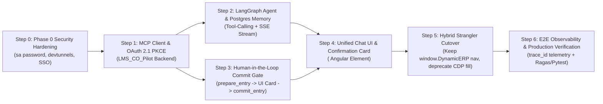

# Blueprint: Unified ERP AI Chat & Dynamic Pro MCP Integration (`Option B-Lite`)

> **Target Deliverable:** Turn the embedded `<lms-ai-copilot>` Angular Element (`DynamicProLearn`) + `LMS_CO_Pilot` (`FastAPI` / `LangGraph`) into a Claude/GPT-grade AI Chat inside Dynamic Pro ERP, connected to Dynamic Pro's `.NET 9` Streamable HTTP MCP Server (`21` client tools) with per-user OAuth 2.1 + PKCE isolation and human-in-the-loop `commit_entry` confirmation.
>
> **Strategy:** `Option B-Lite` — reuse existing UI, SSE streaming, JWT/tenant context, `PostgresSaver`, Hybrid RAG, and JSONL telemetry (`trace_id`), while replacing fragile DOM/CDP form filling with official MCP Streamable HTTP tools.

---

## 1. Architecture & Step Dependency Graph



### Parallelism Map
* **Sequential Gate:** `Step 0` (Security) must be completed before exposing any production/staging environment.
* **Backend Core:** `Step 1` -> `Step 2` and `Step 3` can be developed in parallel once `Step 1`'s MCP client session factory is merged.
* **Frontend & Cutover:** `Step 4` integrates `Step 2` (SSE stream) and `Step 3` (commit endpoint), followed by `Step 5` and `Step 6`.

---

## 2. Global Guardrails (DRY, YAGNI & Security)

1. **Never expose `commit_entry` or `commit_report_designer` to the LLM:** The LLM may only call `prepare_entry` / `prepare_report_designer`, which returns a `draftId` (15-min TTL) with server-calculated taxes and totals. Actual commits happen **only** when the user clicks **"تأكيد الحفظ"** in `<lms-ai-copilot>`, calling a direct FastAPI endpoint.
2. **Reuse existing infrastructure (DRY):**
   * Keep `src/services/shared_infrastructure/auth_service.py` (`UserContext`, `get_current_user`) for ERP/LMS user identity.
   * Keep `src/services/erp_copilot/agentic_stepper/session_telemetry.py` (`append_session_event`, `trace_id`) and `erp-telemetry.service.ts` for observability.
   * Keep `sse-starlette` (`EventSourceResponse`) and `slowapi` (`limiter`) patterns from `src/api/v1/erp.py`.
   * Keep `window.DynamicERP` (`erp-bridge.service.ts`, contract `v2.5.0`) for **screen navigation only**; do not build a new navigation bridge.
3. **Relative API Paths:** All Angular frontend calls must use relative `/api/...` paths (never hardcoded `localhost` or `*.devtunnels.ms`).
4. **No Over-Engineering (YAGNI):** Build a clean 2–3 node LangGraph `StateGraph` (`agent` <-> `tools`) with `PostgresSaver`. Do not build a custom multi-agent framework or custom JSON-RPC HTTP transport; use the official `mcp` and `langchain-mcp-adapters` packages.

---

## Step 0: Phase 0 Security Hardening (Pre-Integration Gate)

### Cold-Start Context Brief
* **Why:** Security audit flagged three critical exposures that must be closed before connecting live ERP tenant data to any AI agent: plain-text `sa` password in Docker config, external `*.devtunnels.ms` script loading in ERP frontend, and plaintext `u`/`p` credentials passed in browser query params (`erp-redirect.component.ts`).
* **Affected Repos & Files:**
  * `e:\Mazen\DynamicProLearn\deployment\docker-compose.yml`
  * `e:\Mazen\DynamicProLearn\learn-dynamic-pro-ui\src\app\features\auth\erp-redirect\erp-redirect.component.ts`
  * ERP Host Repo (`FrontEnd/src/index.html` and `LMSController.cs` — coordinate with ERP team)
* **Tasks:**
  1. Rotate the SQL Server `sa` password, remove plain-text secrets from `docker-compose.yml`, and load via `.env` / secret manager (`.gitignore` verified).
  2. Remove all `*.devtunnels.ms` `<script>` references from ERP `FrontEnd/src/index.html` and serve `<lms-ai-copilot>` bundle from local static assets or internal CDN.
  3. Replace `u`/`p` query params in `LMSController.cs` + `erp-redirect.component.ts` with a short-lived signed SSO token or OAuth 2.1 authorization code.
* **Rollback:** Revert `erp-redirect.component.ts` only on isolated local dev; never restore plain-text `sa` password or `devtunnels.ms` in shared branches.
* **Verification:**
  ```powershell
  Select-String -Path "e:\Mazen\DynamicProLearn\deployment\docker-compose.yml" -Pattern "SA_PASSWORD|sa"
  Select-String -Path "e:\Mazen\DynamicProLearn\learn-dynamic-pro-ui\src\**\*.ts" -Pattern "devtunnels\.ms"
  ```

---

## Step 1: MCP Streamable HTTP Client & Per-User OAuth 2.1 PKCE Store (`LMS_CO_Pilot`)

### Cold-Start Context Brief
* **Why:** Dynamic Pro's `.NET 9` MCP Server (`ModelContextProtocol.AspNetCore 2.3.1`) uses stateless **Streamable HTTP** at tenant-isolated URLs (`/c/<code>/mcp`) with **OAuth 2.1 + PKCE (S256)** (`8h` access token, `30d` refresh token). `LMS_CO_Pilot` already has `httpx>=0.28.1`, `psycopg[binary,pool]>=3.2.1`, and `UserContext` (`auth_service.py`), but lacks `mcp` and per-user OAuth token storage.
* **Files to Modify / Create (`e:\Mazen\EgyDynamic\LMS_CO_Pilot`):**
  * Modify `pyproject.toml`: add `mcp` and `langchain-mcp-adapters`.
  * Modify `src/core/config.py`: add `MCP_BASE_URL`, `MCP_OAUTH_CLIENT_ID`, `MCP_OAUTH_REDIRECT_URI`, `MCP_TOKEN_ENCRYPTION_KEY` (loaded from env).
  * Create `src/services/erp_copilot/mcp/oauth_store.py`: encrypted PostgreSQL token store keyed by `(tenant_id, user_id)` with automatic refresh-token rotation and PKCE `code_verifier` state cache.
  * Create `src/services/erp_copilot/mcp/client_factory.py`: builds a per-request `streamablehttp_client` session injecting `Authorization: Bearer <user_access_token>` and tenant URL `/c/{tenant_code}/mcp`, filtering out commit tools (`commit_entry`, `commit_report_designer`) from LLM tool lists.
  * Create `src/api/v1/mcp_oauth.py` (and register in `src/api/v1/router.py`): `GET /v1/erp/mcp/oauth/start`, `GET /v1/erp/mcp/oauth/callback`, `GET /v1/erp/mcp/oauth/status`.
* **DRY Note:** Reuse `UserContext = Depends(get_current_user)` from `src/services/shared_infrastructure` and existing Postgres pool patterns from `psycopg`.
* **Rollback:** Remove `mcp_oauth` router registration from `src/api/v1/router.py`.
* **Verification:**
  ```powershell
  cd e:\Mazen\EgyDynamic\LMS_CO_Pilot
  pytest tests/unit/test_mcp_oauth_store.py tests/unit/test_mcp_client_factory.py -v
  ```

---

## Step 2: LangGraph Tool-Calling Agent & Unified SSE Chat Endpoint (`LMS_CO_Pilot`)

### Cold-Start Context Brief
* **Why:** `pyproject.toml` already includes `langgraph>=0.2.14`, `langgraph-checkpoint-postgres>=2.0.0`, `langchain-google-genai>=4.3.7`, and `sse-starlette>=3.4.6`. Existing `StepperEngine` (`src/services/erp_copilot/agentic_stepper/stepper_engine.py`) is a custom `while` loop coupled to CDP/DOM. Instead of rewriting `StepperEngine`, create a clean LangGraph `StateGraph` alongside it that streams unified chat tokens, tool-call progress, and RAG citations over SSE.
* **Files to Modify / Create (`e:\Mazen\EgyDynamic\LMS_CO_Pilot`):**
  * Create `src/services/erp_copilot/mcp/chat_graph.py`:
    * `StateGraph` with nodes `agent` (bound to `Gemini 2.5 Flash-Lite` as primary low-cost router/caller, configurable via `config.py`) and `tools` (`ToolNode` wrapping MCP read/search/describe/prepare tools + existing Qdrant Hybrid RAG tool).
    * `PostgresSaver` checkpointer keyed by `thread_id = f"{tenant_id}:{user_id}:{session_id}"` for multi-turn conversation memory.
    * Enforces max tool-call budget per turn (protecting Dynamic Pro's `150 calls / 10 min` limit).
  * Modify `src/api/v1/erp.py`: add `POST /v1/erp/chat/stream` returning `EventSourceResponse` with typed SSE events (`token`, `tool_start`, `tool_end`, `draft_ready`, `nav_action`, `error`, `done`) and logging `trace_id` via `append_session_event`.
  * Create `src/models/mcp_chat_models.py`: Pydantic request/response contracts (`McpChatRequest`, `DraftPreviewPayload`).
* **Rollback:** Keep existing `/v1/erp/navigation/resolve` untouched; disable `/v1/erp/chat/stream` feature flag if needed.
* **Verification:**
  ```powershell
  cd e:\Mazen\EgyDynamic\LMS_CO_Pilot
  pytest tests/unit/test_mcp_chat_graph.py tests/unit/test_erp_endpoints.py -v
  ```

---

## Step 3: Human-in-the-Loop `commit_entry` Gate (`LMS_CO_Pilot`)

### Cold-Start Context Brief
* **Why:** Prompt injection or LLM hallucination must **never** persist accounting/inventory records. Dynamic Pro MCP provides `prepare_entry` (computes taxes/totals server-side, returns `draftId` with 15-min TTL) and `commit_entry(draftId)`.
* **Files to Modify / Create (`e:\Mazen\EgyDynamic\LMS_CO_Pilot`):**
  * Modify `src/services/erp_copilot/mcp/client_factory.py`: hard-block `commit_entry` and `commit_report_designer` from `get_llm_tools()`.
  * Create `src/services/erp_copilot/mcp/commit_service.py`: validates `draftId` ownership against `(tenant_id, user_id)` (preventing cross-user draft replay), invokes MCP `commit_entry` or `commit_report_designer` directly using the user's OAuth token, and logs outcome via `append_session_event` (`trace_id`).
  * Modify `src/api/v1/erp.py`: add `POST /v1/erp/mcp/commit` (`Depends(get_current_user)`, `@limiter.limit("30/minute")`).
* **Rollback:** Disable `POST /v1/erp/mcp/commit` endpoint.
* **Verification:**
  ```powershell
  cd e:\Mazen\EgyDynamic\LMS_CO_Pilot
  pytest tests/unit/test_mcp_commit_gate.py -v
  ```
  *(Must assert `commit_entry` is absent from LLM tool definitions and cross-user `draftId` returns `403 Forbidden`.)*

---

## Step 4: Unified Chat UI, OAuth Prompt & Draft Confirmation Card (`DynamicProLearn`)

### Cold-Start Context Brief
* **Why:** `<lms-ai-copilot>` inside `DynamicProLearn` (`learn-dynamic-pro-ui`) already embeds into the ERP and communicates via `erp-bridge.service.ts` and `erp-telemetry.service.ts`. We add SSE consumption for `/api/v1/erp/chat/stream`, an OAuth connect banner when `status === "unauthenticated"`, and a structured **Confirmation Card** for `draft_ready` events.
* **Files to Modify / Create (`e:\Mazen\DynamicProLearn\learn-dynamic-pro-ui`):**
  * Create `src/app/core/services/erp-automation/mcp-chat.service.ts`: connects to relative `/api/v1/erp/chat/stream`, `/api/v1/erp/mcp/commit`, and `/api/v1/erp/mcp/oauth/status`; forwards telemetry events via existing `ErpTelemetryService` (`erp-telemetry.service.ts`).
  * Create `src/app/shared/components/mcp-draft-card/` (standalone component): displays server-calculated line items, taxes, totals, 15-min TTL countdown, and explicit **"تأكيد الحفظ"** / **"إلغاء"** buttons.
  * Update the `<lms-ai-copilot>` chat container component to render streaming markdown, tool-activity chips, OAuth connect button, and `<app-mcp-draft-card>`.
* **Rollback:** Feature-flag toggle (`useMcpChat`) in `<lms-ai-copilot>` falls back to existing navigation-only chat mode.
* **Verification:**
  ```powershell
  cd e:\Mazen\DynamicProLearn\learn-dynamic-pro-ui
  npx tsc -p tsconfig.spec.json --noEmit
  npm run build
  ```

---

## Step 5: Hybrid Strangler Cutover (Deprecate CDP Form Filling, Keep Navigation)

### Cold-Start Context Brief
* **Why:** MCP handles data queries (`read_page`, `summarize_page`), reports (`run_report`), and transactional entries (`prepare_entry` + `commit_entry`) 10x faster and more reliably than CDP DOM injection (`src/services/erp_copilot/cdp/`). However, MCP cannot navigate the user's open browser tab.
* **Files to Modify (`e:\Mazen\EgyDynamic\LMS_CO_Pilot`):**
  * Modify `src/services/erp_copilot/mcp/chat_graph.py`: add a lightweight `navigate_erp_screen` tool that emits a `nav_action` SSE event (reusing existing `erp_service.resolve_navigation` / `forms_catalog_service` for screen IDs), which `<lms-ai-copilot>` executes via `window.DynamicERP` (`erp-bridge.service.ts`).
  * Mark `src/services/erp_copilot/cdp/*` and legacy DOM form-fill branches in `stepper_engine.py` as deprecated (freeze new features; schedule deletion after 100% screen parity in MCP).
* **Rollback:** Re-enable legacy stepper route if a specific legacy screen lacks MCP `describe_entry` coverage.
* **Verification:**
  ```powershell
  cd e:\Mazen\EgyDynamic\LMS_CO_Pilot
  pytest tests/unit/test_session_telemetry_hierarchical.py tests/unit/test_agentic_stepper_modular_facade.py tests/unit/test_erp_endpoints.py -v
  ```

---

## Step 6: E2E Observability, Rate-Limit Guard & Production Smoke Test

### Cold-Start Context Brief
* **Why:** Dynamic Pro MCP enforces `150 calls / 10 min`, `200 rows / read_page`, `20k rows / summarize_page`, and `300 rows / add`. We must verify telemetry continuity (`trace_id` from Angular -> FastAPI -> MCP) and graceful handling of `429` / expired `draftId` (`15 min`) / expired OAuth tokens (`8h`).
* **Tasks:**
  1. Add integration smoke test verifying `find_pages` -> `describe_page` -> `read_page` -> `prepare_entry` -> UI `POST /v1/erp/mcp/commit` against Dynamic Pro staging MCP with two separate user tokens (verifying row/permission isolation).
  2. Verify `logs/erp_sessions/session_*.jsonl` records `trace_id`, tool names, latency, and **zero** leaked OAuth tokens or PII.
  3. Confirm `ng build` passes with zero errors and no `devtunnels.ms` or hardcoded secrets remain in build artifacts.
* **Verification:**
  ```powershell
  cd e:\Mazen\EgyDynamic\LMS_CO_Pilot
  pytest tests/unit/ -v
  cd e:\Mazen\DynamicProLearn\learn-dynamic-pro-ui
  npm run build
  ```
