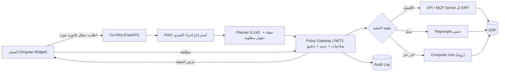
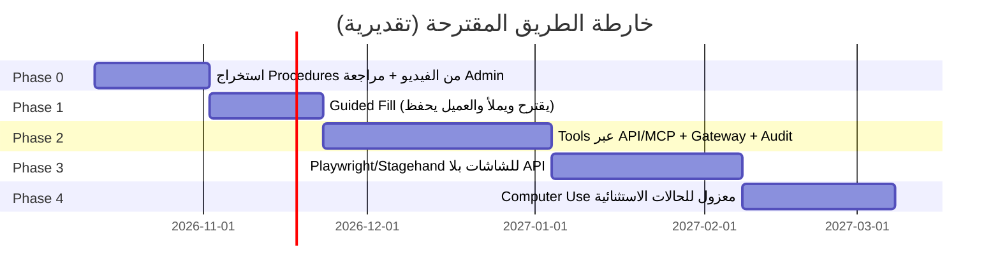

# 🤖 من "مساعد يشرح" إلى "مساعد ينفّذ" — خيارات تنفيذ مهام الـ ERP بالـ AI

> **التاريخ:** 6-10-2026 | **النطاق:** تطوير الـ LMS Co-Pilot الحالي (RAG على فيديوهات الشرح) ليصبح Agent ينفّذ إدخالات ومهام داخل الـ ERP نيابةً عن العميل.
> **ملاحظة منهجية:** المعلومات مجمّعة من بحث ويب بتاريخ اليوم. الأسعار والأرقام **تقريبية** ولازم تتراجع مع المزوّد قبل أي قرار شراء. التقديرات الهندسية (أسابيع/تكلفة) تقديرات مني وليست أرقامًا منشورة.
> **افتراض مهم:** لم أجد في الـ README اسم الـ ERP المستهدف. الاختيار الأمثل يعتمد عليه (القسم 9 فيه الأسئلة الحاسمة).

---

## 1. الخلاصة التنفيذية (TL;DR)

| السؤال | الإجابة المختصرة |
|---|---|
| هل نبني من الصفر؟ | **لا.** لا تبني محرك Agent ولا نموذج. تبني فقط **طبقة الربط والحوكمة** فوق مكونات جاهزة. |
| أفضل مسار تقني عام في 2026 | هرم ثابت: **(1) API/MCP أولًا ← (2) أتمتة متصفح حتمية Playwright ← (3) Computer Use بالرؤية كحل أخير**. |
| أنسب مسار لنا | **مسار هجين تدريجي:** تبدأ بـ "Copilot يقترح ويملأ النموذج والعميل يضغط حفظ"، ثم Tools عبر API/MCP للعمليات الآمنة، ثم Computer Use للشاشات بلا API. |
| أسهل حل | Agent يملأ الحقول في المتصفح (Browser Agent) بموافقة العميل. |
| أصعب حل | Agent مستقل بالكامل بدون API على Desktop قديم. |
| الأكثر أمانًا | API/MCP + صلاحيات المستخدم نفسه + موافقة بشرية للعمليات الحرجة. |
| الأرخص تشغيلًا | API tool calling (تكلفة tokens ضئيلة، بلا screenshots). |
| الأغلى تشغيلًا | Computer Use (screenshot لكل خطوة) أو منصات جاهزة بترخيص لكل مستخدم. |
| ماذا نستفيد مما بنيناه؟ | الـ RAG (يعرف *كيف* تُنفَّذ المهمة من الفيديوهات)، الـ service JWT، الـ SSE streaming، الـ widget، الـ webhooks، الـ Qdrant. كلها تُعاد استخدامها كما هي. |

---

## 2. ما الذي بنيناه ويُعاد استخدامه (DRY)

| الأصل الحالي | يتحوّل إلى دور |
|---|---|
| RAG على فيديوهات الشرح (Qdrant + BGE-M3 + BM25 + Gemini) | **"ذاكرة الإجراءات"**: الـ Agent يسترجع خطوات المهمة من الفيديو قبل التنفيذ (Procedural Grounding). |
| timestamps/citations | **قابلية التتبّع**: "نفّذت الخطوة 3 لأنها مذكورة في فيديو X د:ث". |
| `GenerateServiceCallToken` (JWT قصير 5 دقائق) | أساس **Short-lived task-scoped credentials** (أفضل ممارسة أمنية 2026). |
| .NET API + أدوار (Admin/Student/Tester) + شركة/قسم | **طبقة الحوكمة**: من يحق له أي Tool. |
| Angular floating widget + SSE | واجهة **Plan → Confirm → Execute** (بطاقة تأكيد قبل التنفيذ). |
| Webhooks + حالة الـ Ingestion (State Machine) | نفس النمط لـ **Agent Run lifecycle** (Queued/Running/WaitingApproval/Done/Failed). |

---

## 3. الفكرة المعمارية الجوهرية

الـ RAG يجيب عن **"كيف؟"** والـ Agent يجيب عن **"نفّذ"**. الفيديوهات تُحوَّل إلى **Procedures** منظمة (خطوات، حقول، شروط) بدل نص فقط.

**نقطة تصميم حاسمة:** الـ LLM **لا يتصل بالـ ERP مباشرة أبدًا**؛ يمر عبر Gateway يفرض الصلاحيات والحدود ويسجّل كل شيء.

---

## 4. كل الخيارات التقنية للتنفيذ (طبقة الفعل)

### الخيار A — API Tool Calling (Function Calling)
- **الفكرة:** تعرّف أدوات (`create_invoice`, `create_customer`) بـ schema، والـ LLM يختار ويملأ المعاملات، وكودك الحتمي ينفّذ.
- **الإيجابيات:** الأسرع، الأدق، الأرخص، الأسهل تدقيقًا، يحافظ على سلامة البيانات.
- **السلبيات:** يتطلب أن يوفّر الـ ERP API مستقرًا؛ لو غير موجود/ناقص تحتاج تطويرًا.
- **مناسب لـ:** العمليات المتكررة والمالية والحرجة.

### الخيار B — MCP (Model Context Protocol)
- **الفكرة:** معيار موحّد لتعريض أدوات/بيانات الـ ERP لأي Agent ("USB-C للـ AI").
- **آخر تطور (حسب البحث):** تحديث مواصفات **28 يوليو 2026** جعله **Stateless** وجاهزًا للسحابة، مع **Enterprise-Managed Authorization** عبر الـ IdP (Okta/Azure AD)، وOAuth 2.1 كمواطن أساسي.
- **الإيجابيات:** تبني MCP Server مرة وتستخدمه مع أي نموذج/Agent؛ تقلّل قفل المزوّد؛ حوكمة وتدقيق مركزي. بعض موردي الـ ERP (مثل Dynamics 365) يقدّمون MCP Servers جاهزة.
- **السلبيات:** طبقة إضافية للبناء؛ ما زال يعتمد على API خلفه؛ الأمان مسؤولية المطوّر.
- **التوصية:** **MCP هو الشكل الحديث لتغليف الخيار A.** ابنِ Tools كـ MCP Server من اليوم الأول.

### الخيار C — أتمتة متصفح حتمية (Playwright) + AI للتأليف/الإصلاح
- **الفكرة:** سكربتات Playwright ثابتة لكل مهمة. الـ AI يولّد السكربت من الفيديو/الشرح أو يصلح الـ selectors عند تغيّر الواجهة.
- **الإيجابيات:** شبه 100% نجاح على واجهة مستقرة؛ سريع؛ رخيص؛ قابل للاختبار في CI.
- **السلبيات:** هش أمام تغيّر الواجهة (يخفّفه Stagehand بـ self-healing).
- **مناسب لـ:** ERP ويب بلا API كافٍ ومهام معروفة ومتكررة.

### الخيار D — Browser Agents بالذكاء (Browser Use / Stagehand)
- **Browser Use:** Open-source، استقلالية عالية، يتكيف مع مواقع غير معروفة.
- **Stagehand (Browserbase):** SDK هجين بدوال `act / extract / observe` فوق Playwright؛ يدمج التحكم الحتمي بذكاء موضعي.
- **الإيجابيات:** مرونة، لا تحتاج API.
- **السلبيات:** أبطأ وأغلى وأقل موثوقية من A/C.

### الخيار E — Computer Use (رؤية للشاشة)
- **الفكرة:** النموذج يرى screenshot ويقرر نقر/كتابة. يعمل على أي واجهة حتى Desktop.
- **أبرز المزوّدين (2026):**
  - **Gemini:** Computer Use صار **أداة مدمجة** في سلسلة Gemini 3.x (ضمن Gemini Enterprise Agent Platform) وليس نموذجًا منفصلًا. تبني حلقة Agent بنفسك ويُنفّذ Playwright. التسعير حسب tokens (مثال Gemini 3.8 Flash ≈ $0.75 إدخال / $3.75 إخراج لكل 1M توكن كسعر تمهيدي حتى نهاية 2026).
  - **Claude Computer Use:** API-first، تتحكم أنت بالبنية والبيانات والأمان.
  - **ChatGPT Agent:** خدمة مُدارة، أسهل لكن تحكم أقل ورقابة بيانات أضعف لسيناريو B2B.
  - **UI-TARS (ByteDance):** مفتوح المصدر ومحلي (On-prem)، يتفوّق في معايير OSWorld على مهام Desktop.
- **الواقع:** نسب نجاح المعايير 70–84%؛ **يُعتبر "سدّ فجوات" لا خيارًا رئيسيًا** للعمليات عالية الحجم.
- **السلبيات:** بطيء، تكلفة screenshots لكل خطوة، أخطاء، وسطح هجوم Prompt Injection واسع.

### الخيار F — RPA الكلاسيكي + AI (UiPath / Power Automate)
- **الفكرة:** روبوتات مجرّبة مؤسسيًا مع طبقة Agentic.
- **مناسب لـ:** Desktop/Legacy، أو عميل عنده UiPath/Microsoft أصلًا.

### الخيار G — منصات Agent جاهزة (Buy)
| المنصة | الملاءمة | ملاحظات (حسب البحث) |
|---|---|---|
| **Microsoft Copilot Studio** | بيئة Microsoft/Dynamics | Computer Use متاح GA (مايو 2026)، تكامل Entra ID، تسعير مقاس بالـ credits (أمثلة: ~5 credits لكل خطوة). |
| **UiPath Agentic** | Orchestration عبر أنظمة | Human-in-the-loop وself-healing، مناسب مؤسسات كبيرة. |
| **Salesforce Agentforce** | CRM فقط | لا يلائم ERP غير Salesforce. |
| **SAP Joule / Joule Studio** | عملاء SAP | مبني على SAP Knowledge Graph. |
| **Odoo AI (Odoo 20)** | عملاء Odoo | AI طبقة أساسية؛ ميزات ضمن Enterprise؛ وحدات إضافية قد تتطلب IAP credits. |

> **قاعدة:** إن كان ERP العميل **يملك Agent رسميًا (Joule/Odoo AI/Copilot)** فلا تنافسه في التنفيذ؛ **اربط معه** (عبر MCP/A2A) وقدّم أنت قيمة **التدريب والسياق من الفيديوهات**.

---

## 5. طبقة التنسيق (Orchestration) — أي Framework؟

| Framework | الأنسب | ملاحظة لمشروعنا |
|---|---|---|
| **LangGraph** (Python) | مسارات حالة معقدة + Human-in-the-loop + Time-travel debugging | **الأنسب لـ `LMS_CO_Pilot`** لأنه Python/FastAPI بالفعل. |
| **Microsoft Agent Framework 1.0** (.NET/Python) | .NET enterprise، خليفة Semantic Kernel/AutoGen | خيار لو أردنا الـ Agent داخل الـ .NET API. |
| **Google ADK** | بيئة Google Cloud، متعدد اللغات | منطقي لأننا نستخدم Gemini. |
| **OpenAI Agents SDK** | سرعة تطوير مع OpenAI | تقييد بمزوّد واحد، لا يناسبنا (Gemini). |
| **A2A Protocol v1.0** | تواصل Agent↔Agent عبر الموردين | مفيد لو تعامل Agent عميل (Joule مثلًا) مع Agent لدينا. |

**توصية:** LangGraph داخل خدمة الـ Co-Pilot الحالية (لا خدمة جديدة)، مع Tools مكشوفة كـ MCP.

---

## 6. تحويل الفيديوهات إلى "إجراءات" قابلة للتنفيذ (القيمة المميزة لنا)

حاليًا الفيديو ← نصوص مقطّعة. المطلوب إضافة مسار موازٍ:

1. **استخراج Procedure منظم** من كل فيديو بنموذج Gemini متعدد الوسائط: `{اسم المهمة، الشاشة، الحقول، القيم المطلوبة، الشروط، الأخطاء الشائعة}`.
2. **تخزينها في Qdrant** بـ payload من نوع `procedure` (مع timestamps المصدر) بجانب chunks النص.
3. **Grounding للتنفيذ:** الـ Planner يسترجع الـ Procedure ثم يطابق كل خطوة مع Tool (API) أو Selector.
4. **مراجعة بشرية (Admin)** للـ Procedure قبل اعتماده "قابلًا للتنفيذ" (يمنع هلوسة خطوات مالية).

> هذا ما يميّزنا عن الحلول الجاهزة: هي تنفّذ، لكن **لا تعرف طريقة عمل نظام عميلك كما شرحتها أنت**.

---

## 7. المقارنة الشاملة

### 7.1 مصفوفة المحاور (5 = الأفضل)

| الخيار | السهولة | السرعة | الموثوقية | الأمان | قلة التكلفة | المرونة (بلا API) |
|---|:-:|:-:|:-:|:-:|:-:|:-:|
| A. API Tool Calling | 3 | 5 | 5 | 5 | 5 | 1 |
| B. MCP | 3 | 5 | 5 | 5 | 4 | 1 |
| C. Playwright حتمي | 3 | 5 | 4 | 4 | 5 | 4 |
| D. Browser Agent (Stagehand/Browser Use) | 4 | 3 | 3 | 3 | 3 | 5 |
| E. Computer Use | 4 | 2 | 2 | 2 | 2 | 5 |
| F. RPA + AI | 2 | 4 | 4 | 4 | 2 | 5 |
| G. منصة جاهزة | 5 | 3 | 4 | 4 | 1 | 3 |

### 7.2 الترتيب حسب المحور

| المحور | الأفضل ← الأسوأ |
|---|---|
| **الأسهل** | G ← D/E ← A/B/C ← F |
| **الأصعب** | F (Legacy desktop) ← E (إنتاجيًا) ← A/B (لو لا يوجد API) |
| **الأرخص** | A ← B ← C ← D ← E ← G/F |
| **الأغلى** | G (ترخيص لكل مستخدم) ← F ← E |
| **الأكثر أمانًا** | A/B ← C ← F ← G ← D ← E |
| **الأسرع للإطلاق (MVP)** | D ثم C |

### 7.3 تقدير التكلفة (تقديري، يحتاج تحقق)

| البند | A/B | C | D | E |
|---|---|---|---|---|
| تكلفة LLM لكل مهمة | سنتات أو أقل | ≈ 0 (بعد التأليف) | مرتفعة نسبيًا | الأعلى (screenshot/خطوة) |
| تكلفة التطوير الأولية | متوسطة-عالية (بناء Tools) | متوسطة | منخفضة | منخفضة-متوسطة |
| تكلفة الصيانة | منخفضة | **عالية عند تغيّر UI** | متوسطة | منخفضة لكن مخاطرها عالية |
| بنية تحتية | خفيفة | Headless browsers | Headless + مراقبة | VM/Container معزول |

---

## 8. الأمان والحوكمة (الأهم في الـ ERP)

المخاطر المعتمدة: **OWASP Top 10 for Agentic Applications (2026)**، وأبرزها: **Goal Hijack** (Prompt Injection)، **Tool Misuse**، **Identity & Privilege Abuse**.

### ضوابط إلزامية
| الضابط | التطبيق عندنا |
|---|---|
| **Least Agency** (أبعد من Least Privilege) | الـ Agent يملك قائمة Tools محددة لكل دور، ولا يستطيع تسلسل إجراءات خارج Procedure معتمد. |
| **هوية المستخدم لا هوية خدمة قوية** | التنفيذ بصلاحيات العميل نفسه (On-Behalf-Of / OAuth 2.1)، لا Service Account بصلاحيات عليا. |
| **Short-lived credentials** | توسيع نمط `GenerateServiceCallToken` إلى توكن مرتبط بمهمة واحدة وينتهي بسرعة. |
| **تصنيف الإجراءات** | قراءة ← تلقائي؛ إدخال مسودة ← تلقائي مع عرض؛ **حفظ/ترحيل/دفع/حذف ← موافقة صريحة**. |
| **Action Interception** | سياسات في الـ Gateway: حد قيمة، حد عدد، قائمة بيضاء للحقول، منع الحذف الجماعي. |
| **Context Purification** | تعقيم نصوص الفيديو/الصفحات المسترجعة قبل إدخالها للـ Planner (Prompt Injection غير مضمون الحل). |
| **Audit Log شامل** | كل Tool call: من، متى، مدخلات/مخرجات (مع إخفاء PII)، Procedure المصدر، قرار الموافقة. |
| **Sandbox/Containment لـ Computer Use** | حاوية معزولة، بلا وصول لشبكة داخلية غير لازمة، حساب ERP مخصص بصلاحيات محدودة. |
| **Dry-run / Draft mode** | الإدخال أولًا كمسودة داخل الـ ERP ثم الاعتماد. |
| **Kill switch + Rate limits** | إيقاف فوري لكل Agent run، وحد لعدد الإجراءات/دقيقة. |
| **عزل Multi-tenant** | عزل كامل لكل عميل (Qdrant collection/filters، مفاتيح، سجلات). |
| **بيانات العميل** | سياسة واضحة: ما يُرسل للـ LLM السحابي؛ خيار نموذج محلي (UI-TARS) للعملاء الحساسين. |

> الاعتماد على "الموافقة البشرية لكل شيء" لا يتوسع ويتحول إلى موافقة آلية بلا مراجعة؛ استخدمها **للإجراءات الحرجة فقط** مع سياسات آلية للباقي.

---

## 9. أسئلة حاسمة تحدد المسار (محتاج إجابتك)

1. **ما الـ ERP الذي يستخدمه عملاؤنا؟** (Dynamics 365 / SAP / Odoo / Oracle / نظام محلي / نظام ندعمه نحن؟)
2. **هل لديه REST API موثّق وكافٍ؟** (إن نعم ← A/B، وإلا ← C/D/E)
3. **ويب أم Desktop؟** (Desktop ← F/E)
4. **هل ندير نحن الـ ERP (SaaS خاص بنا) أم نتصل بأنظمة عملاء خارجية؟** (الأول يسمح ببناء API/MCP داخلي بسهولة)
5. **ما المهام الأولى المطلوبة؟** (إدخال بيانات؟ استعلامات؟ تقارير؟ اعتمادات؟)
6. **حساسية البيانات/الامتثال؟** (تحدد سحابي أم محلي)
7. **حجم الاستخدام المتوقع؟** (يحدد اقتصاديات Computer Use مقابل API)

---

## 10. مسارات مقترحة (Roadmap)

### مسار موصى به (هجين تدريجي)

| المرحلة | الوصف | المخرج |
|---|---|---|
| **0** | تحويل الفيديوهات إلى Procedures منظمة | قاعدة إجراءات معتمدة |
| **1** | **Guided Fill:** الـ Co-Pilot يعرض الخطوات ويملأ الحقول (Browser extension/Widget)، العميل يضغط "حفظ" | قيمة فورية بأقل مخاطر |
| **2** | Tools على API/MCP لأهم 5–10 مهام + بطاقة تأكيد + Audit | تنفيذ آمن ومؤتمت |
| **3** | سكربتات حتمية/Stagehand للمهام بلا API | تغطية أوسع |
| **4** | Computer Use داخل Sandbox للاستثناءات | سد الفجوات |

### بدائل المسار

| المسار | متى يناسب | العيب |
|---|---|---|
| **1. Buy فقط** (Copilot Studio/UiPath/Joule) | ERP العميل من نفس المزوّد | تكلفة ترخيص، لا يستفيد من الفيديوهات، قفل مزوّد |
| **2. Build خفيف** (Browser Agent مباشر) | إثبات سريع (PoC) | لا يصلح لإنتاج مالي |
| **3. هجين (الموصى به)** | معظم الحالات | يحتاج انضباط معماري |
| **4. Full autonomous computer-use** | Legacy بلا بدائل | الأعلى مخاطرة وتكلفة |

---

## 11. هل نبني من الصفر؟ — الإجابة النهائية

| المكوّن | Build / Buy / Integrate |
|---|---|
| نموذج LLM والرؤية | **Buy** (Gemini 3.x؛ ونموذج محلي كخيار للحساسين) |
| Orchestration | **Integrate** (LangGraph أو MAF أو ADK) |
| تنفيذ المتصفح | **Integrate** (Playwright، Stagehand/Browser Use) |
| بروتوكول الأدوات | **Integrate** (MCP + A2A عند الحاجة) |
| Agents رسمية للـ ERP | **Integrate** إن وُجدت (Joule/Odoo AI/Copilot Studio) |
| **Procedures من الفيديو + RAG** | **Build/Reuse** (ميزتنا التنافسية، موجود جزئيًا) |
| **Policy Gateway + Audit + تأكيد العميل** | **Build** (خاص بنا، حرج للأمان) |
| Tools/MCP Server لـ ERP | **Build** (أو استخدام MCP الرسمي إن وُجد) |

---

## 12. المخاطر والتحذيرات

| الخطر | التخفيف |
|---|---|
| هلوسة خطوة أو قيمة مالية | Procedures معتمدة + مسودة + تأكيد بشري للحرج |
| تغيّر واجهة الـ ERP يكسر السكربتات | اختبارات دورية (CI) + self-healing + مراقبة |
| Prompt Injection من محتوى مسترجع/صفحة | تعقيم السياق + Least Agency + عزل |
| تكلفة Computer Use تتضخم | Caching، حدود خطوات، تفضيل A/B/C |
| مسؤولية قانونية عن خطأ تنفيذ | موافقة صريحة + سجل تدقيق + شروط استخدام |
| قفل مزوّد | MCP/A2A معياريان + طبقة Abstraction للنموذج |
| أسعار Gemini التمهيدية تتضاعف 1-1-2027 | تضمين السعر المضاعف في نموذج التكلفة |

---

## 13. التوصية الختامية

1. **لا تبني من الصفر.** ركّب مكونات جاهزة، وابنِ فقط Procedures-from-video + Policy Gateway + واجهة التأكيد.
2. **ابدأ بـ Phase 0+1** (أقل مخاطرة وأسرع قيمة): Guided Fill بالاعتماد على الـ RAG الحالي.
3. **ابنِ كل Tool كـ MCP Server** مع Gateway في الـ .NET API (يعيد استخدام الأدوار وservice JWT).
4. **Computer Use ليس حجر الأساس**؛ هو شبكة أمان للحالات بلا API.
5. أجبني على أسئلة القسم 9 (خصوصًا **نوع الـ ERP**) وأحوّل هذه الوثيقة إلى **خطة تنفيذ تفصيلية** (Blueprint) خطوة بخطوة على كودنا الفعلي.

---

### مصادر البحث (ملخصات تجميعية بتاريخ 6-10-2026)
مواضيع: MCP spec يوليو 2026، Gemini Computer Use/التسعير، Copilot Studio Computer Use، UiPath/Agentforce/Joule/Odoo 20، OWASP Agentic Top 10، Microsoft Agent Framework 1.0، A2A v1.0، Browser Use/Stagehand/Playwright، UI-TARS/OSWorld. **يُنصح بالتحقق من المصادر الأصلية قبل اتخاذ قرارات شراء أو التزام بسعر.**
