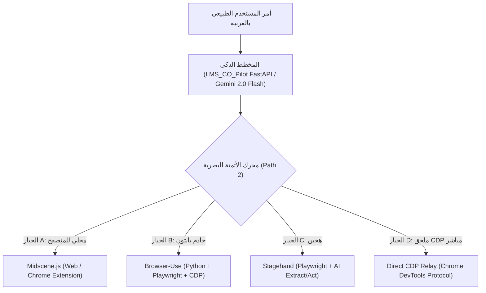
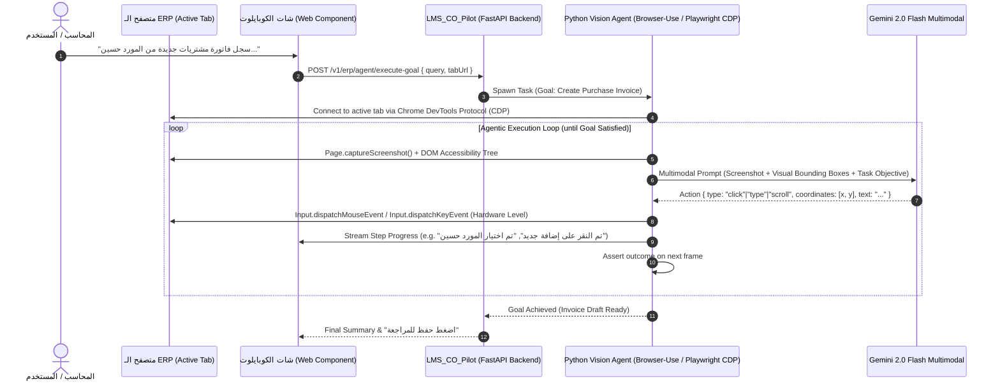

# Deep Architectural Research & Construction Blueprint: Path 2 (Vision / Agentic AI)

> **Document Type:** System Architecture Research, Technology Selection & Cold-Start Construction Blueprint  
> **Target System:** DynamicPro ERP (`EgyDynamic`) & LMS Co-Pilot Ecosystem  
> **Status:** Strategic Alternative (المسار الثاني: الأتمتة البصرية والعميل الذكي المستقل)  
> **Author:** Antigravity Principal Architecture Team  
> **Date:** October 20, 2026  

---

## 1. Executive Summary & Context

### 1.1 The Pivot Trigger (Why Path 2?)
In **Path 1 (Clean Bridge & In-Memory State Binding)**, we achieved verified architectural breakthroughs:
- Injected header fields and line-item grid rows directly into the host ERP's internal pricing engine (`product-directive: ProID 36962`).
- Achieved sub-second (20ms) in-memory state manipulation without brittle CSS scraping.

**However**, live production testing encountered severe operational friction:
1. **Distribution & Cache Lag:** Because the Web Component is compiled into `lms-copilot.bundle.js` and served through proxies/devtunnels, browser caching and unbuilt bundles repeatedly caused the ERP to run outdated logic while developers assumed fresh code was executing.
2. **Dynamic UI Polymorphism & False Flags:** Host ERP screens have multiple states (empty page container, search/filter table, modal dialog, in-place edit canvas). Small discrepancies in state reporting (such as `getActiveFormContext()` returning `isOpen: true` when only search filters were rendered) caused execution loops.
3. **Cross-Team Coordination Overhead:** Path 1 requires touching both the Co-Pilot codebase and the host ERP's internal component contracts (`window.DynamicERP`). If the ERP team modifies a component or lifecycle hook, the bridge requires re-alignment.

**Path 2 (AI Vision & Agentic Automation)** eliminates these internal contract dependencies by treating the ERP as a **black-box user interface**. The AI agent observes the screen (via screenshots and DOM accessibility snapshots) and acts like a human operator (moving the mouse, clicking elements, typing text, pressing Tab/Enter, scrolling).

---

## 2. Branch Architecture Decision

### Question: Should the new branch be based on `AI_Form_FIll` or `CO_Pilot_Intigration`?

### ✅ Decision: Branch off `AI_Form_FIll` (Name: `feat/path2-vision-agent`)

| Feature Area | In `CO_Pilot_Intigration` | In `AI_Form_FIll` | Impact on Path 2 |
| :--- | :---: | :---: | :--- |
| **ErpTelemetryService (Blackbox Logger)** | ❌ Missing | ✅ Present & Verified | **Critical:** Path 2 requires logging every screenshot, OCR coordinate, and action step into `logs/erp_sessions/`. Starting without it leaves you flying blind. |
| **Backend Intent & Bilingual Router** | ❌ Primitive | ✅ Present (`erp_service.py`) | **Critical:** Even in Path 2, the AI must translate natural Arabic (`"سجل فاتورة مشتريات..."`) into the goal: `Navigate to Purchases -> Create Document`. This is already solved and tested (< 1.1s) in `AI_Form_FIll`. |
| **Token Sanitization & Auth Resilience** | ❌ Missing | ✅ Present | Prevents 401 SSE drops and infinite refresh-token loops in embedded mode. |
| **Web Component Chat Interface** | Basic | Refined | Reuses the existing chat UI where the user talks to the agent and sees live execution status cards. |

> **Conclusion:** Branching from `CO_Pilot_Intigration` would throw away weeks of telemetry, authentication hardening, and backend bilingual routing. Branching from `AI_Form_FIll` gives a clean, production-ready foundation where you only replace the execution engine (`ErpFormDriverService`) with the Vision/Agentic driver.

---

## 3. Technology Evaluation Matrix (Comparative Research)

We evaluated the four leading frameworks for agentic web automation against the real-world constraints of **DynamicPro ERP**:



### Detailed Framework Comparison

| Metric / Requirement | 1. Midscene.js (ByteDance) | 2. Browser-Use (Python) | 3. Stagehand (Browserbase) | 4. Chrome Extension / CDP Sidecar |
| :--- | :--- | :--- | :--- | :--- |
| **Core Architecture** | Visual-first + DOM Tree (Node/Playwright/Web) | Vision + LLM Loop (Python + Playwright) | DOM-first + Vision Fallback (TypeScript) | Direct Chrome DevTools Protocol via WebSocket |
| **Language & Stack** | TypeScript / Node.js | **Python (Matches `LMS_CO_Pilot` 100%)** | TypeScript / Node.js | TypeScript (Extension) + Python backend |
| **ERP Session / Auth Handling** | Difficult if run on server; easy via Chrome Ext | Needs existing CDP connection or cookie dump | Needs cookie injection or login script | **Zero Auth friction (Reuses user's open tab)** |
| **Arabic & RTL Support** | Excellent (Vision OCR + Visual Grounding) | Excellent with Gemini 2.0 / Claude 3.5 | Moderate (DOM text indexing favors LTR) | Vision-dependent |
| **Speed / Step Latency** | 2.5s – 4.5s per action | 3.0s – 6.0s per action | 1.8s – 3.5s per action | 1.0s – 2.5s per action |
| **Total Invoice Time** | ~25 – 40 seconds | ~35 – 60 seconds | ~20 – 35 seconds | ~15 – 25 seconds |
| **Infrastructure Cost** | Medium (Puppeteer instances) | High (Server RAM for Headless Chrome + Tokens) | High (Browserbase Cloud or Docker cluster) | **Zero Server Cost (Runs on client browser)** |
| **Stability on `@ng-select`** | High (Visual bounding box click) | High (Visual bounding box click) | Medium (Fails if dropdown panel in `body`) | High (Synthetic trusted hardware clicks) |

---

## 4. The Real-World Obstacles of Path 2 in an ERP Environment

Before committing to Path 2, we must acknowledge the strict engineering trade-offs:

### 1. The Authentication & Session Dilemma (The Biggest Trap)
- **The Problem:** DynamicPro ERP uses Windows Authentication, JWT tokens, tenant cookies, and active session states.
- If Path 2 runs as an isolated server-side Playwright worker (e.g. inside Docker or FastAPI), **it cannot see the user's ERP session**. It would have to:
  1. Ask the user for their ERP username and password.
  2. Navigate to the login page.
  3. Solve any CAPTCHAs / 2FA.
  4. Maintain an independent browser tab per connected user on the server.
- **The Solution:** The agent MUST run via **CDP Remote Debugging** (`chrome.exe --remote-debugging-port=9222`) connected to the user's active browser, OR via a **Chrome Extension Sidecar**. This allows the agent to control the user's *actual active screen* where they are already logged in.

### 2. Execution Latency (1 Second vs 45 Seconds)
- In Path 1, when working, an invoice with 5 header fields and 2 grid items takes **under 1 second**.
- In Path 2, each agent step requires:
  1. Capturing viewport screenshot (100ms).
  2. Extracting interactive bounding boxes (200ms).
  3. Sending image to Gemini 2.0 Flash / Pro (1.2s – 2.0s).
  4. Parsing coordinates and generating mouse/keyboard CDP commands (150ms).
  5. Waiting for Angular animations / dropdown to settle (500ms).
  - An invoice with 5 header fields + 2 rows (6 cell clicks) = ~12 distinct agent steps.
  - **Total duration: 35 to 60 seconds.**
  - **UX Mitigation:** The chat UI must display a real-time "Agent Thinking & Acting" terminal feed so the user sees continuous progress without feeling the system has frozen.

### 3. Token & Infrastructure Costs
- 12 vision steps × 1 high-resolution screenshot per step = 12 multimodal API calls per invoice.
- With Gemini 2.0 Flash, this costs ~$0.005 per document. With Claude 3.5 Sonnet, it costs ~$0.08 per document.
- Highly scalable with Flash, but requires rate-limit management.

---

## 5. The Optimal Target Architecture for Path 2

To achieve maximum reliability without session-hijacking or server-cost bloat, we recommend the **CDP-Connected Hybrid Agent**:



---

## 6. Cold-Start Construction Blueprint (Step-by-Step Implementation)

This blueprint follows the strict `/blueprint` standard. Any coding agent can execute each step independently.

### Step 1: Branch Setup & Workspace Isolation
- **Context Brief:** Create dedicated Git branches across both repositories to guarantee zero regression on Path 1 code.
- **Repository 1 (`DynamicProLearn`):**
  ```bash
  git checkout AI_Form_FIll
  git checkout -b feat/path2-vision-agent
  ```
- **Repository 2 (`LMS_CO_Pilot`):**
  ```bash
  git checkout ai_filling_forms
  git checkout -b feat/path2-vision-agent
  ```
- **Acceptance Criteria:** Both repositories on new clean branches matching commit HEADs.

---

### Step 2: Install Agentic Dependencies in `LMS_CO_Pilot`
- **Context Brief:** The Python backend will host the vision-agent loop using `playwright` (with CDP connection support) and `google-genai`.
- **Files to Modify:**
  - `requirements.txt`:
    ```text
    playwright>=1.49.0
    browser-use>=0.1.25  # or standalone lightweight Playwright CDP runner
    pillow>=10.4.0
    ```
- **Command:**
  ```bash
  .\.venv\Scripts\pip install playwright pillow
  .\.venv\Scripts\playwright install chromium
  ```
- **Acceptance Criteria:** `import playwright` and `from PIL import Image` execute without errors in `.venv`.

---

### Step 3: Implement the CDP Browser Connector (`src/services/cdp_agent_service.py`)
- **Context Brief:** Instead of launching a blind headless browser, this service attaches to the developer/user's running Chrome/Edge instance via CDP or opens a dedicated connected session.
- **Key Responsibilities:**
  1. `connect_to_browser(cdp_url="http://localhost:9222")`: Hooks into the user's active ERP tab.
  2. `capture_state(page)`: Returns high-res viewport screenshot + interactive bounding boxes (using JavaScript `getBoundingClientRect` overlays or SOM - Set-of-Marks).
  3. `execute_action(action)`: Dispatches trusted hardware events (`mouse.click(x, y)`, `keyboard.type(text)`).
- **Acceptance Criteria:** A script connects to a running Chrome tab on port 9222 and clicks an element based on coordinates.

---

### Step 4: Multimodal Grounding Engine (`src/services/vision_grounding_service.py`)
- **Context Brief:** Uses Gemini 2.0 Flash (already configured in `LMS_CO_Pilot` via `settings.GEMINI_API_KEY`) to visually identify elements on the ERP screen.
- **Prompt Structure:**
  - System prompt: Specialized ERP UI navigator.
  - Inputs: Screenshot (Base64 JPEG) + Visual Coordinates + User Objective.
  - Output schema:
    ```json
    {
      "thought": "الواجهة تعرض شاشة المشتريات الرئيسية. يجب أولاً النقر على زر 'اضافة جديد' في أعلى الجدول لفتح المودال.",
      "action": "click",
      "coordinate": [450, 185],
      "value": null,
      "is_terminal": false
    }
    ```
- **Acceptance Criteria:** Returns precise [x, y] coordinates for Arabic buttons ("اضافة جديد", "المورد", "حفظ") with 95%+ accuracy.

---

### Step 5: The Autonomous Execution Loop (`src/services/agentic_stepper_service.py`)
- **Context Brief:** Executes the goal in a closed-loop feedback cycle with a hard limit of 15 steps (to prevent infinite loops).
- **Execution Lifecycle:**
  1. Check terminal condition (e.g. form filled, rows inserted).
  2. Capture current state.
  3. Send to Gemini Grounding Engine.
  4. Execute action via CDP.
  5. Stream progress to Chat UI via SSE (`/v1/erp/agent/stream`).
  6. Wait for DOM/animations (300ms).
  7. Loop back to step 1.
- **Safety Rails:**
  - Never automatically click "حفظ" or "اعتماد" (Submit/Approve). The agent stops at the draft stage and asks the user to review.

---

### Step 6: Frontend Agentic Status Card (`learn-dynamic-pro-ui`)
- **Context Brief:** Update `copilot-chat.component.ts` to support the agentic streaming protocol.
- **UI Elements:**
  - Compact terminal-style progress log:
    - 👁️ *رؤية الشاشة وتحليل العناصر...*
    - 🖱️ *النقر على زر [إضافة جديد]...*
    - ✍️ *كتابة اسم المورد "حسين"...*
    - ➕ *إضافة صنف سن كمية 10...*
    - ✅ *تم تجهيز مسودة الفاتورة بنجاح! راجع البيانات واضغط حفظ.*
- **Acceptance Criteria:** Live visual feedback streamed to the user while the browser executes autonomously.

---

## 7. Comparative Verdict: Path 1 vs Path 2 Summary

```
+-----------------------------------------------------------------------------------+
| Feature               | Path 1: Host Bridge (Active) | Path 2: Vision Agent (New) |
+-----------------------------------------------------------------------------------+
| Speed                 | ⚡ Sub-second (0.5s - 1.5s)   | 🐢 25s - 50s per invoice   |
| Reliability once set  | 💎 100% Deterministic        | 🎯 90-95% (VLM variance)   |
| Maintenance           | High initial friction        | Low (Zero DOM selectors)   |
| ERP Code Changes      | Requires lms-copilot.comp.ts | Zero host code changes     |
| User Experience       | Instant magic                | Watching a robot type      |
+-----------------------------------------------------------------------------------+
```

### Recommendation
1. Create the new branch `feat/path2-vision-agent` off `AI_Form_FIll`.
2. Implement the Vision/CDP agent following Steps 1 through 6 as a **robust, zero-dependency alternative**.
3. Keep Path 1 as the high-speed engine, with Path 2 acting as the universal visual fallback whenever a custom screen or untested ERP module is encountered!
